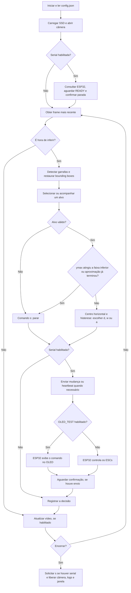

# EcoFlutuador V4.1 — Reconhecimento de garrafas e navegação

## Introdução ao projeto

O EcoFlutuador usa uma câmera para localizar garrafas e orientar a embarcação
até a região de coleta passiva pela rede. O computador ou a Raspberry Pi 5
executa o reconhecimento com SSD MobileNet V3 e escolhe o comando de movimento.
A ESP32-WROOM-32 recebe esse comando e controla os motores brushless por ESCs.
Para conferir a interpretação sem motores, o firmware pode exibir os comandos
em uma tela OLED SSD1306.

O V4.1 é o projeto principal e está na raiz do repositório. Na montagem final,
a câmera USB fica conectada à Raspberry Pi 5. O reconhecimento continua ativo
durante a aproximação e depois da parada.

As instruções de instalação, setup e testes estão em
[docs/testes.md](docs/testes.md).

Para estudar os arquivos e a comunicação serial, consulte o
[guia de estudo do código](docs/estudo_do_codigo.md).

## Bibliotecas utilizadas

### Programa Python

| Biblioteca | Uso | Versão do ambiente local validado |
|---|---|---|
| `opencv-python` | Webcam, SSD via `cv2.dnn`, desenho e janela | 4.14.0.94 |
| `numpy` | Arrays de imagem e dados da inferência | 2.5.3 |
| `pyserial` | Comunicação serial com a ESP32 | 3.5 |

O ambiente local usa Python 3.12.3. O `requirements.txt` define os intervalos
aceitos; `requirements-lock.txt` registra as versões locais. A biblioteca padrão
fornece `argparse`, `threading`, `dataclasses`, `json`, `logging`, `datetime`,
`zoneinfo`, `pathlib`, `time` e `unittest`. O modelo TensorFlow é executado pelo
OpenCV; o fluxo atual dispensa o pacote Python TensorFlow.

### Firmware e ferramentas

| Biblioteca ou ferramenta | Uso |
|---|---|
| Arduino-ESP32 | UART, temporização e PWM LEDC dos ESCs |
| `Wire` | Barramento I²C do OLED; acompanha o core Arduino |
| Adafruit SSD1306 | Controle da tela 128×64 |
| Adafruit GFX Library | Texto e desenho na tela |
| Adafruit BusIO | Dependência das bibliotecas Adafruit |
| Arduino IDE ou PlatformIO | Compilação e gravação da ESP32 |
| `unittest` e `g++` | Testes Python e simulação nativa do firmware |

A compilação foi validada com Espressif32 7.0.1 e Arduino-ESP32 2.0.17.
O código contempla as APIs 2.x e 3.x; o caminho 3.x foi exercitado na simulação.

## Fluxos e funcionamento

### Arquitetura

O programa Python reúne captura, detecção, decisão, visualização e comunicação.
A captura ocorre em uma thread que guarda somente o frame mais recente, evitando
que a inferência trabalhe sobre uma fila de imagens antigas. O ciclo principal
limita a entrega de frames conforme o FPS e executa a rede no intervalo definido
em `config.json`.

A navegação seleciona e acompanha uma garrafa. A posição horizontal decide o
movimento; a borda inferior da caixa, `ymax`, decide a parada. A comunicação
serial envia a decisão à ESP32 e espera a confirmação. A ESP32 mantém o controle
dos ESCs e a parada por timeout independentemente da execução do Python.

| Arquivo ou pasta | Responsabilidade |
|---|---|
| `object-ident.py` | Entrada, argumentos, ciclo principal, desenho da imagem e encerramento |
| `config.py` / `config.json` | Leitura, validação e parâmetros do reconhecimento |
| `camera.py` | Webcam USB, captura do frame recente e controle de FPS |
| `image_processing.py` | Redução proporcional e restauração das coordenadas das caixas |
| `detection/ssd_mobilenet_detector.py` | Inferência SSD, filtro de confiança e classe |
| `detection/types.py` | Classe, confiança, bounding box e centro da detecção |
| `regions.py` | Divisórias, validação das caixas e associação geométrica do alvo |
| `navigation.py` | Seleção, acompanhamento, histerese e decisão de movimento/parada |
| `esp32_link.py` | Consulta, envio, confirmação, heartbeat e parada pela serial |
| `command_log.py` | Blocos no terminal e registros JSONL com rotação |
| `models/` | Pesos `.pb`, grafo `.pbtxt`, nomes COCO e registro de origem |
| `firmware/ControleESP32/` | Firmware Arduino e configuração do PlatformIO |
| `tests/` | Testes Python e simulação C++ do firmware |
| `docs/` | Guias de hardware e registros das revisões |

O reconhecimento executa com os módulos e modelos locais. Os diretórios das
versões anteriores e `aquamonitor/` permanecem como referências históricas.

### Fluxograma de execução

A imagem tem três regiões superiores e uma faixa inferior de parada. Na resolução
640×480 com a configuração atual, as linhas ficam em `x=213`, `x=426` e `y=384`.
O cálculo acompanha a resolução real do frame.

| Região do alvo | Comando | Interpretação na ESP32 |
|---|---|---|
| Esquerda | `d` | Somente motor direito: virar à esquerda |
| Meio | `w` | Ambos os motores: avançar |
| Direita | `a` | Somente motor esquerdo: virar à direita |
| Baixo, alvo ausente/inválido ou aproximação encerrada | `s` | Ambos parados |

Os comandos são minúsculos e terminados por nova linha. O centro da bounding box
determina a região horizontal. A caixa não precisa caber inteira no terço.
Quando `ymax` alcança a linha inferior, o sistema encerra a aproximação daquele
alvo e mantém a parada, mesmo se a caixa recuar acima da linha.

A seleção inicial prioriza a maior área, depois confiança e coordenadas para
desempate. Depois o alvo é associado por sobreposição das caixas ou distância
entre centros. A histerese evita trocas excessivas de direção nas divisórias.
Uma perda do alvo provoca parada na primeira inferência sem associação; a
referência é liberada após três inferências ausentes, conforme a configuração.

A faixa inferior indica proximidade para a rede. **Ela não confirma coleta
física e não incrementa um contador de garrafas coletadas.**

### Comunicação e parada

A ligação usa 115200 baud, 8N1. O Python consulta a ESP32, aguarda `READY` e
confirma uma parada inicial. Cada comando enviado recebe uma confirmação.
Movimentos iguais são suprimidos; quando uma decisão recente mantém o comando,
o heartbeat renova o timeout no máximo uma vez por segundo.

A renovação depende da captura e da inferência. Uma falha solicita parada e
encerra a execução. Se a comunicação ficar indisponível, o watchdog da ESP32
aplica a parada após três segundos. A ausência de um alvo válido também produz
`s` na primeira inferência sem associação.

No modo motores, `s` aplica o pulso mínimo de 1000 µs aos dois ESCs. O firmware
usa PWM de 50 Hz, resolução de 16 bits e pulsos de 1000–2000 µs. A potência
inicial é 30% por ESC, com alvo de 1300 µs. Há armamento de três segundos e rampa
não bloqueante de 15 µs a cada 20 ms. No modo OLED, a tela mostra a decisão
interpretada e nenhum PWM é gerado.

### Visualização e registros

O vídeo é exibido por padrão e mostra as linhas divisórias, as bounding boxes,
a confiança, o alvo selecionado e o comando atual. O reconhecimento também
pode operar sem janela ou processar uma imagem estática.

O terminal registra timestamp, região, objeto, quantidade de garrafas detectadas
e comando. O arquivo JSONL guarda os dados completos, incluindo caixa, centro,
confiança e estado da aproximação, com rotação de aproximadamente 2 MB e três
arquivos anteriores. A quantidade representa detecções no quadro, sem confirmar
coleta física. Os exemplos de execução e leitura dos logs estão no
[guia de testes](docs/testes.md#logs-e-acompanhamento).

## Hardware utilizado

| Componente | Função |
|---|---|
| Raspberry Pi 5 | Executar o reconhecimento e a decisão na embarcação |
| Computador | Desenvolver e testar o reconhecimento e a comunicação USB |
| Câmera USB | Fornecer as imagens ao computador ou à Raspberry |
| ESP32-WROOM-32 | Receber comandos e controlar os ESCs ou a tela OLED |
| Dois motores brushless | Propulsão e correção da trajetória |
| Dois ESCs | Acionar os motores a partir dos sinais PWM da ESP32 |
| OLED SSD1306 128×64, I²C `0x3C` | Exibir comandos no teste visual sem motores |
| Rede de coleta | Coleta passiva na parte inferior da embarcação |
| Cabos USB, fios UART e alimentação dos ESCs | Programação, comunicação e alimentação da montagem |

A montagem final usa UART entre a Raspberry e a ESP32. No firmware, a UART2
está configurada em GPIO 16 para RX e GPIO 17 para TX, normalmente identificados
como **RX2** e **TX2** na placa. A UART0 é usada no teste por USB. A correspondência
entre GPIOs e funções UART está no
[datasheet do ESP32-WROOM-32](https://documentation.espressif.com/esp32-wroom-32_datasheet_en.html).

O motor esquerdo usa o ESC 1, com sinal no GPIO 12; o motor direito usa o ESC 2,
com sinal no GPIO 14. O OLED usa SDA=21 e SCL=22. Os ESCs e motores têm alimentação
própria e compartilham a referência de GND com a ESP32. A pinagem completa e os
procedimentos de ligação estão no [guia de testes](docs/testes.md#seleção-de-oled-ou-motores).

## Fontes consultadas

As referências abaixo foram utilizadas nas orientações de instalação,
comunicação, pinagem e reconhecimento, além da leitura dos arquivos locais e
dos requisitos fornecidos nesta conversa.

### Documentação técnica

| Fonte | Aplicação no projeto |
|---|---|
| [Python — ambientes virtuais com venv](https://docs.python.org/3/library/venv.html) | Criação do ambiente e preparação de um venv próprio na Raspberry |
| [PlatformIO — instalação](https://docs.platformio.org/en/latest/core/installation/index.html) | Instalação do Core e uso pelo terminal do VS Code |
| [PlatformIO — conflitos entre instalações](https://docs.platformio.org/en/latest/core/installation/troubleshooting.html#multiple-platformio-cores-in-a-system) | Diagnóstico do `pio` antigo e seleção da instalação funcional |
| [Arduino-ESP32 — UART](https://docs.espressif.com/projects/arduino-esp32/en/latest/api/serial.html) | Comunicação serial, seleção da UART e configuração dos pinos RX/TX |
| [Arduino-ESP32 — I²C](https://docs.espressif.com/projects/arduino-esp32/en/latest/api/i2c.html) | Ligação do OLED pelos pinos SDA/SCL |
| [Espressif — datasheet do ESP32](https://documentation.espressif.com/esp32_datasheet_en.html) | Características dos GPIOs e configuração de boot |
| [Espressif — datasheet do ESP32-WROOM-32](https://documentation.espressif.com/esp32-wroom-32_datasheet_en.html) | Pinagem e funções UART do módulo utilizado |
| [Espressif — ESP32-DevKitC com módulo WROOM](https://docs.espressif.com/projects/esp-idf/en/v4.4.1/esp32/hw-reference/esp32/get-started-devkitc.html) | Referência da placa de desenvolvimento e seus conectores |
| [Raspberry Pi — configuração das UARTs](https://www.raspberrypi.com/documentation/computers/configuration.html#configure-uarts) | Console serial, habilitação da UART e dispositivos da Pi 5 |
| [Raspberry Pi — overlay uart0-pi5](https://github.com/raspberrypi/firmware/blob/master/boot/overlays/README) | Habilitação da UART nos GPIOs 14/15 |
| [Raspberry Pi — GPIO e conector de 40 pinos](https://www.raspberrypi.com/documentation/computers/raspberry-pi.html#gpio-and-the-40-pin-header) | Referência elétrica e ligação dos GPIOs |
| [Raspberry Pi OS — Python](https://www.raspberrypi.com/documentation/computers/os.html#python-on-raspberry-pi) | Instalação de pacotes Python em ambientes virtuais |
| [GPIO Zero — mapa do conector](https://gpiozero.readthedocs.io/en/stable/cli_pinout.html) | Correspondência entre números GPIO e pinos físicos da Raspberry |
| [Adafruit — código da biblioteca SSD1306](https://github.com/adafruit/Adafruit_SSD1306/blob/master/Adafruit_SSD1306.h) | Inicialização e interface da tela OLED |
| [Adafruit — dependências da SSD1306](https://github.com/adafruit/Adafruit_SSD1306/blob/master/library.properties) | Dependência da biblioteca gráfica |
| [Adafruit — dependências da GFX](https://github.com/adafruit/Adafruit-GFX-Library/blob/master/library.properties) | Dependência Adafruit BusIO |
| [OpenCV — instalação dos pacotes Python](https://docs.opencv.org/5.0/py_tutorials/py_setup/py_pip_install/py_pip_install.html) | Referência de instalação e variantes dos pacotes; o projeto usa OpenCV 4.x |
| [PyPI — arquivos do opencv-python 4.14.0.94](https://pypi.org/project/opencv-python/4.14.0.94/) | Verificação das distribuições disponíveis, incluindo Linux ARM64 |
| [Debian — dependências do python3.13-venv](https://packages.debian.org/trixie/python3.13-venv) | Preparação do venv na distribuição Trixie |
| [Linux — driver UVC](https://docs.kernel.org/userspace-api/media/drivers/uvcvideo.html) | Referência para câmeras USB compatíveis com UVC |

### Referências locais e fornecidas pelo usuário

- **Versões V3 e V4:** referências anteriores de reconhecimento, decisão e
  acionamento dos motores, registradas no
  [relatório da sessão](docs/RELATORIO_SESSAO_2026-10-12.md).
- **Modelo e arquivos provenientes do AquaMonitor:** origem, caminhos e hashes
  registrados em [models/origem.json](models/origem.json).
- **Código OLED e requisitos de operação fornecidos nesta conversa:** exemplo
  SSD1306 128×64, regiões de navegação, comandos e montagem Raspberry/ESP32.
- **Implementação atual:** [config.json](config.json),
  [object-ident.py](object-ident.py), [navigation.py](navigation.py),
  [esp32_link.py](esp32_link.py) e
  [firmware da ESP32](firmware/ControleESP32/ControleESP32.ino), utilizados para
  conferir os comandos e o comportamento descritos neste guia.
- **Verificações de software:** [testes locais](tests/) e resultados registrados
  na [revisão da autonomia](docs/REVISAO_AUTONOMIA.md) e nos guias de teste.
