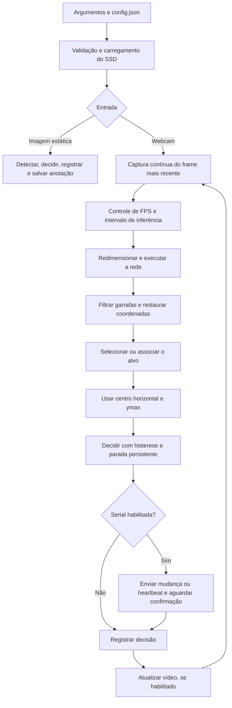

# EcoFlutuador V4.1 — Visão computacional e controle de motores

## Apresentação

O V4.1 é o projeto principal e seus arquivos estão diretamente na raiz deste
repositório. Ele implementa a etapa de percepção e orientação do EcoFlutuador. Uma câmera
fornece imagens ao computador, que reconhece garrafas, seleciona um alvo e
transforma sua posição em comandos de navegação. Esses comandos são registrados
e podem ser enviados a um ESP32 para acionar dois motores brushless por ESCs.

A proposta é demonstrar o fluxo completo entre imagem, decisão e comando. O
reconhecimento usa SSD MobileNet V3 com arquivos provenientes do AquaMonitor.
A seleção do alvo e os acionamentos usam o V3 como referência. O V4.1 acrescenta
uma região inferior de parada por `ymax`, acompanhamento do alvo, histerese
horizontal, configuração em JSON e captura do frame mais recente. Cada
responsabilidade permanece em seu módulo.

O programa pode funcionar com vídeo, sem janela, sobre uma imagem estática ou
com envio serial ao ESP32. O vídeo é o padrão; somente `--no-display` desativa
a janela na execução com webcam. Os motores recebem comandos apenas quando
`--serial-port` é informado.

## Organização na raiz

```text
ecoMEGACLUSTER/
├── object-ident.py
├── config.json / config.py
├── camera.py / image_processing.py
├── navigation.py / regions.py
├── esp32_link.py / command_log.py
├── detection/
├── models/
├── firmware/ControleESP32/
├── tests/
├── docs/
├── requirements.txt / requirements-lock.txt
├── .venv/
└── logs/
```

O nome V4.1 identifica a versão atual; não existe mais uma pasta `V4.1/`.
Os comandos deste guia devem ser executados na raiz do repositório. A pasta
`aquamonitor/` continua como referência e não precisa ser iniciada para executar
o projeto principal.

## Arquitetura e arquivos

| Arquivo ou pasta | Responsabilidade |
|---|---|
| `object-ident.py` | Entrada principal, argumentos, coordenação do ciclo, desenho das linhas e encerramento |
| `config.py` e `config.json` | Leitura, validação e parâmetros do reconhecimento |
| `camera.py` | Abertura da webcam, captura em thread e limite de entrega de frames |
| `image_processing.py` | Redução proporcional do frame e restauração das coordenadas das caixas |
| `detection/ssd_mobilenet_detector.py` | Carregamento da rede, inferência, filtro de classe e confiança |
| `detection/types.py` | Estrutura da detecção: classe, confiança, caixa e centro |
| `regions.py` | Geometria, validação de caixas, seleção inicial e associação do alvo |
| `navigation.py` | Acompanhamento, histerese, decisão e encerramento da aproximação |
| `command_log.py` | Resumo no terminal e registros completos em JSONL com rotação |
| `esp32_link.py` | Inicialização, confirmação, supressão de repetição, heartbeat e parada |
| `models/` | Pesos `.pb`, grafo `.pbtxt`, nomes COCO e registro de origem |
| `firmware/ControleESP32/` | Sketch do ESP32 e configuração de compilação com PlatformIO |
| `tests/` | Testes Python e simulação C++ da lógica do firmware |
| `docs/` | Relatório histórico da sessão e revisão da aproximação autônoma |

## Fluxo de funcionamento



1. **Inicialização.** O programa lê `config.json`, valida os parâmetros e verifica
   os arquivos do modelo. Os caminhos são resolvidos em relação ao JSON, mesmo
   quando o comando é executado em outro diretório.
2. **Câmera e visualização.** A webcam é aberta com a resolução e o FPS solicitados.
   A janela é criada na posição `(40, 40)` e com o tamanho configurado para a
   câmera. No Linux, é necessário acesso à sessão gráfica para exibir o vídeo.
3. **Captura.** Uma thread mantém somente o frame mais recente em memória. A
   entrega ao processamento é limitada por `camera.fps`, mesmo que a webcam
   mantenha outra taxa de captura.
4. **Inicialização dos motores, quando habilitados.** A ligação serial consulta
   o ESP32 com `?`, espera `READY` e envia uma parada inicial. Essa etapa ocorre
   antes do ciclo de decisões; o armamento dos ESCs leva três segundos no firmware.
5. **Inferência.** Ao atingir o intervalo configurado, o frame pode ser reduzido
   proporcionalmente e é convertido para a entrada da rede. O detector usa
   escala `1/127.5`, média `(127.5, 127.5, 127.5)` e troca dos canais de cor.
   São mantidas as classes permitidas que atendem à confiança mínima.
6. **Seleção e decisão.** As coordenadas retornam à resolução da câmera. O sistema
   escolhe inicialmente a maior caixa válida, com desempate determinístico.
   Depois associa o alvo por sobreposição e distância entre centros. O centro
   horizontal decide a direção; `ymax` decide a entrada na região de parada.
7. **Saída.** A decisão é enviada ao ESP32, se habilitado, e registrada. A janela
   mostra as regiões, caixas, confiança, alvo selecionado e comando atual.
   Mudanças de comando são enviadas imediatamente após cada inferência; o
   heartbeat mantém a ligação quando o comando não muda. Entre inferências,
   o vídeo continua usando a última decisão disponível.
8. **Encerramento.** O programa solicita `s` ao ESP32, registra o encerramento,
   fecha a serial, libera a câmera e destrói a janela. Uma falha de confirmação
   é informada; o timeout do firmware também interrompe o acionamento.

No modo de imagem estática, a câmera e a serial não são abertas. Os argumentos
`--image` e `--output` devem ser usados juntos; `--serial-port` não é permitido
nesse modo.

## Regiões e decisão de navegação

A linha horizontal está em `altura × display.bottom_zone_ratio`. Acima dela,
duas linhas verticais dividem a largura em três regiões. A faixa inferior ocupa
toda a largura e tem prioridade na classificação.

| Posição da garrafa | Região | Comando serial | Motor esquerdo / ESC 1 / GPIO 12 | Motor direito / ESC 2 / GPIO 14 |
|---|---|---|---|---|
| Centro horizontal no terço esquerdo, `ymax` acima da horizontal | Esquerda | `d` | Parado | Ativo |
| Centro horizontal no terço central, `ymax` acima da horizontal | Meio | `w` | Ativo | Ativo |
| Centro horizontal no terço direito, `ymax` acima da horizontal | Direita | `a` | Ativo | Parado |
| `ymax` sobre a horizontal ou abaixo dela | Baixo | `s` | Parado | Parado |
| Alvo ausente, inválido ou aproximação encerrada | Parada | `s` | Parado | Parado |

Os comandos lógicos `D`, `W`, `A` e parada são enviados em minúsculas, conforme
os bytes aceitos pelo firmware. Os acionamentos e GPIOs de
`V3/ControleESP32.ino` foram preservados; o mapeamento da posição do objeto foi
ajustado para motor direito ativo ao perseguir um alvo à esquerda e vice-versa.
A montagem deve ligar o ESC 1 ao motor esquerdo e o ESC 2 ao direito.

A caixa não precisa estar inteiramente dentro da região. A classificação
horizontal usa seu centro; a parada usa a borda inferior `ymax`, inclusive
quando o centro ainda está acima da linha. Ao atingir essa faixa, a aproximação
fica encerrada para o alvo acompanhado, mesmo se sua caixa recuar na imagem.
A condição representa proximidade para coleta passiva pela rede: não confirma
coleta física nem alimenta um contador de objetos coletados.

Na primeira detecção, o centro sobre uma divisória pertence ao meio. Nas
seguintes, a histerese exige ultrapassar a divisória mais uma margem configurada
para mudar de região. Com largura de 640 pixels e razão `0.03`, a margem é de
19,2 pixels. A margem persiste durante uma perda breve do alvo.

A seleção inicial prioriza área da caixa, depois confiança e coordenadas para
desempate. Depois o alvo é associado por IoU e distância entre centros, sem
ser substituído apenas porque outra garrafa ficou maior. A ausência de associação
provoca `s` na mesma inferência. O sistema conserva a referência por até três
inferências ausentes; ao atingir esse limite, libera o alvo e permite uma nova
seleção na inferência seguinte. O estado de aproximação encerrada segue essa
mesma regra de liberação. Enquanto outro objeto visível não corresponde ao alvo,
a embarcação permanece parada durante a confirmação de desaparecimento.

## Bibliotecas, ambiente e ferramentas

O ambiente local de referência usa Linux x86_64 e Python **3.12.3**. As versões
instaladas na preparação deste documento são:

| Biblioteca | Versão local | Função |
|---|---|---|
| `opencv-python` | 4.14.0.94 | Câmera, rede `cv2.dnn`, redimensionamento, desenho e janela |
| `numpy` | 2.5.3 | Arrays de imagem e dados do detector |
| `pyserial` | 3.5 | Porta serial USB, leitura de respostas e envio de comandos |

[requirements.txt](requirements.txt) define os intervalos aceitos: OpenCV
`>=4.8,<5`, NumPy `>=1.24,<3` e pyserial `>=3.5,<4`. As versões locais acima
são um registro do ambiente, não um arquivo de dependências fixadas.

A biblioteca padrão do Python fornece `argparse`, `json`, `pathlib`, `dataclasses`,
`threading`, `time`, `logging`, `datetime`, `zoneinfo` e `unittest`. O log do
terminal usa o fuso `America/Sao_Paulo`. O modelo tem origem TensorFlow, mas é
executado pelo OpenCV; o pacote Python `tensorflow` não é necessário neste fluxo.

| Programa ou ferramenta | Uso no projeto |
|---|---|
| Python e `venv` | Execução e isolamento das dependências |
| Arduino IDE com core Arduino-ESP32 | Abertura e gravação do sketch |
| PlatformIO | Compilação reproduzível para a placa `esp32dev` |
| `g++` | Compilação da simulação nativa da lógica do firmware nos testes |
| `serial.tools.list_ports` | Identificação das portas seriais disponíveis |
| Git | Versionamento das fontes, modelos, configurações e documentação |

O firmware usa `Arduino.h` e o PWM LEDC do core Arduino-ESP32. Possui caminhos
para as APIs 2.x e 3.x e não depende de ESP32Servo, TinyGPSPlus ou sensores.
A compilação para ESP32 Dev Module foi validada com PlatformIO Espressif32
**7.0.1** e core Arduino-ESP32 **2.0.17**. O caminho 3.x foi exercitado na simulação
nativa; ainda não houve compilação para a placa com esse core.

## Instalação

Execute na raiz do repositório:

```bash
python3 -m venv .venv
.venv/bin/python -m pip install -r requirements.txt
.venv/bin/python -m pip check
```

O ambiente principal é `.venv/` e as dependências estão em `requirements.txt`,
ambos na raiz. `requirements-lock.txt` registra as versões exatas do ambiente
validado e pode ser instalado com `python -m pip install -r requirements-lock.txt`
para reproduzir essas versões. Os arquivos antigos da raiz foram preservados
em `docs/historico-raiz/`; seu ambiente está em `.venv-anterior/`.

Para a janela, o OpenCV deve ter suporte gráfico e o processo deve acessar a
sessão do usuário. `--no-display` dispensa a janela, mas mantém a necessidade
de acesso à câmera na execução com webcam.

Os arquivos de modelo esperados são:

```text
models/frozen_inference_graph.pb
models/ssd_mobilenet_v3_large_coco_2020_01_14.pbtxt
models/coco.names
```

A origem e os hashes dos arquivos de referência estão em
[models/origem.json](models/origem.json). Os nomes COCO participam da associação
entre IDs e classes; o arquivo deve permanecer compatível com os pesos e o grafo.

## Configuração atual

O perfil em [config.json](config.json), na preparação deste documento, contém:

| Parâmetro | Valor | Efeito |
|---|---|---|
| `camera.device_index` | `0` | Primeira webcam |
| `camera.width` / `height` | `640` / `480` | Resolução solicitada |
| `camera.fps` | `10` | Limite de entrega de frames à aplicação |
| `ssd_mobilenet.confidence_threshold` | `0.3` | Confiança mínima aceita |
| `ssd_mobilenet.input_width` / `input_height` | `320` / `320` | Entrada da rede |
| `ssd_mobilenet.detection_types` | `["bottle"]` | Classe permitida |
| `detection_interval_ms` | `300` | Intervalo mínimo entre inferências |
| `image_processing.enabled` | `true` | Habilita redução proporcional quando necessária |
| `image_processing.max_width` / `max_height` | `640` / `480` | Limites antes da entrada da rede |
| `display.bottom_zone_ratio` | `0.8` | Linha horizontal a 80% da altura; parada por `ymax` |
| `navigation.horizontal_hysteresis_ratio` | `0.03` | Margem de troca de região, como fração da largura |
| `navigation.target_max_distance_px` | `90` | Distância máxima entre centros para associação sem sobreposição suficiente |
| `navigation.target_min_iou` | `0.1` | Sobreposição mínima para associação, como alternativa à distância |
| `navigation.target_missing_frames` | `3` | Inferências consecutivas ausentes para liberar o alvo; parada ocorre já na primeira |

Em um frame efetivo de 640×480, as divisões ficam em `x=213`, `x=426` e `y=384`.
A faixa inferior começa em `y=384`. As posições são calculadas usando o tamanho
real do frame, caso a câmera entregue outra resolução.

FPS e frequência de reconhecimento são controles separados. O perfil solicita
vídeo a até 10 FPS e permite aproximadamente 3,3 inferências por segundo; o
processamento pode reduzir essas taxas. O tempo entre comandos deve ficar abaixo
do timeout de três segundos do firmware para manter o acionamento contínuo.

Perfis anteriores sem a seção `navigation` recebem esses valores padrão.

A configuração é lida na inicialização. Reinicie após editar o JSON. A exibição
é controlada pelo comando de execução; `display` configura a posição da linha.

## Comandos de operação

### Reconhecimento com vídeo

```bash
.venv/bin/python object-ident.py
```

### Reconhecimento headless

```bash
.venv/bin/python object-ident.py --no-display
```

### Reconhecimento com comandos ao ESP32

Depois de gravar o firmware e identificar a porta:

```bash
.venv/bin/python object-ident.py --serial-port /dev/ttyUSB0
```

### Reconhecimento headless com comandos aos motores

```bash
.venv/bin/python object-ident.py --serial-port /dev/ttyUSB0 --no-display
```

### Teste com tempo limitado

```bash
.venv/bin/python object-ident.py --duration 5
```

### Imagem estática

```bash
.venv/bin/python object-ident.py --image foto.jpg --output resultado.jpg
```

| Argumento | Função |
|---|---|
| `-c`, `--config caminho/config.json` | Carrega outro perfil |
| `--camera-index 1` | Substitui o índice da câmera do JSON |
| `--serial-port PORTA` | Habilita envio serial; por exemplo `/dev/ttyUSB0` ou `COM3` |
| `--duration 5` | Limita o ciclo de webcam a cinco segundos, após a inicialização |
| `--display` | Solicita explicitamente vídeo, que já é o padrão |
| `--no-display` | Desativa a janela |
| `--log-file caminho/arquivo.jsonl` | Define o arquivo de registros |
| `--image foto.jpg` e `--output resultado.jpg` | Processa e salva uma imagem anotada |
| `--help` | Lista os argumentos aceitos |

`Q`, `Esc` ou fechar a janela encerram a execução com vídeo. `Ctrl+C` também
encerra e é a forma usual no modo headless.

## Firmware, conexões e protocolo

Abra [ControleESP32.ino](firmware/ControleESP32/ControleESP32.ino) na Arduino IDE,
selecione o ESP32 compatível com a montagem e grave o sketch. O projeto de
compilação fornecido usa ESP32 Dev Module (`esp32dev`).

| Conexão | Destino |
|---|---|
| Sinal do ESC 1 | GPIO 12 |
| Sinal do ESC 2 | GPIO 14 |
| Referência dos sinais | GND comum entre ESP32 e ESCs |
| Comunicação com o computador | USB serial, 115200 baud |

Os ESCs e motores usam sua alimentação própria, dimensionada para a montagem.
Os GPIOs fornecem os sinais de controle.

| Parâmetro do firmware | Valor |
|---|---|
| Frequência PWM | 50 Hz |
| Resolução PWM | 16 bits |
| Pulso mínimo / máximo | 1000 / 2000 µs |
| Potência inicial por ESC | 30%, equivalente a 1300 µs como alvo |
| Armamento | 3000 ms no pulso mínimo |
| Passo da rampa | 15 µs a cada 20 ms |
| Timeout sem comandos | 3000 ms |

A rampa atualiza os pulsos sem bloquear a leitura serial. A parada aplica o pulso
mínimo imediatamente. As constantes `POTENCIA_ESC1` e `POTENCIA_ESC2` permitem
ajustar os alvos no firmware; a configuração JSON controla o reconhecimento,
não a potência dos motores.

Cada mensagem serial é terminada por nova linha:

| Mensagem | Significado |
|---|---|
| `?` | Consulta o estado e aplica parada |
| `ARMING` | Armamento em andamento |
| `READY` | Firmware pronto para receber movimentos |
| `a`, `w`, `d`, `s` | Comandos de navegação |
| `CMD_OK:<comando>` | Comando aceito pelo firmware |
| `CAPS:HEARTBEAT` | Resposta à consulta; anuncia suporte à renovação sem repetir movimento |
| `h` / `HB_OK` | Renova o timeout e confirma a ligação, sem modificar os motores |
| `TIMEOUT:s` | Parada por ausência de comandos por três segundos |
| `ERROR:<motivo>` | Erro de PWM, comando inválido ou tentativa de movimento antes do armamento |

O Python espera até oito segundos por `READY` e até um segundo pela confirmação
de cada comando. Envia `a/w/d/s` quando o estado muda e força `s` na inicialização
e no encerramento. Com o firmware atualizado, comandos iguais são suprimidos;
no máximo uma vez por segundo, uma decisão recente envia `h` e espera `HB_OK`.
O heartbeat não aciona nem reinicia motores parados. Sem decisões novas, não há
renovação em segundo plano, e o watchdog para os motores após três segundos.

O firmware anterior do V4.1, com `READY` e `CMD_OK` mas sem `CAPS:HEARTBEAT`,
continua compatível: nesse caso, o mesmo comando de movimento é renovado no
máximo uma vez por segundo para preservar seu watchdog. Grave o sketch atualizado
para eliminar também essas renovações de movimento. O firmware original do V3,
sem o protocolo de confirmação, não atende à inicialização serial do V4.1.
`CMD_OK` confirma aceitação; não mede velocidade nem sentido real do motor.

A perda da confirmação, um timeout informado pelo ESP32 ou uma reinicialização
detectada solicitam `s` e interrompem a execução. Um envio incompleto também
provoca essa parada; a ligação não volta a autorizar movimento após a falha.
Ao fechar, o Python tenta enviar e confirmar `s`. Caso a ligação não permita
essa confirmação, informa a falha e o firmware aplica sua parada por timeout.

Para compilar, sem gravar a placa:

```bash
pio run --project-dir firmware/ControleESP32 --environment esp32
```

O binário é gerado em
`firmware/ControleESP32/.pio/build/esp32/firmware.bin`. Para listar portas:

```bash
.venv/bin/python -m serial.tools.list_ports
```

## Registros e acompanhamento

O terminal mostra cinco campos por registro:

```text
timestamp: 2026-10-12-15-30
regiao: esquerda
objeto: bottle
garrafas_detectadas: 1
comando: d
```

O formato é `AAAA-MM-DD-HH-SS`: ano, mês, dia, hora e segundo, **sem minutos**,
conforme o formato solicitado. O fuso é `America/Sao_Paulo`. Sem alvo, a região
é `sem_alvo` e o objeto é `nenhum`. A quantidade representa todas as garrafas
detectadas no quadro, inclusive outras que não foram selecionadas como alvo.
Esse campo não conta objetos coletados.

`comando` mostra a decisão de movimento (`a`, `w`, `d` ou `s`) encaminhada ao
ESP32 quando a serial está habilitada. O campo permanece visível enquanto o
estado é mantido, mesmo quando o reenvio é suprimido ou substituído por heartbeat.
Sem serial, mostra a decisão registrada para demonstração.

Os registros completos ficam em `logs/recognition.jsonl`, com um objeto
JSON por linha. Incluem timestamp ISO 8601 em UTC, sequência da execução,
evento, região, comando, mudança de comando, classe, confiança, caixa, centro,
quantidade de detecções, `ymax`, estado de navegação, indicação de aproximação
encerrada e modo terminal/serial. A sequência reinicia em cada
execução. Eventos de câmera incluem FPS configurado, FPS reportado pelo
dispositivo, intervalo de inferência e indicação de vídeo habilitado.

Inicialização serial e erros ficam no arquivo completo. Falhas também aparecem
como mensagens no terminal. A rotação ocorre ao atingir aproximadamente
2.000.000 bytes, mantendo até três arquivos anteriores.

Para acompanhar o arquivo em outro terminal:

```bash
tail -f logs/recognition.jsonl
```

## Testes e evidências de validação

Para executar os testes sem abrir câmera ou serial física:

```bash
.venv/bin/python -B -m unittest discover -s tests -v
```

| Grupo | Quantidade | Cobertura |
|---|---|---|
| FPS da câmera | 3 | Limite de entrega, captura contínua e valores inválidos |
| Comunicação serial | 9 | Consulta, supressão, heartbeat, firmware anterior, confirmação, falhas e fechamento |
| Configuração da navegação | 2 | Padrões para perfis antigos e validação dos parâmetros |
| Lógica do firmware | 1 | Acionamentos, rampa, parada, timeout e rollover de `millis()`, nos caminhos 2.x e 3.x |
| Navegação e logs | 18 | Regiões, ymax, parada persistente, alvo estável, perda, histerese, caixas inválidas e registros |
| Vídeo e integração | 4 | Vídeo por padrão, headless, ciclo integrado com serial e encerramento por falha de inferência |
| **Total** | **37** | **Aprovados na validação desta sessão** |

O teste do firmware usa `g++` e interfaces simuladas do Arduino. Se `g++` estiver
ausente, esse teste é ignorado. Ele valida a lógica de controle, enquanto a
compilação com PlatformIO valida o sketch com a toolchain ESP32.

O firmware compilado ocupou 21.592 bytes de RAM e 274.713 bytes de programa no
perfil `esp32dev` validado. `pip check` não apontou dependências incompatíveis.
As evidências e as alterações estão descritas no
[relatório da sessão](docs/RELATORIO_SESSAO_2026-10-12.md) e na
[revisão da aproximação autônoma](docs/REVISAO_AUTONOMIA.md).

## Limites da etapa atual

O acompanhamento mantém uma referência geométrica do alvo; garrafas muito
próximas, sobrepostas ou cruzando trajetórias podem tornar a associação ambígua.
Não estima distância física. A chegada à faixa inferior encerra a aproximação,
mas não confirma a entrada na rede. O detector Python não aplica uma etapa
adicional de NMS. O reconhecimento está configurado para garrafas; não foi
avaliado com métricas de precisão e recall em um conjunto de imagens rotuladas.

O V4.1 não oferece a interface web, sliders de potência, sensores ou navegação
por GPS das outras linhas do projeto. A calibração dos ESCs, a orientação dos
motores e a navegação física ainda precisam de testes de bancada. Compilação e
simulação não comprovam o comportamento da embarcação em operação.

Uma sessão gráfica inacessível impede a janela. Durante esta sessão, houve
bloqueio de acesso à tela no ambiente isolado de execução; isso não confirmou
a causa do problema relatado no terminal do usuário. Os ajustes de abertura
explicitam o vídeo como padrão e posicionam a janela em uma área visível.

## Documentação e arquivos gerados

O [relatório da sessão](docs/RELATORIO_SESSAO_2026-10-12.md) registra a evolução,
as reversões solicitadas e as verificações realizadas. A
[revisão da autonomia](docs/REVISAO_AUTONOMIA.md) descreve a lógica de aproximação.
A [migração para a raiz](docs/MIGRACAO_PARA_RAIZ.md) registra a nova organização.

`.venv/`, `.venv-anterior/`, `logs/`, `__pycache__/` e `.pio/` são saídas locais
ignoradas pelo Git.
Os modelos, as fontes, os testes, a configuração compartilhada e esta
documentação compõem a entrega do V4.1.
