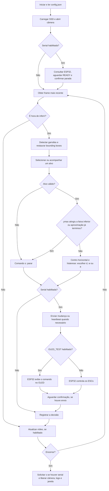

# EcoFlutuador V4.1 — Reconhecimento de garrafas e navegação

O EcoFlutuador usa uma câmera para localizar garrafas e orientar a embarcação
até a região de coleta passiva pela rede. O computador ou a Raspberry Pi 5
executa o reconhecimento com SSD MobileNet V3 e escolhe o comando de movimento.
A ESP32-WROOM-32 recebe esse comando e controla os motores brushless por ESCs.
Para conferir a interpretação sem motores, o firmware pode exibir os comandos
em uma tela OLED SSD1306.

O V4.1 é o projeto principal e está na raiz do repositório. Os comandos deste
guia devem ser executados nessa raiz. A câmera é USB; na montagem final, ela
fica conectada à Raspberry. O vídeo é exibido por padrão. Use `--no-display`
para executar sem janela.

## Conteúdo

- [Arquitetura](#arquitetura)
- [Fluxograma de execução](#fluxograma-de-execução)
- [Bibliotecas e instalação](#bibliotecas-e-instalação)
- [Seleção de OLED ou motores](#seleção-de-oled-ou-motores)
- [Teste apenas do reconhecimento](#teste-apenas-do-reconhecimento)
- [Teste no computador com ESP32](#teste-no-computador-com-esp32)
- [Setup na Raspberry Pi 5 com ESP32](#setup-na-raspberry-pi-5-com-esp32)
- [Configuração do reconhecimento](#configuração-do-reconhecimento)
- [Comandos úteis](#comandos-úteis)
- [Logs e acompanhamento](#logs-e-acompanhamento)
- [Validação e próximos passos](#validação-e-próximos-passos)

## Arquitetura

O programa Python reúne captura, detecção, decisão, visualização e comunicação.
A captura ocorre em uma thread que guarda somente o frame mais recente, evitando
que a inferência trabalhe sobre uma fila de imagens antigas. O ciclo principal
limita a entrega de frames conforme o FPS e executa a rede no intervalo definido
em `config.json`.

A navegação seleciona e acompanha uma garrafa. A posição horizontal decide o
movimento; a borda inferior da caixa, `ymax`, decide a parada. A comunicação
serial envia a decisão à ESP32 e espera a confirmação. A ESP32 mantém o controle
dos ESCs e a parada por timeout independentemente da execução do Python.

| Arquivo ou pasta | Responsabilidade |
|---|---|
| `object-ident.py` | Entrada, argumentos, ciclo principal, desenho da imagem e encerramento |
| `config.py` / `config.json` | Leitura, validação e parâmetros do reconhecimento |
| `camera.py` | Webcam USB, captura do frame recente e controle de FPS |
| `image_processing.py` | Redução proporcional e restauração das coordenadas das caixas |
| `detection/ssd_mobilenet_detector.py` | Inferência SSD, filtro de confiança e classe |
| `detection/types.py` | Classe, confiança, bounding box e centro da detecção |
| `regions.py` | Divisórias, validação das caixas e associação geométrica do alvo |
| `navigation.py` | Seleção, acompanhamento, histerese e decisão de movimento/parada |
| `esp32_link.py` | Consulta, envio, confirmação, heartbeat e parada pela serial |
| `command_log.py` | Blocos no terminal e registros JSONL com rotação |
| `models/` | Pesos `.pb`, grafo `.pbtxt`, nomes COCO e registro de origem |
| `firmware/ControleESP32/` | Firmware Arduino e configuração do PlatformIO |
| `tests/` | Testes Python e simulação C++ do firmware |
| `docs/` | Guias de hardware e registros das revisões |

O reconhecimento executa com os módulos e modelos locais. Os diretórios das
versões anteriores e `aquamonitor/` permanecem como referências históricas.

## Fluxograma de execução



A imagem tem três regiões superiores e uma faixa inferior de parada. Na resolução
640×480 com a configuração atual, as linhas ficam em `x=213`, `x=426` e `y=384`.
O cálculo acompanha a resolução real do frame.

| Região do alvo | Comando | Interpretação na ESP32 |
|---|---|---|
| Esquerda | `d` | Somente motor direito: virar à esquerda |
| Meio | `w` | Ambos os motores: avançar |
| Direita | `a` | Somente motor esquerdo: virar à direita |
| Baixo, alvo ausente/inválido ou aproximação encerrada | `s` | Ambos parados |

Os comandos são minúsculos e terminados por nova linha. O centro da bounding box
determina a região horizontal. A caixa não precisa caber inteira no terço.
Quando `ymax` alcança a linha inferior, o sistema encerra a aproximação daquele
alvo e mantém a parada, mesmo se a caixa recuar acima da linha.

A seleção inicial prioriza a maior área, depois confiança e coordenadas para
desempate. Depois o alvo é associado por sobreposição das caixas ou distância
entre centros. A histerese evita trocas excessivas de direção nas divisórias.
Uma perda do alvo provoca parada na primeira inferência sem associação; a
referência é liberada após três inferências ausentes, conforme a configuração.

A faixa inferior indica proximidade para a rede. **Ela não confirma coleta
física e não incrementa um contador de garrafas coletadas.**

## Bibliotecas e instalação

### Programa Python

| Biblioteca | Uso | Versão do ambiente local validado |
|---|---|---|
| `opencv-python` | Webcam, SSD via `cv2.dnn`, desenho e janela | 4.14.0.94 |
| `numpy` | Arrays de imagem e dados da inferência | 2.5.3 |
| `pyserial` | Comunicação serial com a ESP32 | 3.5 |

O ambiente local usa Python 3.12.3. O `requirements.txt` define os intervalos
aceitos; `requirements-lock.txt` registra as versões locais. A biblioteca padrão
fornece `argparse`, `threading`, `dataclasses`, `json`, `logging`, `datetime`,
`zoneinfo`, `pathlib`, `time` e `unittest`. O modelo TensorFlow é executado pelo
OpenCV; o fluxo atual dispensa o pacote Python TensorFlow.

No Linux, na raiz do projeto:

```bash
python3 -m venv .venv
.venv/bin/python -m pip install -r requirements.txt
.venv/bin/python -m pip check
```

No Windows, em PowerShell:

```powershell
py -m venv .venv
.venv\Scripts\python.exe -m pip install -r requirements.txt
.venv\Scripts\python.exe object-ident.py
```

Nos demais comandos deste guia, o Windows usa `.venv\Scripts\python.exe` no
lugar de `.venv/bin/python`, e uma porta como `COM3` no lugar de `/dev/ttyUSB0`.

A visualização precisa do OpenCV com suporte gráfico e de uma sessão gráfica
acessível. O mesmo `opencv-python` atende aos modos com vídeo e headless.

### Firmware e ferramentas

| Biblioteca ou ferramenta | Uso |
|---|---|
| Arduino-ESP32 | UART, temporização e PWM LEDC dos ESCs |
| `Wire` | Barramento I²C do OLED; acompanha o core Arduino |
| Adafruit SSD1306 | Controle da tela 128×64 |
| Adafruit GFX Library | Texto e desenho na tela |
| Adafruit BusIO | Dependência das bibliotecas Adafruit |
| Arduino IDE ou PlatformIO | Compilação e gravação da ESP32 |
| `unittest` e `g++` | Testes Python e simulação nativa do firmware |

O PlatformIO instala as bibliotecas declaradas em `platformio.ini`. Instale o
[PlatformIO Core](https://docs.platformio.org/en/latest/core/installation/index.html)
ou use o terminal do PlatformIO no VS Code para executar `pio`. Na Arduino IDE,
instale o core Arduino-ESP32, selecione **ESP32 Dev Module** e instale Adafruit
SSD1306 e Adafruit GFX Library com suas dependências. Essas bibliotecas são
necessárias para compilar o sketch também quando o modo de saída é motores.

A compilação foi validada com Espressif32 7.0.1 e Arduino-ESP32 2.0.17.
O código contempla as APIs 2.x e 3.x; o caminho 3.x foi exercitado na simulação.

## Seleção de OLED ou motores

A seleção da saída é feita em
[ControleESP32.ino](firmware/ControleESP32/ControleESP32.ino):

```cpp
constexpr bool OLED_TEST = true;
```

| Valor | Saída |
|---|---|
| `true` | Exibe o comando e a interpretação no OLED; nenhum PWM é configurado ou escrito |
| `false` | Controla os dois ESCs e motores |

O arquivo está com `true`. Ao mudar a constante, **compile e grave novamente**.
O comando Python é o mesmo nos dois modos. O teste visual descrito neste guia
usa a tela **OLED SSD1306**, de endereço I²C `0x3C`.

### Ligações da saída

| Componente | ESP32-WROOM-32 |
|---|---|
| OLED SDA | GPIO 21 |
| OLED SCL | GPIO 22 |
| OLED GND | GND |
| OLED VCC | 3,3 V, com módulo compatível com essa alimentação |
| Sinal do ESC 1 / motor esquerdo | GPIO 12 |
| Sinal do ESC 2 / motor direito | GPIO 14 |
| Referência dos ESCs | GND comum com a ESP32 |

Para o modo motores, os GPIOs fornecem sinais aos ESCs; os ESCs e motores usam
alimentação própria. Faça o primeiro teste de acionamento sem hélices. A parada
`s` aplica o pulso mínimo de 1000 µs aos ESCs; ela não corta a alimentação elétrica.

A tela usa I²C nos pinos 21/22, conforme a
[API I²C do Arduino-ESP32](https://docs.espressif.com/projects/arduino-esp32/en/latest/api/i2c.html).
Mais detalhes da tela estão no [guia OLED](docs/TESTE_OLED.md).

### Seleção do canal de comunicação

A saída OLED/motores e o canal de comunicação são escolhas independentes:

| Cenário | Perfil PlatformIO | Canal de comandos |
|---|---|---|
| Computador com cabo USB conectado à ESP32 | `esp32-usb` | UART0 pelo conversor USB da placa |
| Raspberry com fios nos GPIOs | `esp32` | UART2 da ESP32: RX=16, TX=17 |

Com PlatformIO, mantenha o valor padrão `ECO_SERIAL_USB=0` no sketch; o perfil
`esp32-usb` define `1` na compilação. Pela Arduino IDE, altere essa definição para
`1` no teste USB ou `0` na montagem com UART2. Grave novamente depois de mudar.

No perfil UART2, o cabo USB continua servindo para gravação e diagnóstico de
partida. Os comandos de controle chegam pelos pinos 16/17.

## Teste apenas do reconhecimento

Conecte a câmera USB ao computador, instale as dependências e execute:

```bash
.venv/bin/python object-ident.py
```

A janela deve mostrar a câmera, as bounding boxes, as regiões, a garrafa
selecionada e o comando decidido. O terminal registra cada inferência.
Sem `--serial-port`, as decisões ficam no terminal e no arquivo de log.

Para outra câmera ou uma execução limitada:

```bash
.venv/bin/python object-ident.py --camera-index 1 --duration 20
```

Para executar sem janela:

```bash
.venv/bin/python object-ident.py --no-display --duration 20
```

Para uma imagem estática, sem abrir a câmera:

```bash
.venv/bin/python object-ident.py --image foto.jpg --output resultado.jpg
```

Nesse caso, `--image` e `--output` são usados juntos. O programa salva a imagem
com as anotações. Encerre o vídeo com `q`, `Esc`, fechando a janela ou `Ctrl+C`.

## Teste no computador com ESP32

### 1. Preparar e gravar a ESP32

Conecte o OLED ou os ESCs conforme a tabela de saída e escolha `OLED_TEST`:
`true` para a tela, `false` para os motores. Conecte a ESP32 ao computador com
um cabo USB de dados. Liste as portas:

```bash
.venv/bin/python -m serial.tools.list_ports
```

Compile e grave o perfil **USB**, substituindo a porta pelo dispositivo listado:

```bash
pio run --project-dir firmware/ControleESP32 --environment esp32-usb
pio run --project-dir firmware/ControleESP32 --environment esp32-usb --target upload --upload-port /dev/ttyUSB0
```

Na Arduino IDE, use `ECO_SERIAL_USB=1` antes de gravar. No Windows, a porta de
gravação e execução pode ser, por exemplo, `COM3`.

### 2. Executar o reconhecimento com a comunicação

Feche o monitor serial da Arduino IDE ou do PlatformIO, conecte a webcam ao
computador e execute:

```bash
.venv/bin/python object-ident.py --serial-port /dev/ttyUSB0
```

O programa espera `READY` e confirma uma parada inicial. A inicialização do
firmware leva cerca de três segundos. Com OLED, observe a letra e o movimento
interpretado; com motores, observe os acionamentos correspondentes.

### 3. Conferir o comportamento

Apresente uma garrafa à esquerda, no meio e à direita: os comandos esperados
são `d`, `w` e `a`. Faça a borda inferior da caixa alcançar a linha horizontal:
o comando deve virar `s`. Retire a garrafa e confira a parada. Se houver mais
de uma garrafa, o alvo destacado deve permanecer acompanhado sem trocar apenas
porque outra caixa ficou maior.

O mesmo teste aceita `--no-display` e `--duration 20`. Para testar comandos
manualmente, sem a câmera, use o monitor serial descrito em **Comandos úteis**.

## Setup na Raspberry Pi 5 com ESP32

### 1. Instalar o projeto e a câmera

Para o teste com vídeo, use Raspberry Pi OS de 64 bits com Desktop. A instalação
abaixo parte dessa edição. Copie as fontes e os modelos **sem copiar `.venv/`**
e crie o ambiente na Pi. Ambientes virtuais são vinculados ao sistema onde foram
criados; prepare um novo `.venv` na Raspberry, conforme a
[documentação do Python](https://docs.python.org/3/library/venv.html).

No terminal da Pi, instale o suporte a venv e, na raiz do projeto, execute:

```bash
sudo apt update
sudo apt install -y python3-venv
python3 -m venv .venv
.venv/bin/python -m pip install -r requirements.txt
.venv/bin/python -m pip check
```

Conecte a câmera USB à Pi. Primeiro confira apenas o reconhecimento:

```bash
.venv/bin/python object-ident.py --duration 20
```

Em SSH ou console sem sessão gráfica, acrescente `--no-display`. O Raspberry
Pi OS Lite também exige esse argumento e pode precisar das bibliotecas nativas
do OpenCV que a edição Desktop já fornece; a receita acima não valida sua
instalação no Lite. Ajuste `--camera-index` se a webcam não for o índice zero.

### 2. Preparar a ESP32 e ligar a UART

Escolha `OLED_TEST=true` para a tela ou `false` para os motores. Grave o perfil
**UART2** pelo cabo USB da ESP32, usando o computador de programação ou a Pi:

```bash
pio run --project-dir firmware/ControleESP32 --environment esp32 --target upload --upload-port /dev/ttyUSB0
```

Na Arduino IDE, use `ECO_SERIAL_USB=0`. A porta USB acima serve para gravar;
a comunicação da Pi em operação usa a UART dos GPIOs.

| Raspberry Pi 5 | ESP32-WROOM-32 |
|---|---|
| GPIO 14 / TX, pino físico 8 | GPIO 16 / RX |
| GPIO 15 / RX, pino físico 10 | GPIO 17 / TX |
| GND, por exemplo pino físico 6 | GND |

Cruze TX com RX e compartilhe GND. Use sinais UART TTL de **3,3 V**. A numeração
GPIO e a posição física do conector são diferentes. Os pinos da Pi podem ser
conferidos no [mapa do conector](https://gpiozero.readthedocs.io/en/stable/cli_pinout.html),
e a configuração RX/TX da ESP32 na
[API UART](https://docs.espressif.com/projects/arduino-esp32/en/latest/api/serial.html).
O fio de retorno ESP32→Pi é necessário para as confirmações.

A alimentação da ESP32 pode vir de sua conexão USB, enquanto a comunicação
com a Pi passa pelos fios UART. A câmera permanece conectada à Pi. O OLED ou
os ESCs ficam conectados à ESP32 conforme a seção de saída.

### 3. Habilitar a UART dos GPIOs da Pi 5

Abra:

```bash
sudo raspi-config
```

Em **Interface Options → Serial Port**, responda **No** para o login/console
serial e **Yes** para habilitar o hardware serial. Edite
`/boot/firmware/config.txt`:

```bash
sudo nano /boot/firmware/config.txt
```

Em uma seção ativa para a Pi 5, como `[all]`, adicione a linha abaixo se ainda
não estiver presente. Ela habilita a UART nos GPIOs 14/15:

```ini
dtoverlay=uart0-pi5
```

Reinicie e confira a porta:

```bash
sudo reboot
```

Depois de reconectar:

```bash
ls -l /dev/ttyAMA0
readlink -f /dev/serial0
```

Use `/dev/ttyAMA0` para a ligação deste guia e confirme sua presença. Na Pi 5,
`/dev/serial0` pode apontar para `/dev/ttyAMA10`, no conector de depuração.
A configuração e os dispositivos estão descritos na
[documentação de UART da Raspberry](https://www.raspberrypi.com/documentation/computers/configuration.html#configure-uarts)
e no [overlay oficial uart0-pi5](https://github.com/raspberrypi/firmware/blob/master/boot/overlays/README).

Se a porta pertencer ao grupo `dialout` e ocorrer erro de permissão:

```bash
sudo usermod -a -G dialout "$USER"
```

Faça novo login para aplicar o grupo.

### 4. Confirmar a ligação e executar

Antes da câmera com comandos, consulte a ESP32 e confirme somente a parada:

```bash
.venv/bin/python - <<'PY'
from esp32_link import Esp32Link

link = Esp32Link('/dev/ttyAMA0')
try:
    print('ESP32 pronta; parada inicial confirmada.')
finally:
    link.close()
PY
```

Depois execute com vídeo:

```bash
.venv/bin/python object-ident.py --serial-port /dev/ttyAMA0
```

Ou headless, adequado ao acesso SSH:

```bash
.venv/bin/python object-ident.py --serial-port /dev/ttyAMA0 --no-display
```

Confira a sequência `d → w → a → s`, a parada ao perder o alvo e o timeout.
O modo OLED e o modo motores usam esse mesmo comando de execução. A preparação
completa também está no [guia físico](docs/TESTE_FISICO_RPI5.md).

## Configuração do reconhecimento

Edite [config.json](config.json) e reinicie o programa para aplicar as mudanças.

| Parâmetro | Valor atual | Efeito |
|---|---|---|
| `camera.device_index` | `0` | Índice da webcam |
| `camera.width` / `height` | `640` / `480` | Resolução solicitada |
| `camera.fps` | `30` | Limite de entrega de frames à aplicação |
| `ssd_mobilenet.confidence_threshold` | `0.45` | Confiança mínima |
| `ssd_mobilenet.input_width` / `input_height` | `320` / `320` | Entrada da rede |
| `ssd_mobilenet.detection_types` | `["bottle"]` | Classe reconhecida para navegação |
| `detection_interval_ms` | `300` | Intervalo mínimo entre inferências |
| `image_processing.enabled` | `true` | Redução proporcional quando necessária |
| `image_processing.max_width` / `max_height` | `640` / `480` | Limites antes da entrada da rede |
| `display.bottom_zone_ratio` | `0.8` | Linha horizontal em 80% da altura |
| `navigation.horizontal_hysteresis_ratio` | `0.03` | Margem de troca de região |
| `navigation.target_max_distance_px` | `90` | Distância máxima para associação por centro |
| `navigation.target_min_iou` | `0.1` | Sobreposição mínima para associação |
| `navigation.target_missing_frames` | `3` | Inferências ausentes para liberar o alvo |

FPS e inferência são controles separados: o perfil entrega até 30 frames por
segundo e permite aproximadamente 3,3 inferências por segundo, conforme o tempo
de processamento. Na Pi, meça esse tempo antes de ajustar os valores. As decisões
precisam chegar com margem abaixo do watchdog de três segundos para manter o
movimento. A captura real pode ter FPS diferente do valor solicitado; o software
limita a entrega mesmo quando a webcam ignora o pedido.

Os caminhos do modelo são relativos ao JSON:

```text
models/frozen_inference_graph.pb
models/ssd_mobilenet_v3_large_coco_2020_01_14.pbtxt
models/coco.names
```

`coco.names` usa um nome por linha, com o ID definido pela posição. A origem e
os hashes dos modelos estão em [models/origem.json](models/origem.json).
`display` configura a linha inferior; a janela é controlada pelo comando.

## Comandos úteis

### Reconhecimento e diagnóstico

```bash
# Ver argumentos
.venv/bin/python object-ident.py --help

# Usar outro perfil e outra câmera
.venv/bin/python object-ident.py --config config.json --camera-index 1

# ESP32 por USB, sem janela, durante 20 segundos
.venv/bin/python object-ident.py --serial-port /dev/ttyUSB0 --no-display --duration 20

# Usar outro arquivo de log
.venv/bin/python object-ident.py --log-file logs/teste.jsonl

# Listar portas e conferir dependências
.venv/bin/python -m serial.tools.list_ports
.venv/bin/python -m pip check

# Ativar o ambiente; depois, python aponta para o venv
source .venv/bin/activate
```

`--display` solicita explicitamente o vídeo, que já é o padrão. O modo de
imagem estática usa `--image` com `--output` e não aceita `--serial-port`.

### Monitor serial e comandos manuais

Com o perfil USB gravado, feche o reconhecimento e abra:

```bash
.venv/bin/python -m serial.tools.miniterm /dev/ttyUSB0 115200 --eol LF
```

Na Pi com o perfil UART2, substitua a porta por `/dev/ttyAMA0`. Aguarde `READY`,
ou envie `?` seguido de Enter para consultar. Envie `a`, `w`, `d` ou `s`,
sempre com Enter. `Ctrl+]` fecha o miniterm; envie `s` antes de sair.
O monitor serial da Arduino IDE também pode ser usado com **115200 baud** e
**nova linha** no perfil USB. Use um programa por vez na mesma porta.

| Mensagem | Função |
|---|---|
| `?` | Consulta a ESP32 e aplica parada |
| `ARMING` / `READY` | Inicialização em andamento / firmware pronto |
| `a`, `w`, `d`, `s` | Movimentos e parada |
| `CMD_OK:<comando>` | Confirmação de aceitação |
| `CAPS:HEARTBEAT` | Anúncio de suporte ao heartbeat |
| `h` / `HB_OK` | Renovação do timeout sem mudar o movimento |
| `TIMEOUT:s` | Parada após três segundos sem mensagens de movimento/heartbeat |
| `ERROR:<motivo>` | Erro informado pelo firmware |

O Python espera até oito segundos por `READY` e um segundo por confirmação.
Suprime movimentos repetidos e envia `h` no máximo uma vez por segundo, quando
uma decisão recente mantém o comando. A renovação depende da câmera e da
inferência; ela não roda em uma thread independente. O firmware anterior do
V4.1, sem heartbeat, recebe renovações do movimento em vez de `h`.

Falhas de comunicação solicitam `s` e encerram a execução. Quando a serial está
totalmente indisponível, o watchdog da ESP32 aplica a parada. Comandos inválidos
também param os motores. No modo manual, sem novas mensagens, a parada ocorre
após três segundos.

### Compilação e testes de software

```bash
# Compilar UART2 sem gravar
pio run --project-dir firmware/ControleESP32 --environment esp32

# Compilar USB sem gravar
pio run --project-dir firmware/ControleESP32 --environment esp32-usb

# Executar testes sem câmera, serial ou motores físicos
.venv/bin/python -B -m unittest discover -s tests -v
```

O firmware usa 50 Hz, resolução de 16 bits e pulsos de 1000–2000 µs. A potência
inicial é 30% por ESC, com alvo de 1300 µs. O armamento leva três segundos e a
rampa muda 15 µs a cada 20 ms. `POTENCIA_ESC1` e `POTENCIA_ESC2` ajustam os alvos;
a configuração JSON ajusta o reconhecimento.

### Problemas comuns

| Sintoma | Verificação |
|---|---|
| Janela não abre | Sessão gráfica disponível e OpenCV com GUI; em SSH, use `--no-display` |
| Câmera não abre | Conexão USB, permissões e `camera.device_index` / `--camera-index` |
| ESP32 não confirma `READY` | Porta correta, perfil USB/UART2, RX/TX cruzados e GND comum |
| Acesso negado à serial | Grupo da porta e outro programa usando o dispositivo |
| OLED não mostra texto | `OLED_TEST=true`, alimentação, SDA=21, SCL=22 e endereço `0x3C` |
| Motores não acionam | `OLED_TEST=false`, firmware regravado, alimentação dos ESCs e pinagem |
| Paradas por timeout | Tempo real de inferência e chegada de mensagens abaixo de três segundos |

GPIO 12 participa da configuração de boot da ESP32. Se a placa deixar de
inicializar com o ESC conectado, confira o nível imposto a esse pino, conforme
o [datasheet do ESP32](https://documentation.espressif.com/esp32_datasheet_en.html).

## Logs e acompanhamento

Cada inferência aparece no terminal:

```text
timestamp: 2026-10-12-15-30
regiao: esquerda
objeto: bottle
garrafas_detectadas: 1
comando: d
```

O timestamp usa `AAAA-MM-DD-HH-SS`, sem minutos, no fuso de São Paulo, conforme
o formato solicitado. Sem alvo, a região é `sem_alvo` e o objeto é `nenhum`.
`garrafas_detectadas` conta as detecções no quadro. `comando` mostra a decisão
mantida, inclusive quando um reenvio é suprimido ou substituído por heartbeat.

O arquivo `logs/recognition.jsonl` guarda dados completos: timestamp UTC, sequência,
evento, caixa, centro, confiança, `ymax`, estado da aproximação e modo de execução.
Inicialização da câmera, serial e erros também ficam nesse arquivo. A rotação
usa aproximadamente 2 MB por arquivo e conserva três arquivos anteriores.

```bash
tail -f logs/recognition.jsonl
```

## Validação e próximos passos

A revisão de software passou com **38 testes**, incluindo FPS, regiões, alvo,
histerese, parada persistente, logs, serial com falhas, watchdog e firmware OLED
sem PWM. Os perfis UART2 e USB compilaram para ESP32 Dev Module. A inferência
com o SSD real e a geração de uma imagem com divisórias também foram verificadas.
Os testes nativos cobrem as APIs Arduino-ESP32 2.x e 3.x.

A resposta física da tela, os ESCs, os motores e o desempenho na Raspberry ainda
precisam ser avaliados. O acompanhamento usa geometria e pode ficar ambíguo com
garrafas sobrepostas ou cruzando trajetórias. A precisão do detector ainda não
foi medida em um conjunto de imagens rotuladas.

Próximas etapas, em ordem de execução:

1. **Validar o OLED pelo computador.** Conferir `d/w/a/s`, confirmação serial,
   parada ao perder a garrafa e timeout, antes de acionar motores.
2. **Validar a Raspberry com OLED.** Medir FPS entregue, tempo de inferência e
   intervalo entre decisões; ajustar a configuração à câmera e à Pi.
3. **Validar os ESCs e motores em bancada.** Conferir armamento, pulso mínimo,
   potência, rampa e correspondência entre esquerda/direita com a montagem.
4. **Calibrar a navegação na embarcação.** Ajustar margem de histerese, linha
   inferior e potência a partir da trajetória observada e da posição da rede.
5. **Avaliar a detecção.** Registrar cenas de água com diferentes iluminações,
   reflexos, distâncias e oclusões; medir precisão e perdas antes de decidir
   por ajustes de confiança ou substituição/treinamento do modelo.
6. **Avaliar a coleta e a parada física.** Testar a aproximação com a rede e
   definir uma forma independente de confirmar coleta, caso a contagem seja
   necessária. A região inferior continua sendo apenas um indicativo visual.

Guias e registros adicionais:

- [Teste OLED](docs/TESTE_OLED.md).
- [Montagem Raspberry Pi 5 e ESP32](docs/TESTE_FISICO_RPI5.md).
- [Revisão da aproximação autônoma](docs/REVISAO_AUTONOMIA.md).
- [Relatório da sessão](docs/RELATORIO_SESSAO_2026-10-12.md).
- [Migração do V4.1 para a raiz](docs/MIGRACAO_PARA_RAIZ.md).

`.venv/`, `.venv-anterior/`, `logs/`, `__pycache__/` e `.pio/` são arquivos gerados
localmente e ignorados pelo Git. Os documentos antigos da raiz estão preservados
em `docs/historico-raiz/`.
