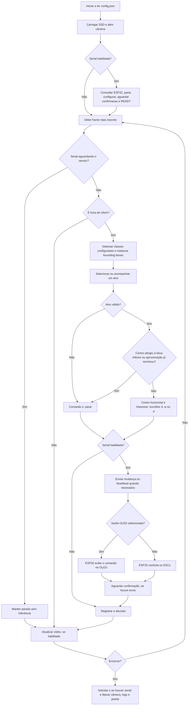

# EcoFlutuador V4.1 — Reconhecimento de garrafas e navegação

## Introdução ao projeto

O EcoFlutuador usa uma câmera para localizar garrafas e orientar a embarcação
até a região de coleta passiva pela rede. O computador ou a Raspberry Pi 5
executa o reconhecimento com SSD MobileNet V3 e escolhe o comando de movimento.
A ESP32-WROOM-32 recebe esse comando e controla os motores brushless por ESCs.
Para conferir a interpretação sem motores, o firmware pode exibir os comandos
em uma tela OLED SSD1306.

O V4.1 é o projeto principal, iniciado por `object-ident.py` na raiz do repositório.
Os módulos Python ficam no pacote `ecoflutuador/`. Na montagem final,
a câmera USB fica conectada à Raspberry Pi 5. O teste com OLED funciona
continuamente, sem precisar do HC-SR04. No modo de motores, o padrão aguarda
uma distância válida menor que 15 cm para liberar uma janela de 30 segundos.
Sem serial, o reconhecimento continua ativo normalmente.

As instruções de instalação, setup e testes estão em
[Setup e testes](#setup-e-testes--ecoflutuador-v41).

O conteúdo completo desse guia também está incorporado abaixo, em
[Setup e testes](#setup-e-testes--ecoflutuador-v41), sem cortes.

Para estudar os arquivos e a comunicação serial, consulte o
[guia de estudo do código](docs/guias/estudo_do_codigo.md).

## Bibliotecas utilizadas

### Programa Python

| Biblioteca | Uso | Versão do ambiente local validado |
|---|---|---|
| `opencv-python` | Webcam, SSD via `cv2.dnn`, desenho e janela | 4.14.0.94 |
| `numpy` | Arrays de imagem e dados da inferência | 2.5.3 |
| `pyserial` | Comunicação serial com a ESP32 | 3.5 |

O ambiente local usa Python 3.12.3. O `requirements.txt` define os intervalos
aceitos; `requirements-lock.txt` registra as versões locais. A biblioteca padrão
fornece `argparse`, `threading`, `dataclasses`, `json`, `logging`, `datetime`,
`zoneinfo`, `pathlib`, `time` e `unittest`. O modelo TensorFlow é executado pelo
OpenCV; o fluxo atual dispensa o pacote Python TensorFlow.

### Firmware e ferramentas

| Biblioteca ou ferramenta | Uso |
|---|---|
| Arduino-ESP32 | UART, temporização, leitura simultânea dos três HC-SR04 e PWM LEDC dos ESCs |
| `Wire` | Barramento I²C do OLED; acompanha o core Arduino |
| Adafruit SSD1306 | Controle da tela 128×64 |
| Adafruit GFX Library | Texto e desenho na tela |
| Adafruit BusIO | Dependência das bibliotecas Adafruit |
| Arduino IDE ou PlatformIO | Compilação e gravação da ESP32 |
| `unittest` e `g++` | Testes Python e simulação nativa do firmware |

A compilação foi validada com Espressif32 7.0.1 e Arduino-ESP32 2.0.17.
O código contempla as APIs 2.x e 3.x; o caminho 3.x foi exercitado na simulação.

## Fluxos e funcionamento

### Arquitetura

O programa Python reúne captura, detecção, decisão, visualização e comunicação.
A captura ocorre em uma thread que guarda somente o frame mais recente, evitando
que a inferência trabalhe sobre uma fila de imagens antigas. O ciclo principal
limita a entrega de frames conforme o FPS e executa a rede no intervalo definido
em `config.json`.

A navegação seleciona e acompanha um alvo das classes em
`ssd_mobilenet.detection_types`; o teste atual inclui `bottle` e `cell phone`.
Para a coleta somente de garrafas, configure apenas `bottle`.
A posição horizontal decide o
movimento; a coordenada vertical do centro da caixa decide a parada. A comunicação
serial envia a decisão à ESP32 e espera a confirmação. A ESP32 mantém o controle
dos ESCs e a parada por timeout independentemente da execução do Python.

| Arquivo ou pasta | Responsabilidade |
|---|---|
| `object-ident.py` | Entrada, argumentos, ciclo principal, desenho da imagem e encerramento |
| `config.py` / `config.json` | Leitura, validação e parâmetros do reconhecimento |
| `ecoflutuador/camera.py` | Webcam USB, captura do frame recente e controle de FPS |
| `ecoflutuador/image_processing.py` | Redução proporcional e restauração das coordenadas das caixas |
| `ecoflutuador/detection/ssd_mobilenet_detector.py` | Inferência SSD, filtro de confiança e classe |
| `ecoflutuador/detection/types.py` | Classe, confiança, bounding box e centro da detecção |
| `ecoflutuador/regions.py` | Divisórias, validação das caixas e associação geométrica do alvo |
| `ecoflutuador/navigation.py` | Seleção, acompanhamento, histerese e decisão de movimento/parada |
| `ecoflutuador/esp32_link.py` | Consulta, envio, confirmação, heartbeat e parada pela serial |
| `ecoflutuador/command_log.py` | Blocos no terminal e registros JSONL com rotação |
| `models/` | Pesos `.pb`, grafo `.pbtxt`, nomes COCO e registro de origem |
| `firmware/ControleESP32/` | Firmware Arduino e configuração do PlatformIO |
| `tests/` | Testes Python e simulação C++ do firmware |
| `docs/` | Guia de estudo em `guias/` e diário da auditoria em `historico/` |

### Organização das pastas

```text
.
├── object-ident.py             # Entrada do programa
├── config.py                   # Leitura e validação da configuração
├── config.json                 # Parâmetros e caminhos dos modelos
├── README.md
├── requirements.txt
├── requirements-lock.txt
├── ecoflutuador/                # Módulos da aplicação
│   ├── __init__.py
│   ├── camera.py
│   ├── command_log.py
│   ├── esp32_link.py
│   ├── image_processing.py
│   ├── navigation.py
│   ├── regions.py
│   └── detection/
├── docs/
│   ├── guias/estudo_do_codigo.md
│   └── historico/diario.txt
├── firmware/ControleESP32/
├── models/
├── tests/
└── logs/                       # Gerados durante a execução
```

Os comandos de execução continuam usando `object-ident.py` na raiz. Para importar
os componentes em outros scripts, use `ecoflutuador`, por exemplo
`from ecoflutuador.esp32_link import Esp32Link`.
Os caminhos dos modelos continuam relativos a `config.json`; a configuração e o
log padrão são localizados a partir dos arquivos do projeto, mesmo ao iniciar
o programa de outro diretório.

O reconhecimento executa com os módulos e modelos locais. A origem no AquaMonitor
e as referências às versões anteriores estão registradas em `models/origem.json`
e nos relatórios em `docs/`.

### Fluxograma de execução



A imagem tem três regiões superiores e uma faixa inferior de parada. Na resolução
640×480 com a configuração atual, as linhas ficam em `x=213`, `x=426` e `y=384`.
O cálculo acompanha a resolução real do frame.

| Região do alvo | Comando | Interpretação na ESP32 |
|---|---|---|
| Esquerda | `d` | Somente motor direito: virar à esquerda |
| Meio | `w` | Ambos os motores: avançar |
| Direita | `a` | Somente motor esquerdo: virar à direita |
| Baixo, alvo ausente/inválido ou aproximação encerrada | `s` | Ambos parados |

Os comandos são minúsculos e terminados por nova linha. O centro da bounding box
determina a posição horizontal e vertical. A caixa não precisa caber inteira no terço.
Quando o centro alcança a linha inferior, o sistema encerra a aproximação daquele
alvo e mantém a parada, mesmo se a caixa recuar acima da linha. Apenas a ponta
do objeto entrar na faixa inferior não provoca mais a parada.

A seleção inicial prioriza a maior área, depois confiança e coordenadas para
desempate. Depois o alvo é associado por sobreposição das caixas ou distância
entre centros. A histerese evita trocas excessivas de direção nas divisórias.
Uma perda breve mantém o último movimento por até 1000 ms desde a primeira
inferência que identifica a perda. A constante `COMMAND_HOLD_MS` em `ecoflutuador/navigation.py` define esse prazo;
`0` desativa a permanência. A referência só é liberada após o prazo e o número
configurado de inferências ausentes. Ao reencontrar o alvo, a contagem é zerada;
uma perda posterior inicia outro prazo. Ausências consecutivas não o reiniciam.

A faixa inferior indica proximidade para a rede. **Ela não confirma coleta
física e não incrementa um contador de garrafas coletadas.**

### Comunicação e parada

A ligação usa 115200 baud, 8N1. O Python consulta a ESP32, solicita parada,
envia o modo, verifica `CONFIG_OK` e aguarda `READY`. Confirma outra parada
antes de reconhecer. Cada comando enviado recebe uma confirmação.
Movimentos iguais são suprimidos; quando uma decisão recente mantém o comando,
o heartbeat renova o timeout no máximo uma vez por segundo.

Os argumentos `--output oled|motors` e `--ultrasonic`/`--no-ultrasonic`
configuram o firmware pela UART. O padrão é OLED sem sensor; `motors` habilita
o sensor por padrão. Grave esta versão uma vez; a troca de modo entre execuções
não exige editar nem regravar o firmware. A ESP32 anuncia `CONFIG_REQUIRED`
na inicialização e só prepara o acionamento após uma configuração válida.
No teste contínuo, a configuração informa `INICIAR:1` sem depender do HC-SR04.
O passo a passo está no [guia OLED](docs/TESTE_OLED.md).

Os três HC-SR04 compartilham TRIG no GPIO 19, VCC e GND. Os ECHOs são separados:
sensor 1 no GPIO 21, sensor 2 no GPIO 35 e sensor 3 no GPIO 32.
A ESP32 dispara os três a cada 100 ms e acompanha os ECHOs no mesmo disparo,
com uma única espera máxima de 30 ms para o conjunto. Com a ativação por
proximidade habilitada, uma leitura válida abaixo de 15 cm em **qualquer sensor** envia
`INICIAR:1`, liberando reconhecimento e movimentos por 30 segundos. Ao expirar,
a ESP32 para localmente e envia `INICIAR:0`; o Python volta à espera. A consulta
`?` também informa esse estado. Isso vale para UART2 e USB, com OLED ou motores;
o modo sem `--serial-port` continua reconhecendo sem depender do sensor.
Leituras próximas durante a janela não reiniciam o prazo. Após o vencimento,
uma nova leitura abaixo de 15 cm pode abrir outra janela, mesmo sem afastar o
objeto. A navegação é reiniciada em cada transição; resultados de inferências
que atravessarem uma transição são descartados.

A renovação depende da captura e da inferência. Uma falha solicita parada e
encerra a execução. Se a comunicação ficar indisponível, o watchdog da ESP32
aplica a parada após três segundos. Sem um alvo anterior, a decisão é `s`;
se um alvo acompanhado desaparecer, a parada ocorre ao vencer a permanência.
O ciclo verifica o vencimento também entre inferências. A permanência não adia
a parada na faixa inferior, em falhas ou no fim da janela ultrassônica.

No modo motores, `s` aplica o pulso mínimo de 1000 µs aos dois ESCs. O firmware
usa PWM de 50 Hz, resolução de 16 bits e pulsos de 1000–2000 µs. A potência
inicial é 30% por ESC, com alvo de 1300 µs. Há armamento de três segundos e rampa
não bloqueante de 15 µs a cada 20 ms. No modo OLED, nenhum PWM é gerado.
A tela é inicializada ao ligar e mostra o comando interpretado e as três distâncias
em centímetros nos dois modos: `Dist1`, `Dist2` e `Dist3`, correspondentes aos
ECHOs 21, 35 e 32, respectivamente. Sem leitura válida, a linha daquele sensor
mostra `sem eco`. A menor distância válida é usada para a ativação; sensores
sem resposta não impedem a ativação pelos demais.
Os três HC-SR04 são medidos a cada 100 ms mesmo com `--no-ultrasonic`; esse argumento
dispensa apenas a ativação por proximidade e o limite de 30 segundos.

### Visualização e registros

O vídeo é exibido por padrão e mostra as linhas divisórias, as bounding boxes,
a confiança, o alvo selecionado e o comando atual. O reconhecimento também
pode operar sem janela ou processar uma imagem estática.
Durante a espera pelo HC-SR04, a câmera e as linhas continuam visíveis, com
comando `s`; a inferência fica suspensa.

O terminal registra timestamp, região, objeto, quantidade de garrafas detectadas
e comando. O arquivo JSONL guarda os dados completos, incluindo caixa, centro,
confiança e estado da aproximação, com rotação de aproximadamente 2 MB e três
arquivos anteriores. A quantidade conta somente `bottle` no quadro, sem confirmar
coleta física. Os exemplos de execução e leitura dos logs estão no
[guia de testes](#logs-e-acompanhamento).

## Hardware utilizado

| Componente | Função |
|---|---|
| Raspberry Pi 5 | Executar o reconhecimento e a decisão na embarcação |
| Computador | Desenvolver e testar o reconhecimento e a comunicação USB |
| Câmera USB | Fornecer as imagens ao computador ou à Raspberry |
| ESP32-WROOM-32 | Receber comandos e controlar os ESCs ou a tela OLED |
| Dois motores brushless | Propulsão e correção da trajetória |
| Dois ESCs | Acionar os motores a partir dos sinais PWM da ESP32 |
| OLED SSD1306 128×64, I²C `0x3C` | Exibir comandos no teste visual sem motores |
| Três HC-SR04 | Liberar a janela de reconhecimento e movimento pela proximidade em qualquer sensor |
| Rede de coleta | Coleta passiva na parte inferior da embarcação |
| Cabos USB, fios UART e alimentação dos ESCs | Programação, comunicação e alimentação da montagem |

A montagem final usa UART entre a Raspberry e a ESP32. No firmware, a UART2
está configurada em GPIO 16 para RX e GPIO 17 para TX, normalmente identificados
como **RX2** e **TX2** na placa. A UART0 é usada no teste por USB. A correspondência
entre GPIOs e funções UART está no
[datasheet do ESP32-WROOM-32](https://documentation.espressif.com/esp32-wroom-32_datasheet_en.html).

O motor esquerdo usa o ESC 1, com sinal no GPIO 12; o motor direito usa o ESC 2,
com sinal no GPIO 13. O OLED usa **SDA no GPIO23** e **SCL no GPIO22**,
conforme a montagem confirmada e os diagramas de hardware.
Os ESCs exigem alimentação de potência própria e referência de GND com a ESP32;
os detalhes da ligação física ainda precisam ser confirmados.

O [HC-SR04 clássico](https://cdn.sparkfun.com/datasheets/Sensors/Proximity/HCSR04.pdf)
usa alimentação de 5 V e pode entregar
[ECHO de 5 V](https://learn.adafruit.com/ultrasonic-sonar-distance-sensors/pinouts).
**Cada ECHO precisa de seu próprio divisor ou conversor de nível antes dos
GPIOs 21, 35 e 32**, que usam lógica de 3,3 V. Os ECHOs não são unidos entre si.
A fonte real dos sensores permanece pendente. O
[guia de hardware](docs/HARDWARE.md#hc-sr04-ligações-previstas) descreve as
ligações previstas; os diagramas anteriores continuam mostrando apenas os
sete jumpers Raspberry–ESP32–OLED, sem o sensor.

### Documentação de hardware

O [guia de hardware](docs/HARDWARE.md) reúne as tabelas de pinagem, todos os GPIOs
utilizados, os diagramas SVG e Mermaid e as orientações elétricas para a montagem
Raspberry Pi–ESP32–OLED. Ele distingue a numeração BCM dos pinos físicos da
Raspberry e documenta a ligação do OLED com SCL22/SDA23.

Os procedimentos de instalação, gravação e execução continuam no
[guia de testes](#setup-e-testes--ecoflutuador-v41).

## Setup e testes — EcoFlutuador V4.1

Este guia reúne a instalação, a configuração e os testes do reconhecimento,
do OLED e dos motores, no computador e na Raspberry Pi 5 com ESP32-WROOM-32.
A apresentação, o funcionamento, o hardware e as fontes estão no
[README principal](README.md).

### Conexões dos cabos

Na Raspberry, os números **GPIO/BCM** são diferentes dos números físicos do
conector. Na ESP32, os números abaixo identificam seus GPIOs.

A pinagem atual do firmware é: **TRIG19 comum, ECHOs 21/35/32, SDA23, SCL22, ESC1 no
GPIO12 e ESC2 no GPIO13**. A UART permanece em **RX2/GPIO16 e TX2/GPIO17**.
Se a montagem ainda usa TRIG18, ECHO19 ou ESC2 no GPIO14, desligue a alimentação,
mova os fios conforme as tabelas abaixo e regrave o firmware usando o perfil
correspondente à sua conexão, conforme as instruções de gravação deste guia.

#### ESP32 — OLED

| ESP32 / conexão | Pino do OLED | Função |
|---|---|---|
| GPIO22 / D22 | SCL | Clock I²C |
| GPIO23 / D23 | SDA | Dados I²C |
| 3V3 | VCC | Alimentação de 3,3 V |
| Emenda de GND compartilhado | GND | Derivação 1 do cabo comum |

#### ESP32 — Três sensores ultrassônicos HC-SR04

| ESP32 / fonte / conexão | Pino do HC-SR04 | Função ou observação |
|---|---|---|
| GPIO19 | TRIG dos três sensores | Pulso de medição comum enviado pela ESP32 |
| GPIO21, **após adaptação para 3,3 V** | ECHO do sensor 1 | Resposta individual; `Dist1` no OLED |
| GPIO35, **após adaptação para 3,3 V** | ECHO do sensor 2 | Resposta individual; `Dist2` no OLED |
| GPIO32, **após adaptação para 3,3 V** | ECHO do sensor 3 | Resposta individual; `Dist3` no OLED |
| Fonte de 5 V compartilhada | VCC dos três sensores | Fonte e cabo reais: a confirmar |
| Emenda de GND compartilhado | GND dos três sensores | Derivação 2 do cabo comum |

VCC, GND e TRIG são comuns aos três sensores; cada ECHO segue separado até
seu GPIO, com adaptação individual de 5 V para 3,3 V.

#### ESP32 — ESCs

| ESP32 / conexão | ESC | Função ou observação |
|---|---|---|
| GPIO12 | Entrada de sinal do ESC 1 / motor esquerdo | PWM; identificação física do fio a confirmar |
| GPIO13 | Entrada de sinal do ESC 2 / motor direito | PWM; segundo ESC previsto no código, montagem a confirmar |
| Emenda de GND compartilhado | GND de referência do ESC informado | Derivação 3 do cabo comum |
| GND comum com a ESP32 | GND de referência do segundo ESC, se instalado | Derivação física a confirmar |

#### Raspberry Pi 5 — ESP32

| Raspberry Pi 5 | ESP32 | Função |
|---|---|---|
| GPIO14 / TX — **físico 8** | RX2 / GPIO16 | Comandos UART da Raspberry para a ESP32 |
| GPIO15 / RX — **físico 10** | TX2 / GPIO17 | Respostas UART da ESP32 para a Raspberry |
| GND — por exemplo, **físico 6** | GND comum | Pino físico efetivamente utilizado: a confirmar |

O GND entre a Raspberry e a ESP32 estabelece a referência elétrica comum dos
sinais UART de 3,3 V e o caminho de retorno da corrente desses sinais. Ele não
alimenta a ESP32. Mantenha essa referência comum mesmo com fontes separadas.

#### GNDs compartilhados

| Origem | Ligação | Destino |
|---|---|---|
| GND do OLED | Derivação 1 | Emenda comum |
| GNDs dos três HC-SR04 unidos | Derivação 2 | Mesma emenda comum |
| GND de referência do ESC informado | Derivação 3 | Mesma emenda comum |
| Emenda dos GNDs | **Um único cabo** | **Ponto de GND da montagem — destino físico a confirmar** |

Os GNDs do OLED, dos três sensores e da referência dos ESCs são unidos em uma
emenda e seguem por um único cabo.
O destino desse cabo foi descrito como
“uma porta USB”; falta confirmar se isso significa um **pino GND da ESP32** ou
o **GND de uma conexão USB**. As tabelas não pressupõem essa ligação. Todos esses
GNDs devem compartilhar a referência elétrica da ESP32 e da Raspberry.

#### ESCs — Motores e alimentação de potência

| Origem | Destino | Observação |
|---|---|---|
| Fonte/bateria dos motores | Entrada de alimentação dos ESCs | Tensão, conectores e cabos dependem dos ESCs; a confirmar |
| Saída para motor do ESC 1 | Motor brushless esquerdo | Ordem e identificação dos fios: a confirmar |
| Saída para motor do ESC 2, se instalado | Motor brushless direito | Ordem e identificação dos fios: a confirmar |

As conexões de potência dos ESCs são separadas dos fios de sinal e de referência
listados acima. Os detalhes elétricos estão em [HARDWARE.md](docs/HARDWARE.md).

#### USB e alimentação das placas

| Origem | Cabo | Destino | Função ou observação |
|---|---|---|---|
| Câmera USB | USB | Porta USB da Raspberry Pi 5 | Captura de imagens |
| Computador ou Raspberry | USB de dados | Conector USB da ESP32 | Gravação; também comunica no perfil `esp32-usb` |
| Fonte da Raspberry | Alimentação | Entrada de alimentação da Raspberry Pi 5 | Fonte e cabo reais: a confirmar |
| Fonte da ESP32 | Alimentação | Entrada de alimentação da ESP32 | Forma de alimentação real: a confirmar |

**Execute todos os comandos na raiz do projeto**, mesmo que este documento
tenha sua versão original dentro de `docs/`. A câmera é USB e o vídeo é exibido por padrão;
`--no-display` permite executar sem janela.

No padrão OLED, câmera e comandos funcionam continuamente com `--serial-port`,
sem HC-SR04. No modo de motores, o padrão exige a janela de 30 s do sensor.
Sem serial, a câmera e a detecção também funcionam continuamente.

### Conteúdo

- [Conexões dos cabos](#conexões-dos-cabos)
- [Instalação](#instalação)
- [Seleção de OLED ou motores](#seleção-de-oled-ou-motores)
- [Teste apenas do reconhecimento](#teste-apenas-do-reconhecimento)
- [Teste no computador com ESP32](#teste-no-computador-com-esp32)
- [Setup na Raspberry Pi 5 com ESP32](#setup-na-raspberry-pi-5-com-esp32)
- [Configuração do reconhecimento](#configuração-do-reconhecimento)
- [Comandos úteis](#comandos-úteis)
- [Logs e acompanhamento](#logs-e-acompanhamento)
- [Validação e próximos passos](#validação-e-próximos-passos)

### Instalação

#### 1. Preparar o computador

Instale o Git e o Python 3 com suporte a ambientes virtuais. O ambiente local
validado usa Python 3.12.3. Para testar o reconhecimento ao vivo, conecte uma
câmera USB; a ESP32 só é necessária para os testes de comunicação e controle.

No Ubuntu/Debian ou Raspberry Pi OS:

```bash
sudo apt update
sudo apt install -y git python3 python3-venv python3-pip libgl1 libglib2.0-0
git --version
python3 --version
```

No Windows, instale o Git e o Python 3.12, incluindo o launcher `py`, e abra
um novo PowerShell. Confira as instalações:

```powershell
git --version
py --version
```

#### 2. Clonar o repositório

No terminal, escolha a pasta onde deseja guardar o projeto e execute:

```bash
git clone https://github.com/Vy0618/ecoflutuador.git
cd ecoflutuador
```

Os comandos acima também funcionam no PowerShell. Execute os próximos passos
nessa pasta, que contém `object-ident.py`, `config.json` e `requirements.txt`.
Os arquivos do modelo já estão versionados em `models/`; não é necessário
baixar os pesos separadamente nem instalar o pacote Python TensorFlow.

#### 3. Criar o ambiente e instalar as dependências

No Linux ou na Raspberry Pi:

```bash
python3 -m venv .venv
.venv/bin/python -m pip install --upgrade pip
.venv/bin/python -m pip install -r requirements.txt
.venv/bin/python -m pip check
```

No Windows, em PowerShell:

```powershell
py -m venv .venv
.venv\Scripts\python.exe -m pip install --upgrade pip
.venv\Scripts\python.exe -m pip install -r requirements.txt
.venv\Scripts\python.exe -m pip check
```

Crie um ambiente novo em cada máquina; não copie a pasta `.venv` de outro
computador. Os comandos usam o interpretador do ambiente diretamente, sem
precisar ativá-lo.

Nos demais comandos deste guia, o Windows usa `.venv\Scripts\python.exe` no
lugar de `.venv/bin/python`, e uma porta como `COM3` no lugar de `/dev/ttyUSB0`.

#### 4. Fazer a primeira execução

Com a câmera conectada, execute no Linux ou na Raspberry Pi:

```bash
.venv/bin/python object-ident.py --duration 20
```

No Windows:

```powershell
.venv\Scripts\python.exe object-ident.py --duration 20
```

O programa abre o vídeo e executa o reconhecimento por 20 segundos, sem
precisar da ESP32. Se houver mais de uma câmera, acrescente `--camera-index 1`
para testar outro dispositivo. Em uma sessão sem interface gráfica, acrescente
`--no-display`; a câmera continua necessária.

A visualização precisa do OpenCV com suporte gráfico e de uma sessão gráfica
acessível. O mesmo `opencv-python` atende aos modos com vídeo e headless.

Para continuar com a placa, siga a instalação das ferramentas abaixo e o
[teste no computador com ESP32](#teste-no-computador-com-esp32). Para a montagem
na Raspberry com UART pelos GPIOs, siga o
[setup na Raspberry Pi 5](#setup-na-raspberry-pi-5-com-esp32).

#### Firmware e ferramentas

O PlatformIO instala as bibliotecas declaradas em `platformio.ini`. Instale o
[PlatformIO Core](https://docs.platformio.org/en/latest/core/installation/index.html)
ou use o terminal do PlatformIO no VS Code para executar `pio`. Na Arduino IDE,
instale o core Arduino-ESP32, selecione **ESP32 Dev Module** e instale Adafruit
SSD1306 e Adafruit GFX Library com suas dependências. Essas bibliotecas são
necessárias para compilar o sketch também quando o modo de saída é motores.

Confira qual instalação do PlatformIO o terminal usa:

```bash
type -a pio
pio --version
```

Se `/usr/bin/pio` mostrar o erro `resultcallback`, o terminal está usando uma
instalação antiga incompatível com o Click do sistema. Neste computador existe
um PlatformIO 6.1.19 em `~/.platformio/penv/bin/pio`. Use-o diretamente:

```bash
~/.platformio/penv/bin/pio run --project-dir firmware/ControleESP32 --environment esp32-usb --target upload --upload-port /dev/ttyUSB0
```

Para que `pio` use essa instalação na sessão atual do Bash:

```bash
export PATH="$HOME/.platformio/penv/bin:$PATH"
hash -r
pio --version
```

O caminho depende da instalação de cada máquina. O
[guia do PlatformIO](https://docs.platformio.org/en/latest/core/installation/troubleshooting.html#multiple-platformio-cores-in-a-system)
descreve os conflitos entre versões instaladas.

Neste ambiente local, `.venv/bin/pio` também aponta para o PlatformIO 6.1.19.
Reative o venv e limpe o cache de comandos do Bash para usar esse caminho:

```bash
source .venv/bin/activate
hash -r
command -v pio
pio --version
```

O caminho esperado é o `pio` dentro de `.venv/bin/`. Esse vínculo pertence ao
ambiente local; ao criar um novo venv em outra máquina, prepare o PlatformIO nela.

### Seleção de OLED ou motores

A saída e o sensor são escolhidos ao iniciar o Python:

Os quatro exemplos abaixo usam **cabo USB**, porta `/dev/ttyUSB0` e perfil
`esp32-usb`. Na Raspberry ligada por fios RX2/TX2, use `/dev/ttyAMA0` e grave
o perfil `esp32`. Os argumentos de saída e ativação são iguais nos dois canais.

#### OLED sem sensor — padrão

Executa o reconhecimento continuamente e mostra os comandos no OLED, sem
depender do HC-SR04 e sem acionar os motores.

```bash
.venv/bin/python object-ident.py --serial-port /dev/ttyUSB0 --output oled
```

#### OLED com ultrassônico

Mantém o reconhecimento em espera até uma leitura válida abaixo de 15 cm em
qualquer um dos três sensores.
Depois, exibe os comandos no OLED durante a janela de 30 segundos.

```bash
.venv/bin/python object-ident.py --serial-port /dev/ttyUSB0 --output oled --ultrasonic
```

#### Motores com ultrassônico — padrão dos motores

Usa os motores para a navegação, com ativação pelo HC-SR04 e janela de
30 segundos. Esse é o padrão ao selecionar `--output motors`.

```bash
.venv/bin/python object-ident.py --serial-port /dev/ttyUSB0 --output motors
```

#### Motores sem ultrassônico

Executa o reconhecimento e envia os comandos aos motores continuamente,
sem aguardar o sensor e sem o limite de 30 segundos.

```bash
.venv/bin/python object-ident.py --serial-port /dev/ttyUSB0 --output motors --no-ultrasonic
```

As portas são exemplos: use a porta correspondente à ligação e ao perfil
gravado na ESP32. As paradas por alvo ausente, região inferior e falha de
comunicação continuam funcionando em todos os modos.

| Argumento | Saída |
|---|---|
| `--output oled` | Exibe os comandos no OLED; nenhum PWM é gerado |
| `--output motors` | Controla os ESCs e motores |
| `--ultrasonic` | Exige proximidade em qualquer sensor e limita a janela a 30 s |
| `--no-ultrasonic` | Reconhecimento contínuo, sem exigir disparo do sensor |

**Grave esta versão do firmware uma vez.** Depois, a mudança entre esses modos
é enviada pela UART, sem editar variáveis ou regravar a cada teste. O padrão
com serial é OLED sem exigir disparo do sensor; os argumentos de modo exigem `--serial-port`.
O display mostra `CMD: <letra>` e `Dist1`/`Dist2`/`Dist3` em centímetros tanto
em `oled` quanto em `motors`, desde a inicialização. A medição continua a cada 100 ms com
`--no-ultrasonic`: a opção dispensa apenas a ativação por proximidade.
Sem leitura válida ou com um sensor desconectado, sua linha mostra `sem eco`.
`--no-display` controla apenas o vídeo no computador. O teste visual usa
OLED SSD1306 de endereço I²C `0x3C`.

#### Ligações da saída

| Componente | ESP32-WROOM-32 |
|---|---|
| OLED SDA | GPIO 23 (`OLED_SDA`, valor atual do firmware) |
| OLED SCL | GPIO 22 |
| OLED GND | GND |
| OLED VCC | 3,3 V, com módulo compatível com essa alimentação |
| Sinal do ESC 1 / motor esquerdo | GPIO 12 |
| Sinal do ESC 2 / motor direito | GPIO 13 |
| Referência dos ESCs | GND comum com a ESP32 |
| TRIG dos três HC-SR04 | GPIO19 comum |
| ECHO do HC-SR04 1 (`Dist1`) | Adaptação de nível de 5 V para 3,3 V → GPIO21 |
| ECHO do HC-SR04 2 (`Dist2`) | Adaptação de nível de 5 V para 3,3 V → GPIO35 |
| ECHO do HC-SR04 3 (`Dist3`) | Adaptação de nível de 5 V para 3,3 V → GPIO32 |

Para o modo motores, os GPIOs fornecem sinais aos ESCs; os ESCs e motores usam
alimentação própria. Faça o primeiro teste de acionamento sem hélices. A parada
`s` aplica o pulso mínimo de 1000 µs aos ESCs; ela não corta a alimentação elétrica.

A tela usa I²C nos pinos SDA23/SCL22, conforme a
[API I²C do Arduino-ESP32](https://docs.espressif.com/projects/arduino-esp32/en/latest/api/i2c.html).
Mais detalhes da tela estão no [guia OLED](docs/TESTE_OLED.md).
Os HC-SR04 não precisam estar conectados no teste OLED padrão.
O HC-SR04 clássico usa VCC de 5 V; a fonte real ainda precisa ser definida.
Não conecte ECHO de 5 V diretamente aos GPIOs 21, 35 ou 32.
Confira GND, alimentação e adaptação
nas [ligações previstas do sensor](docs/HARDWARE.md#hc-sr04-ligações-previstas).

#### Seleção do canal de comunicação

A saída OLED/motores e o canal de comunicação são escolhas independentes:

| Cenário | Perfil PlatformIO | Canal de comandos |
|---|---|---|
| Computador ou Raspberry com cabo USB conectado à ESP32 | `esp32-usb` | UART0 pelo conversor USB da placa |
| Raspberry com fios nos GPIOs | `esp32` | UART2 da ESP32: RX2 (GPIO 16), TX2 (GPIO 17) |

Com PlatformIO, mantenha o valor padrão `ECO_SERIAL_USB=0` no sketch; o perfil
`esp32-usb` define `1` na compilação. Pela Arduino IDE, altere essa definição para
`1` no teste USB ou `0` na montagem com UART2. Grave novamente depois de mudar.

No perfil UART2, o cabo USB continua servindo para gravação. Os comandos e as
respostas do protocolo passam por RX2/TX2 (GPIOs 16/17).

### Teste apenas do reconhecimento

Conecte a câmera USB ao computador, instale as dependências e execute:

```bash
.venv/bin/python object-ident.py
```

A janela deve mostrar a câmera, as bounding boxes, as regiões, a garrafa
selecionada e o comando decidido. O terminal registra cada inferência.
Sem `--serial-port`, as decisões ficam no terminal e no arquivo de log, sem
depender do HC-SR04.

Para outra câmera ou uma execução limitada:

```bash
.venv/bin/python object-ident.py --camera-index 1 --duration 20
```

Para executar sem janela:

```bash
.venv/bin/python object-ident.py --no-display --duration 20
```

Para uma imagem estática, sem abrir a câmera:

```bash
.venv/bin/python object-ident.py --image foto.jpg --image-output resultado.jpg
```

Nesse caso, `--image` e `--image-output` são usados juntos. O antigo
`--image foto.jpg --output resultado.jpg` continua aceito. O programa salva a imagem
com as anotações. Encerre o vídeo com `q`, `Esc`, fechando a janela ou `Ctrl+C`.

### Teste no computador com ESP32

#### 1. Preparar e gravar a ESP32

Conecte o OLED ou os ESCs conforme a tabela de saída e escolha `--output oled`
ou `--output motors` no comando Python. Conecte a ESP32 ao computador com
um cabo USB de dados. Liste as portas:

```bash
.venv/bin/python -m serial.tools.list_ports
```

Compile e grave o perfil **USB**, substituindo a porta pelo dispositivo listado:

```bash
pio run --project-dir firmware/ControleESP32 --environment esp32-usb
pio run --project-dir firmware/ControleESP32 --environment esp32-usb --target upload --upload-port /dev/ttyUSB0
```

Na Arduino IDE, use `ECO_SERIAL_USB=1` antes de gravar. No Windows, a porta de
gravação e execução pode ser, por exemplo, `COM3`.

#### 2. Executar o reconhecimento com a comunicação

Feche o monitor serial da Arduino IDE ou do PlatformIO, conecte a webcam ao
computador e execute:

```bash
.venv/bin/python object-ident.py --serial-port /dev/ttyUSB0
```

O programa consulta a placa, solicita parada, envia `CONFIG:OLED:0` por padrão,
exige `CONFIG_OK:OLED:0`, espera `READY` e confirma outra parada. A preparação
da saída leva cerca de três segundos. No OLED padrão, a ESP32 informa
`INICIAR:1` e libera o reconhecimento continuamente, sem exigir disparo e sem limite
de 30 s. Isso vale para USB e UART2; é preciso gravar o firmware atualizado.
Com `--ultrasonic`, só recebe essa liberação após o disparo.
A câmera continua aberta e a janela mostra as linhas e a parada enquanto
espera. Não é necessário reiniciar o Python a cada disparo do sensor.

#### 3. Conferir o comportamento

No teste OLED padrão, apresente um alvo configurado à esquerda, no meio e à direita:
os comandos esperados são `d`, `w` e `a`. Faça o centro da caixa
alcançar a linha horizontal: o comando deve virar `s`. O ponto verde marca esse
centro; somente a ponta da caixa cruzar a linha não deve parar. Retire o alvo e
confira a parada. Se houver mais
de uma garrafa, o alvo destacado deve permanecer acompanhado sem trocar apenas
porque outra caixa ficou maior.

As classes de `ssd_mobilenet.detection_types` também são usadas pela navegação.
Para testar com celular, use `cell phone`. Depois de alcançar a faixa inferior,
retire o alvo por três inferências (cerca de 1 s) para liberar outro teste;
enquanto a mesma aproximação estiver encerrada, `s` permanece esperado.

Somente com a ativação por proximidade habilitada, aproxime um objeto abaixo
de 15 cm de qualquer sensor. Repita o teste separadamente nos três sensores,
conferindo também `Dist1`, `Dist2` e `Dist3` no OLED.
Ao terminar a janela, confira `INICIAR:0` e a parada, mesmo que ainda haja uma
garrafa na câmera. O firmware rejeita movimentos enquanto aguarda o sensor.
Sem eco válido, nenhuma janela deve começar. Para conferir o vencimento,
execute sem `--duration` ou use um tempo maior que 30 s e afaste o objeto do
sensor após o disparo. Se ele continuar abaixo de 15 cm, a próxima leitura
após o vencimento poderá abrir outra janela. Leituras próximas ou sem eco
durante uma janela não reiniciam nem encerram seu prazo.

O mesmo teste aceita `--no-display` e `--duration 20`. Para testar comandos
manualmente, sem a câmera, use o monitor serial descrito em [Comandos úteis](#comandos-úteis).

### Setup na Raspberry Pi 5 com ESP32

#### 1. Instalar o projeto e a câmera

Para o teste com vídeo, use Raspberry Pi OS de 64 bits com Desktop. A instalação
abaixo parte dessa edição. Clone o repositório e crie o ambiente na Pi.
Ambientes virtuais são vinculados ao sistema onde foram
criados; prepare um novo `.venv` na Raspberry, conforme a
[documentação do Python](https://docs.python.org/3/library/venv.html).

No terminal da Pi, instale o Git e o suporte a venv, clone o repositório e entre
na pasta do projeto antes de criar o ambiente:

```bash
sudo apt update
sudo apt install -y git python3-venv
git clone https://github.com/Vy0618/ecoflutuador.git
cd ecoflutuador
python3 -m venv .venv
.venv/bin/python -m pip install -r requirements.txt
.venv/bin/python -m pip check
```

Conecte a câmera USB à Pi. Primeiro confira apenas o reconhecimento:

```bash
.venv/bin/python object-ident.py --duration 20
```

Em SSH ou console sem sessão gráfica, acrescente `--no-display`. O Raspberry
Pi OS Lite também exige esse argumento e pode precisar das bibliotecas nativas
do OpenCV que a edição Desktop já fornece; a receita acima não valida sua
instalação no Lite. Ajuste `--camera-index` se a webcam não for o índice zero.

#### 2. Preparar a ESP32 e ligar a UART

Escolha `--output oled` para a tela ou `--output motors` para os motores no Python.
Grave o perfil
**UART2** pelo cabo USB da ESP32, usando o computador de programação ou a Pi:

```bash
pio run --project-dir firmware/ControleESP32 --environment esp32 --target upload --upload-port /dev/ttyUSB0
```

Na Arduino IDE, use `ECO_SERIAL_USB=0`. A porta USB acima serve para gravar;
a comunicação da Pi em operação usa a UART dos GPIOs.

| Raspberry Pi 5 | ESP32-WROOM-32 |
|---|---|
| GPIO 14 / TX, pino físico 8 | RX2 / GPIO 16 |
| GPIO 15 / RX, pino físico 10 | TX2 / GPIO 17 |
| GND, por exemplo pino físico 6 | GND |

Na ESP32, os GPIOs 16/17 costumam estar identificados como RX2/TX2 na placa.
Cruze TX com RX e compartilhe GND. Use sinais UART TTL de **3,3 V**. A numeração
GPIO e a posição física do conector são diferentes. Os pinos da Pi podem ser
conferidos no [mapa do conector](https://gpiozero.readthedocs.io/en/stable/cli_pinout.html),
e a configuração RX/TX da ESP32 na
[API UART](https://docs.espressif.com/projects/arduino-esp32/en/latest/api/serial.html).
O fio de retorno ESP32→Pi é necessário para as confirmações.

A alimentação da ESP32 pode vir de sua conexão USB, enquanto a comunicação
com a Pi passa pelos fios UART. A câmera permanece conectada à Pi. O OLED ou
os ESCs ficam conectados à ESP32 conforme a seção de saída.

#### 3. Habilitar a UART dos GPIOs da Pi 5

Abra:

```bash
sudo raspi-config
```

Em **Interface Options → Serial Port**, responda **No** para o login/console
serial e **Yes** para habilitar o hardware serial. Edite
`/boot/firmware/config.txt`:

```bash
sudo nano /boot/firmware/config.txt
```

Em uma seção ativa para a Pi 5, como `[all]`, adicione a linha abaixo se ainda
não estiver presente. Ela habilita a UART nos GPIOs 14/15:

```ini
dtoverlay=uart0-pi5
```

Reinicie e confira a porta:

```bash
sudo reboot
```

Depois de reconectar:

```bash
ls -l /dev/ttyAMA0
readlink -f /dev/serial0
```

Use `/dev/ttyAMA0` para a ligação deste guia e confirme sua presença. Na Pi 5,
`/dev/serial0` pode apontar para `/dev/ttyAMA10`, no conector de depuração.
A configuração e os dispositivos estão descritos na
[documentação de UART da Raspberry](https://www.raspberrypi.com/documentation/computers/configuration.html#configure-uarts)
e no [overlay oficial uart0-pi5](https://github.com/raspberrypi/firmware/blob/master/boot/overlays/README).

Se a porta pertencer ao grupo `dialout` e ocorrer erro de permissão:

```bash
sudo usermod -a -G dialout "$USER"
```

Faça novo login para aplicar o grupo.

#### 4. Confirmar a ligação e executar

Antes da câmera com comandos, consulte a ESP32 e confirme somente a parada:

```bash
.venv/bin/python - <<'PY'
from ecoflutuador.esp32_link import Esp32Link

link = Esp32Link('/dev/ttyAMA0')
try:
    print('ESP32 pronta; parada inicial confirmada.')
finally:
    link.close()
PY
```

Esse exemplo configura **OLED sem exigir disparo do sensor**. Para confirmar
também a preparação dos ESCs, use `Esp32Link('/dev/ttyAMA0', output='motors')`;
a consulta continua sem solicitar movimento. O programa de reconhecimento
reaplica o modo escolhido em seus argumentos ao iniciar.

Depois execute com vídeo:

```bash
.venv/bin/python object-ident.py --serial-port /dev/ttyAMA0
```

Ou headless, adequado ao acesso SSH:

```bash
.venv/bin/python object-ident.py --serial-port /dev/ttyAMA0 --no-display
```

Confira a sequência `d → w → a → s`, a parada ao perder o alvo e o timeout.
No OLED padrão, não há disparo do sensor nem limite de 30 s. Quando a ativação
por proximidade estiver habilitada por `--ultrasonic` ou pelo padrão de `motors`,
aproxime um objeto abaixo de 15 cm de qualquer um dos três HC-SR04 e confira
`INICIAR:0` e a parada ao completar 30 s. Para testar só a câmera, execute
sem `--serial-port`.
Para os motores, acrescente `--output motors` ao comando; para a tela, use
`--output oled` ou mantenha o padrão. A preparação completa também está no
[guia físico](docs/TESTE_FISICO_RPI5.md).

### Configuração do reconhecimento

Edite [config.json](config.json) e reinicie o programa para aplicar as mudanças.

| Parâmetro | Valor atual | Efeito |
|---|---|---|
| `camera.device_index` | `0` | Índice da webcam |
| `camera.width` / `height` | `640` / `480` | Resolução solicitada |
| `camera.fps` | `30` | Limite de entrega de frames à aplicação |
| `ssd_mobilenet.confidence_threshold` | `0.45` | Confiança mínima |
| `ssd_mobilenet.input_width` / `input_height` | `320` / `320` | Entrada da rede |
| `ssd_mobilenet.detection_types` | `["bottle", "cell phone"]` | Classes reconhecidas e usadas para navegação |
| `detection_interval_ms` | `300` | Intervalo mínimo entre inferências |
| `image_processing.enabled` | `true` | Redução proporcional quando necessária |
| `image_processing.max_width` / `max_height` | `640` / `480` | Limites antes da entrada da rede |
| `display.bottom_zone_ratio` | `0.8` | Linha horizontal em 80% da altura |
| `navigation.horizontal_hysteresis_ratio` | `0.03` | Margem de troca de região |
| `navigation.target_max_distance_px` | `90` | Distância máxima para associação por centro |
| `navigation.target_min_iou` | `0.1` | Sobreposição mínima para associação |
| `navigation.target_missing_frames` | `3` | Inferências ausentes para liberar o alvo |

Para ajustar a permanência do comando durante uma perda breve, edite a constante
em [navigation.py](ecoflutuador/navigation.py) e reinicie o Python:

```python
COMMAND_HOLD_MS = 1000
```

O valor é em milissegundos desde a primeira inferência sem o alvo; `0` desativa a
permanência. Ausências consecutivas não renovam o prazo. Reencontrar o alvo
zera a contagem para uma perda futura. A faixa inferior, falhas e
o encerramento da janela ultrassônica continuam provocando parada imediata.
O JSONL marca a perda breve como `alvo_temporariamente_perdido` e registra
`permanencia_encerrada` quando o prazo vence entre inferências.

FPS e inferência são controles separados: o perfil entrega até 30 frames por
segundo e permite aproximadamente 3,3 inferências por segundo, conforme o tempo
de processamento. Na Pi, meça esse tempo antes de ajustar os valores. As decisões
precisam chegar com margem abaixo do watchdog de três segundos para manter o
movimento. A captura real pode ter FPS diferente do valor solicitado; o software
limita a entrega mesmo quando a webcam ignora o pedido.

Os caminhos do modelo são relativos ao JSON:

```text
models/frozen_inference_graph.pb
models/ssd_mobilenet_v3_large_coco_2020_01_14.pbtxt
models/coco.names
```

`coco.names` usa um nome por linha, com o ID definido pela posição. A origem e
os hashes dos modelos estão em [models/origem.json](models/origem.json).
`display` configura a linha inferior; a janela é controlada pelo comando.

### Comandos úteis

#### Reconhecimento e diagnóstico

```bash
# Ver argumentos
.venv/bin/python object-ident.py --help

# Usar outro perfil e outra câmera
.venv/bin/python object-ident.py --config config.json --camera-index 1

# ESP32 por USB, sem janela, durante 20 segundos
.venv/bin/python object-ident.py --serial-port /dev/ttyUSB0 --no-display --duration 20

# Usar outro arquivo de log
.venv/bin/python object-ident.py --log-file logs/teste.jsonl

# Listar portas e conferir dependências
.venv/bin/python -m serial.tools.list_ports
.venv/bin/python -m pip check

# Ativar o ambiente; depois, python aponta para o venv
source .venv/bin/activate
```

`--display` solicita explicitamente o vídeo, que já é o padrão. O modo de
imagem estática usa `--image` com `--image-output` (ou o antigo `--output`) e
não aceita `--serial-port`.

#### Monitor serial e comandos manuais

Com o perfil USB gravado, feche o reconhecimento e abra:

```bash
.venv/bin/python -m serial.tools.miniterm /dev/ttyUSB0 115200 --eol LF
```

Na Pi com o perfil UART2, substitua a porta por `/dev/ttyAMA0`. A placa anuncia
`CONFIG_REQUIRED` ao ligar. Envie `CONFIG:OLED:0` para OLED contínuo,
`CONFIG:OLED:1` para OLED com sensor, `CONFIG:MOTORES:1` para motores com sensor
ou `CONFIG:MOTORES:0` para motores sem sensor. Aguarde a confirmação exata
`CONFIG_OK:<saida>:<sensor>` e depois `READY`. Envie `?` para consultar o estado.
Somente com a ativação por proximidade habilitada, dispare qualquer um dos
três HC-SR04 antes de enviar movimentos.
Envie `a`, `w`, `d` ou `s`,
sempre com Enter. `Ctrl+]` fecha o miniterm; envie `s` antes de sair.
O monitor serial da Arduino IDE também pode ser usado com **115200 baud** e
**nova linha** no perfil USB. Use um programa por vez na mesma porta.

| Mensagem | Função |
|---|---|
| `?` | Consulta prontidão e `INICIAR:0/1`; aplica parada |
| `CONFIG_REQUIRED` | Aguarda configuração do modo; OLED e medição já iniciados, sem PWM |
| `CONFIG:OLED:0` / `CONFIG:OLED:1` | Teste OLED sem/com ativação por proximidade |
| `CONFIG:MOTORES:0` / `CONFIG:MOTORES:1` | Motores sem/com ativação por proximidade |
| `CONFIG_OK:<saida>:<sensor>` | Confirmação exata do modo aplicado; depois aguarde `READY` |
| `ARMING` / `READY` | Inicialização em andamento / firmware pronto |
| `a`, `w`, `d`, `s` | Movimentos e parada |
| `CMD_OK:<comando>` | Confirmação de aceitação |
| `CAPS:HEARTBEAT` | Anúncio de suporte ao heartbeat |
| `h` / `HB_OK` | Renovação do timeout sem mudar o movimento |
| `TIMEOUT:s` | Parada após três segundos sem mensagens de movimento/heartbeat |
| `ERROR:<motivo>` | Erro informado pelo firmware |
| `INICIAR:1` / `INICIAR:0` | Liberado / aguardando o sensor; sem ultrassônico, a liberação é contínua |

Com ultrassônico habilitado e fora da janela, `a/w/d` provocam parada e resposta `INICIAR:0`, sem `CMD_OK`
para o movimento. `s` e `h` continuam aceitos quando a placa está pronta;
`h` não libera movimentos. Firmware antigo sem suporte a `CONFIG` é rejeitado
pelo Python; grave a versão atual antes de usar os novos argumentos.

Os três HC-SR04 são lidos em todos os modos a cada 100 ms, com um único pulso
TRIG e acompanhamento simultâneo dos ECHOs por até 30 ms no total.
Quando a ativação por proximidade está habilitada, uma distância válida abaixo
de 15 cm em qualquer sensor libera a janela. A ESP32 encerra os movimentos
localmente após 30 s; `h` não prolonga essa autorização. `INICIAR:1/0` são
mensagens enviadas pela ESP32, não comandos manuais para forçar a liberação.

A configuração é mantida apenas em RAM e reaplicada pelo Python a cada execução.
Para trocar o modo, encerre o programa e inicie novamente com os argumentos desejados.

O Python espera até oito segundos por `READY` e um segundo por confirmação.
Suprime movimentos repetidos e envia `h` no máximo uma vez por segundo, quando
uma decisão recente mantém o comando. A renovação depende da câmera e da
inferência; ela não roda em uma thread independente. Para este teste, grave o
firmware atualizado, que informa a liberação contínua ou pelo HC-SR04.

Falhas de comunicação solicitam `s` e encerram a execução. Quando a serial está
totalmente indisponível, o watchdog da ESP32 aplica a parada. Comandos inválidos
também param os motores. No modo manual, sem novas mensagens, a parada ocorre
após três segundos.

#### Compilação e testes de software

```bash
# Compilar UART2 sem gravar
pio run --project-dir firmware/ControleESP32 --environment esp32

# Compilar USB sem gravar
pio run --project-dir firmware/ControleESP32 --environment esp32-usb

# Executar testes sem câmera, serial ou motores físicos
.venv/bin/python -B -m unittest discover -s tests -v
```

O firmware usa 50 Hz, resolução de 16 bits e pulsos de 1000–2000 µs. A potência
inicial é 30% por ESC, com alvo de 1300 µs. O armamento leva três segundos e a
rampa muda 15 µs a cada 20 ms. `POTENCIA_ESC1` e `POTENCIA_ESC2` ajustam os alvos;
a configuração JSON ajusta o reconhecimento.

#### Problemas comuns

| Sintoma | Verificação |
|---|---|
| Janela não abre | Sessão gráfica disponível e OpenCV com GUI; em SSH, use `--no-display` |
| Câmera não abre | Conexão USB, permissões e `camera.device_index` / `--camera-index` |
| ESP32 não confirma `READY` | Porta correta, perfil USB/UART2, RX/TX cruzados e GND comum |
| Acesso negado à serial | Grupo da porta e outro programa usando o dispositivo |
| OLED não mostra texto | Alimentação, SDA=23, SCL=22 e endereço `0x3C`; a tela mostra o estado desde a inicialização nos dois modos |
| Motores não acionam | `--output motors`, confirmação `CONFIG_OK`, sensor quando habilitado, alimentação dos ESCs e pinagem |
| Paradas por timeout | Tempo real de inferência e chegada de mensagens abaixo de três segundos |
| Serial pronta, mas sem reconhecimento/movimento | Firmware atualizado, argumentos de sensor e `INICIAR:1`; para teste sem sensor, use `--output oled --no-ultrasonic` |
| Sem confirmação `CONFIG_OK` | Grave o novo firmware e confira se outro programa ocupa a porta |
| Celular aparece na imagem, mas só há `s` | `cell phone` em `detection_types`, programa atualizado, centro da caixa acima da faixa inferior e aproximação anterior já liberada |

GPIO 12 participa da configuração de boot da ESP32. Se a placa deixar de
inicializar com o ESC conectado, confira o nível imposto a esse pino, conforme
o [datasheet do ESP32](https://documentation.espressif.com/esp32_datasheet_en.html).

#### Timeout ao aguardar READY

Se `Esp32Link('/dev/ttyAMA0')` abrir a porta, mas não receber `READY` em oito
segundos, confira o canal usado pela ligação:

- **Raspberry por RX2/TX2:** grave o perfil `esp32`, com o padrão
  `ECO_SERIAL_USB=0`. O perfil `esp32-usb` recebe pelo cabo USB.
- **Cabo USB:** use o perfil `esp32-usb` e a porta USB identificada por
  `serial.tools.list_ports`, como `/dev/ttyUSB0` ou `/dev/ttyACM0`.
- **UART dos GPIOs:** confira o overlay `uart0-pi5`, a porta `/dev/ttyAMA0`,
  TX da Pi → RX2 da ESP32, RX da Pi ← TX2 da ESP32 e GND comum.

Com o reconhecimento fechado, consulte a porta manualmente:

```bash
.venv/bin/python -m serial.tools.miniterm /dev/ttyAMA0 115200 --eol LF
```

Envie `?` e pressione Enter. O firmware responde `CAPS:HEARTBEAT`, `INICIAR:0/1`
e `CONFIG_REQUIRED` se ainda não estiver configurado. Envie `CONFIG:OLED:0`,
aguarde `CONFIG_OK:OLED:0` e depois `READY`. Se já configurado, a consulta retorna
`READY` quando está pronto ou `ARMING` durante a preparação. Sem resposta,
confira firmware, porta, ligação e alimentação. Se aparecer `ERROR:OLED`,
a inicialização da tela falhou. Feche o monitor com `Ctrl+]` antes de repetir
o teste com `Esp32Link`.

### Logs e acompanhamento

Cada inferência aparece no terminal:

```text
timestamp: 2026-10-12-15-30
regiao: esquerda
objeto: bottle
garrafas_detectadas: 1
comando: d
```

O timestamp usa `AAAA-MM-DD-HH-SS`, sem minutos, no fuso de São Paulo, conforme
o formato solicitado. Sem alvo, a região é `sem_alvo` e o objeto é `nenhum`.
`garrafas_detectadas` conta somente as detecções `bottle`; um celular não incrementa
esse campo. `comando` mostra a decisão
mantida, inclusive quando um reenvio é suprimido ou substituído por heartbeat.

O arquivo `logs/recognition.jsonl` guarda dados completos: timestamp UTC, sequência,
evento, caixa, centro, confiança, `ymax`, estado da aproximação e modo de execução.
Inicialização da câmera, serial e erros também ficam nesse arquivo. A rotação
usa aproximadamente 2 MB por arquivo e conserva três arquivos anteriores.

```bash
tail -f logs/recognition.jsonl
```

### Validação e próximos passos

A suíte de testes cobre FPS, encerramento da câmera, filtros do detector, regiões,
alvo, histerese, parada persistente, logs, serial com falhas, watchdog,
inicialização dos ESCs e firmware OLED sem PWM. Para executar, use
`.venv/bin/python -m unittest discover -s tests`.
Os perfis UART2 e USB compilaram para ESP32 Dev Module. A inferência
com o SSD real e a geração de uma imagem com divisórias também foram verificadas.
Os testes nativos cobrem as APIs Arduino-ESP32 2.x e 3.x, os três ECHOs
simultâneos ou sobrepostos, a ativação individual, sensores sem resposta e
a volta do contador de microssegundos.

A resposta física da tela, os ESCs, os motores e o desempenho na Raspberry ainda
precisam ser avaliados. O acompanhamento usa geometria e pode ficar ambíguo com
garrafas sobrepostas ou cruzando trajetórias. A precisão do detector ainda não
foi medida em um conjunto de imagens rotuladas.

Próximas etapas, em ordem de execução:

1. **Validar o OLED pelo computador.** Conferir `d/w/a/s`, confirmação serial,
   parada ao perder a garrafa e timeout, antes de acionar motores.
2. **Validar a Raspberry com OLED.** Medir FPS entregue, tempo de inferência e
   intervalo entre decisões; ajustar a configuração à câmera e à Pi.
3. **Validar os ESCs e motores em bancada.** Conferir armamento, pulso mínimo,
   potência, rampa e correspondência entre esquerda/direita com a montagem.
4. **Calibrar a navegação na embarcação.** Ajustar margem de histerese, linha
   inferior e potência a partir da trajetória observada e da posição da rede.
5. **Avaliar a detecção.** Registrar cenas de água com diferentes iluminações,
   reflexos, distâncias e oclusões; medir precisão e perdas antes de decidir
   por ajustes de confiança ou substituição/treinamento do modelo.
6. **Avaliar a coleta e a parada física.** Testar a aproximação com a rede e
   definir uma forma independente de confirmar coleta, caso a contagem seja
   necessária. A região inferior continua sendo apenas um indicativo visual.

Guias e registros adicionais:

- [Teste OLED](docs/TESTE_OLED.md).
- [Montagem Raspberry Pi 5 e ESP32](docs/TESTE_FISICO_RPI5.md).
- [Revisão da aproximação autônoma](docs/REVISAO_AUTONOMIA.md).
- [Relatório da sessão](docs/RELATORIO_SESSAO_2026-10-12.md).
- [Migração do V4.1 para a raiz](docs/MIGRACAO_PARA_RAIZ.md).

`.venv/`, `.venv-anterior/`, `logs/`, `__pycache__/` e `.pio/` são arquivos gerados
localmente e ignorados pelo Git. Os documentos antigos da raiz estão preservados
em `docs/historico-raiz/`.

## Fontes consultadas

As referências abaixo foram utilizadas nas orientações de instalação,
comunicação, pinagem e reconhecimento, além da leitura dos arquivos locais e
dos requisitos fornecidos nesta conversa.

### Documentação técnica

| Fonte | Aplicação no projeto |
|---|---|
| [Python — ambientes virtuais com venv](https://docs.python.org/3/library/venv.html) | Criação do ambiente e preparação de um venv próprio na Raspberry |
| [PlatformIO — instalação](https://docs.platformio.org/en/latest/core/installation/index.html) | Instalação do Core e uso pelo terminal do VS Code |
| [PlatformIO — conflitos entre instalações](https://docs.platformio.org/en/latest/core/installation/troubleshooting.html#multiple-platformio-cores-in-a-system) | Diagnóstico do `pio` antigo e seleção da instalação funcional |
| [Arduino-ESP32 — UART](https://docs.espressif.com/projects/arduino-esp32/en/latest/api/serial.html) | Comunicação serial, seleção da UART e configuração dos pinos RX/TX |
| [Arduino-ESP32 — I²C](https://docs.espressif.com/projects/arduino-esp32/en/latest/api/i2c.html) | Ligação do OLED pelos pinos SDA/SCL |
| [Arduino-ESP32 — PWM LEDC](https://docs.espressif.com/projects/arduino-esp32/en/latest/api/ledc.html#ledcdetach) | Configuração do PWM e desconexão dos pinos ao trocar motores por OLED |
| [Espressif — datasheet do ESP32](https://documentation.espressif.com/esp32_datasheet_en.html) | Características dos GPIOs e configuração de boot |
| [Espressif — datasheet do ESP32-WROOM-32](https://documentation.espressif.com/esp32-wroom-32_datasheet_en.html) | Pinagem e funções UART do módulo utilizado |
| [Espressif — ESP32-DevKitC com módulo WROOM](https://docs.espressif.com/projects/esp-idf/en/v4.4.1/esp32/hw-reference/esp32/get-started-devkitc.html) | Referência da placa de desenvolvimento e seus conectores |
| [Raspberry Pi — configuração das UARTs](https://www.raspberrypi.com/documentation/computers/configuration.html#configure-uarts) | Console serial, habilitação da UART e dispositivos da Pi 5 |
| [Raspberry Pi — overlay uart0-pi5](https://github.com/raspberrypi/firmware/blob/master/boot/overlays/README) | Habilitação da UART nos GPIOs 14/15 |
| [Raspberry Pi — GPIO e conector de 40 pinos](https://www.raspberrypi.com/documentation/computers/raspberry-pi.html#gpio-and-the-40-pin-header) | Referência elétrica e ligação dos GPIOs |
| [Raspberry Pi OS — Python](https://www.raspberrypi.com/documentation/computers/os.html#python-on-raspberry-pi) | Instalação de pacotes Python em ambientes virtuais |
| [GPIO Zero — mapa do conector](https://gpiozero.readthedocs.io/en/stable/cli_pinout.html) | Correspondência entre números GPIO e pinos físicos da Raspberry |
| [Adafruit — código da biblioteca SSD1306](https://github.com/adafruit/Adafruit_SSD1306/blob/master/Adafruit_SSD1306.h) | Inicialização e interface da tela OLED |
| [Adafruit — dependências da SSD1306](https://github.com/adafruit/Adafruit_SSD1306/blob/master/library.properties) | Dependência da biblioteca gráfica |
| [Adafruit — dependências da GFX](https://github.com/adafruit/Adafruit-GFX-Library/blob/master/library.properties) | Dependência Adafruit BusIO |
| [OpenCV — instalação dos pacotes Python](https://docs.opencv.org/5.0/py_tutorials/py_setup/py_pip_install/py_pip_install.html) | Referência de instalação e variantes dos pacotes; o projeto usa OpenCV 4.x |
| [PyPI — arquivos do opencv-python 4.14.0.94](https://pypi.org/project/opencv-python/4.14.0.94/) | Verificação das distribuições disponíveis, incluindo Linux ARM64 |
| [Debian — dependências do python3.13-venv](https://packages.debian.org/trixie/python3.13-venv) | Preparação do venv na distribuição Trixie |
| [Linux — driver UVC](https://docs.kernel.org/userspace-api/media/drivers/uvcvideo.html) | Referência para câmeras USB compatíveis com UVC |
| [HC-SR04 — datasheet ElecFreaks](https://cdn.sparkfun.com/datasheets/Sensors/Proximity/HCSR04.pdf) | Alimentação, pulso de disparo e cálculo da distância |
| [Adafruit — sinais do HC-SR04](https://learn.adafruit.com/ultrasonic-sonar-distance-sensors/pinouts) | ECHO de 5 V e adaptação para GPIO de 3,3 V |

### Referências locais e fornecidas pelo usuário

- **Versões V3 e V4:** referências anteriores de reconhecimento, decisão e
  acionamento dos motores, registradas no
  [relatório da sessão](docs/RELATORIO_SESSAO_2026-10-12.md).
- **Modelo e arquivos provenientes do AquaMonitor:** origem, caminhos e hashes
  registrados em [models/origem.json](models/origem.json).
- **Código OLED e requisitos de operação fornecidos nesta conversa:** exemplo
  SSD1306 128×64, regiões de navegação, comandos e montagem Raspberry/ESP32.
- **Implementação atual:** [config.json](config.json),
  [object-ident.py](object-ident.py), [navigation.py](ecoflutuador/navigation.py),
  [esp32_link.py](ecoflutuador/esp32_link.py) e
  [firmware da ESP32](firmware/ControleESP32/ControleESP32.ino), utilizados para
  conferir os comandos e o comportamento descritos neste guia.
- **Verificações de software:** [testes locais](tests/) e resultados registrados
  na [revisão da autonomia](docs/REVISAO_AUTONOMIA.md) e nos guias de teste.
