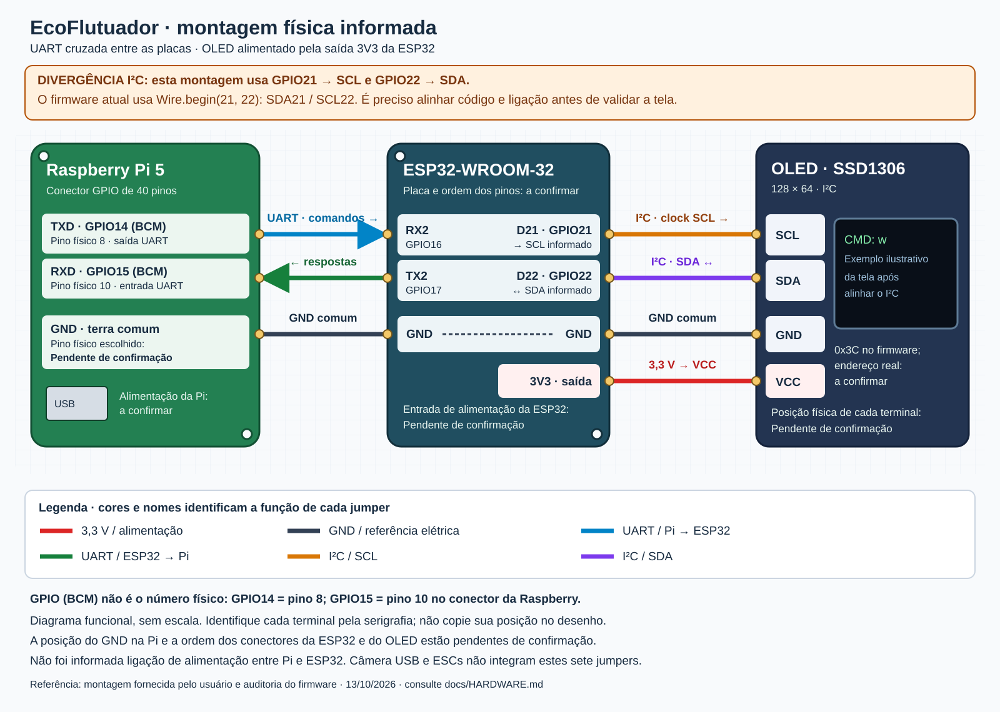
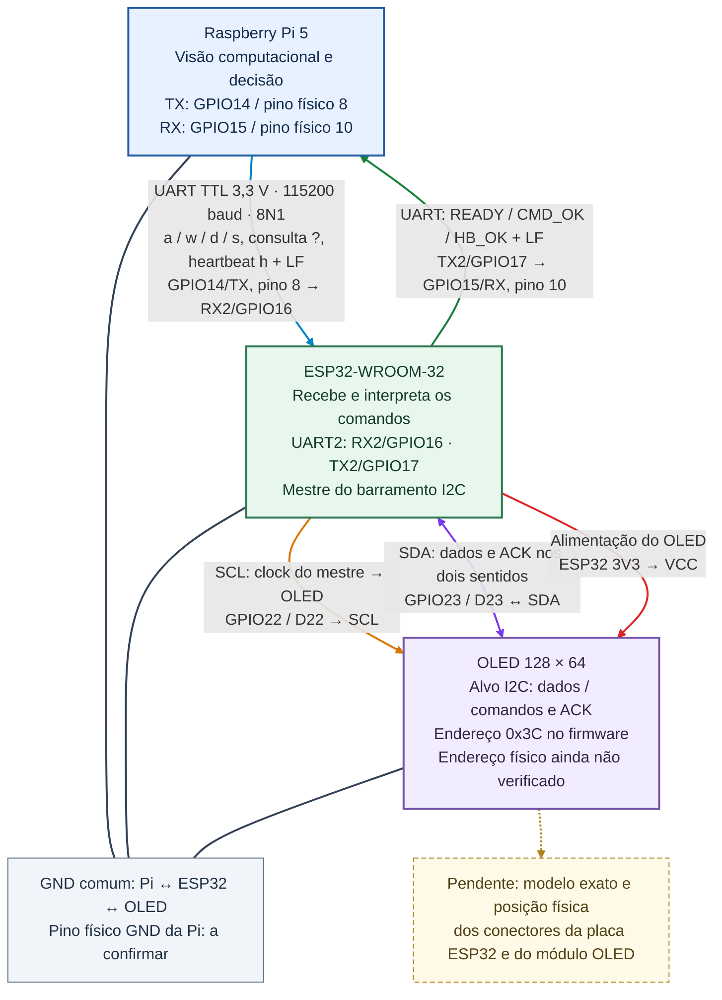

# Hardware do EcoFlutuador

Referência da montagem informada e do código revisado em **16/10/2026**.
Este documento descreve a Raspberry Pi 5, a ESP32-WROOM-32 e o display OLED,
incluindo as conexões conhecidas e as verificações que ainda faltam.
Os procedimentos de instalação, gravação e execução estão em [testes.md](testes.md).

A ligação do OLED confirmada é **GPIO22 → SCL** e **GPIO23 → SDA**,
correspondente a `Wire.begin(OLED_SDA, OLED_SCL)`, com SDA=23 e SCL=22.

## 1. Componentes e responsabilidades

| Componente | Responsabilidade | Informação disponível |
|---|---|---|
| Raspberry Pi 5 | Captura da câmera USB, detecção SSD MobileNet, seleção do alvo e comandos de navegação | Comunicação pelo conector GPIO, nos GPIOs BCM14/15 |
| Câmera USB | Fornece os quadros para o OpenCV | Modelo, consumo e porta USB física: **Pendente de confirmação** |
| ESP32-WROOM-32 em placa de desenvolvimento | Interpreta comandos UART; exibe no OLED ou gera PWM para os ESCs | Módulo informado; modelo exato da placa e posição dos conectores: **Pendente de confirmação** |
| OLED SSD1306 I²C | Mostra o comando interpretado e o comportamento esperado dos motores | Código para 128×64 e endereço `0x3C`; modelo exato do módulo e endereço medido: **Pendente de confirmação** |
| HC-SR04 | Libera reconhecimento e movimentos por 30 s ao detectar distância válida abaixo de 15 cm | TRIG18/ECHO19 no código; alimentação e adaptação elétrica reais: **Pendentes de confirmação** |
| Dois ESCs e motores brushless | Propulsão quando o firmware estiver no modo de motores | GPIOs dos sinais definidos; modelos, conectores e alimentação real: **Pendente de confirmação** |

As opções `usarOled` e `usarUltrassonico` são configuradas pela UART a partir
de `--output oled|motors` e `--ultrasonic`/`--no-ultrasonic` no Python. O padrão
é OLED sem sensor; com motores, o sensor é habilitado por padrão. Na inicialização,
a ESP32 anuncia `CONFIG_REQUIRED` e aguarda a configuração, sem gerar PWM.
O OLED mostra comando e distância desde a inicialização, inclusive no modo motores.
No modo OLED, nenhum PWM é gerado. A medição do HC-SR04 continua nos dois modos;
`--no-ultrasonic` dispensa apenas a ativação por proximidade. A alimentação
da Raspberry e a entrada de alimentação da placa ESP32 não foram informadas;
não há fio de alimentação entre essas duas placas nos diagramas.

## 2. Numeração dos pinos

Na Raspberry, **GPIO/BCM** identifica o sinal do processador. **Pino físico**
identifica a posição no conector de 40 pinos. Eles não são intercambiáveis:

| Sinal na Raspberry Pi | Número GPIO (BCM) | Número físico no conector |
|---|---|---|
| TXD para a ESP32 | GPIO14 | **8** |
| RXD vindo da ESP32 | GPIO15 | **10** |
| GND compartilhado | Não é GPIO | Pino efetivamente usado: **Pendente de confirmação** |

O pino físico **6** é uma opção de GND, mas não foi informado como o pino
utilizado na montagem. Os números físicos **14 e 15 não são os GPIOs 14 e 15**.
Confira a orientação do conector pelo pino 1 e por um mapa de pinagem antes de
conectar. [Referência do conector da Raspberry](https://gpiozero.readthedocs.io/en/stable/cli_pinout.html).

Na ESP32, os nomes **RX2/TX2** correspondem, nesta configuração, a
**GPIO16/GPIO17**; RX0/TX0 normalmente correspondem a GPIO3/GPIO1. Aqui,
**D22/D23 significam GPIO22/GPIO23**, conforme a identificação fornecida para
esta placa. Não são números físicos do módulo WROOM ou do conector da Raspberry.
A posição real desses terminais deve ser identificada pela serigrafia da placa.
[Pinagem do ESP32-WROOM-32](https://documentation.espressif.com/esp32-wroom-32_datasheet_en.html).

## 3. Tabelas das conexões físicas informadas

### Raspberry Pi → ESP32: UART

| Componente de origem | Pino de origem | Componente de destino | Pino de destino | Função |
|---|---|---|---|---|
| Raspberry Pi 5 | TXD / GPIO14 BCM / **pino físico 8** | ESP32 | RX2 / GPIO16 | Enviar comandos para a ESP32 |
| ESP32 | TX2 / GPIO17 | Raspberry Pi 5 | RXD / GPIO15 BCM / **pino físico 10** | Devolver respostas e confirmações |
| Raspberry Pi 5 | GND / pino físico **Pendente de confirmação** | ESP32 | GND | Compartilhar a referência elétrica dos sinais |

**TX liga a RX; RX liga a TX.** Ambos os sentidos são necessários porque o
Python aguarda as respostas da ESP32. Esses três fios não alimentam as placas.

### ESP32 → OLED: I²C e alimentação

Pinagem confirmada para o OLED, também descrita em
[TESTE_OLED.md](TESTE_OLED.md#ligação):

| Componente de origem | Pino de origem | Componente de destino | Pino de destino | Função |
|---|---|---|---|---|
| ESP32 | **D22 / GPIO22** | OLED | **SCL** | Clock I²C |
| ESP32 | **D23 / GPIO23** | OLED | **SDA** | Dados I²C e confirmação ACK |
| ESP32 | GND | OLED | GND | Referência elétrica comum |
| ESP32 | **3V3** | OLED | **VCC** | Alimentação informada de 3,3 V |

Não determine a posição de VCC/GND/SCL/SDA pela ordem desta tabela ou pelo
desenho: leia os nomes impressos no módulo. A ordem física dos quatro terminais
do OLED está **Pendente de confirmação**. A compatibilidade do módulo exato com
alimentação de 3,3 V também precisa ser conferida em sua documentação.

### HC-SR04: ligações previstas

| Componente de origem | Pino de origem | Componente de destino | Pino de destino | Função |
|---|---|---|---|---|
| ESP32 | GPIO18 | HC-SR04 | TRIG | Pulso de disparo |
| HC-SR04 | ECHO | ESP32 | GPIO19, através de adaptação de nível | Pulso usado para medir a distância |
| HC-SR04 | GND | ESP32 | GND | Referência elétrica comum |
| Fonte adequada: **Pendente de confirmação** | **Pendente de confirmação** | HC-SR04 | VCC | HC-SR04 clássico especifica 5 V; alimentação real pendente |

**Não conecte ECHO de 5 V diretamente ao GPIO19.** Use divisor de tensão ou
conversor de nível compatível com entrada de 3,3 V; os valores e a montagem
reais precisam ser confirmados. A ESP32 mede a cada 100 ms, usando `pulseIn`
com timeout de 30 ms. Leituras sem eco não liberam o sistema. O
[datasheet do HC-SR04](https://cdn.sparkfun.com/datasheets/Sensors/Proximity/HCSR04.pdf)
especifica o pulso TRIG de pelo menos 10 µs e ciclo de medição acima de 60 ms;
a [referência elétrica da Adafruit](https://learn.adafruit.com/ultrasonic-sonar-distance-sensors/pinouts)
explica a adaptação do ECHO.

## 4. Diagrama das conexões físicas

O desenho representa a pinagem confirmada SCL22/SDA23.
O desenho usa representações funcionais das placas, com jumpers e terminais
identificados individualmente. **Não é um desenho em escala nem um mapa da
posição física dos conectores.** Os dois terminais GND desenhados na ESP32
representam a mesma rede elétrica, sem pressupor dois conectores específicos.

| Cor no diagrama | Ligação |
|---|---|
| Vermelho | Alimentação 3,3 V: ESP32 → OLED |
| Cinza escuro | GND compartilhado |
| Azul | UART: comandos Raspberry → ESP32 |
| Verde | UART: respostas ESP32 → Raspberry |
| Laranja | I²C: SCL |
| Roxo | I²C: SDA |

O diagrama contém somente os **sete jumpers informados**. Não representa
ligações de bateria, ESCs, motores ou alimentação das placas que não foram
confirmadas. **O HC-SR04 e sua adaptação de nível não estão nesses diagramas**;
suas ligações previstas estão na tabela acima.

## 5. Arquitetura de comunicação

O fluxo de software é câmera USB → reconhecimento e decisão na Raspberry →
UART → interpretação na ESP32 → atualização do OLED por I²C. No modo de motores,
a última etapa passa a ser a geração de PWM para os ESCs. O OLED é um teste
visual da interpretação do comando, não uma medição de movimento do barco.

Este diagrama mostra a arquitetura e as conexões confirmadas, com SCL22/SDA23.
A imagem SVG representa o mesmo fluxo do código Mermaid apresentado abaixo.
Ele antecede a integração do HC-SR04;
o sensor e as mensagens `INICIAR:1/0` são descritos no texto, sem mudar o desenho.

## 6. Todos os GPIOs usados pela implementação

Os números da tabela são GPIOs do componente indicado, salvo onde consta
explicitamente uma posição física da Raspberry. **GPIO14 da Raspberry e GPIO14
da ESP32 são pinos de placas diferentes e têm funções diferentes.**

| Componente | GPIO / nome | Função no código ou na montagem | Quando é utilizado |
|---|---|---|---|
| Raspberry Pi | BCM14 / TXD / físico 8 | Transmitir UART para RX2 | Montagem informada; roteamento depende da configuração do sistema operacional |
| Raspberry Pi | BCM15 / RXD / físico 10 | Receber UART de TX2 | Montagem informada; roteamento depende da configuração do sistema operacional |
| ESP32 | GPIO16 / RX2 | `UART_RX_PIN = 16` | Perfil `esp32`, entrada de `Serial2` |
| ESP32 | GPIO17 / TX2 | `UART_TX_PIN = 17` | Perfil `esp32`, saída de `Serial2` |
| ESP32 | GPIO3 / RX0 | RX padrão da UART0 no ESP32 clássico; não declarado como constante no projeto | `Serial`, normalmente ligado ao conversor USB–UART da placa |
| ESP32 | GPIO1 / TX0 | TX padrão da UART0 no ESP32 clássico; não declarado como constante no projeto | Comandos e respostas no perfil `esp32-usb` |
| ESP32 | GPIO23 / D23 | `OLED_SDA = 23`: SDA do OLED | `Wire.begin(OLED_SDA, OLED_SCL)` na inicialização, em todos os modos |
| ESP32 | GPIO22 / D22 | `OLED_SCL = 22`: SCL do OLED | `Wire.begin(OLED_SDA, OLED_SCL)` na inicialização, em todos os modos |
| ESP32 | GPIO12 | `ESC_PIN1`: PWM do ESC1/motor esquerdo | Somente no modo motores (`usarOled=false`) |
| ESP32 | GPIO14 | `ESC_PIN2`: PWM do ESC2/motor direito | Somente no modo motores (`usarOled=false`) |
| ESP32 | GPIO18 | TRIG do HC-SR04 | Medições em todos os modos |
| ESP32 | GPIO19 | ECHO do HC-SR04, após adaptação de nível | Medições em todos os modos |

O Python usa `pyserial`, não uma biblioteca de controle direto de GPIO. O nome
da porta serial é passado por `--serial-port`; `config.json` não configura a
pinagem UART/I²C. A câmera usa USB e não ocupa um GPIO definido neste projeto.
O construtor `Adafruit_SSD1306(128, 64, &Wire, -1)` não atribui um GPIO dedicado
ao reset do display. Números de canais LEDC 0/1 nas versões antigas do Arduino
não são GPIO0/1 adicionais.

### Sinais previstos para os ESCs

| Componente de origem | Pino de origem | Componente de destino | Pino de destino | Função |
|---|---|---|---|---|
| ESP32 | GPIO12 | ESC1 / motor esquerdo | Entrada de sinal: **Pendente de confirmação** | PWM previsto no código |
| ESP32 | GPIO14 | ESC2 / motor direito | Entrada de sinal: **Pendente de confirmação** | PWM previsto no código |
| ESP32 | GND | Referência de sinal dos ESCs | Terminal e ligação real: **Pendente de confirmação** | Referência necessária para interpretar o PWM |

Os pulsos configurados são 1000–2000 µs, a 50 Hz; potência 30 corresponde a 1300 µs.
`s` escreve o pulso mínimo de 1000 µs no modo de motores. Isso **não corta a
alimentação elétrica**. A interpretação desse mínimo como parada, a calibração
e a compatibilidade com sinais de 3,3 V precisam ser confirmadas no modelo real
de ESC. Não é possível deduzir a pinagem de potência ou as cores dos fios apenas
pelo código.

## 7. Como UART, comandos e OLED funcionam no código

### Perfil e porta serial

| Perfil PlatformIO | Interface dos comandos | Uso previsto |
|---|---|---|
| `esp32` | `Serial2`: RX16/TX17, 115200 baud, 8N1 | Raspberry pelos fios RX2/TX2 |
| `esp32-usb` | `Serial`: UART0 pelo conversor USB–UART | Computador ou Raspberry pelo cabo USB |

`ECO_SERIAL_USB=0` é o padrão; o perfil `esp32-usb` define essa opção como 1.
Gravar o perfil USB e depois usar os fios RX2/TX2 impede a comunicação nessa
interface. No perfil UART2, o USB permite gravar o firmware, mas as respostas
do protocolo vão para RX2/TX2.

Na Raspberry Pi 5, o dispositivo `/dev/serial0` pode corresponder à UART de
depuração, em vez dos GPIOs 14/15. O sistema deve habilitar a UART desses GPIOs,
por exemplo com o overlay `uart0-pi5`, e deixar o console de login fora da porta
usada. Confirme qual dispositivo foi criado antes de usar `/dev/ttyAMA0`.
Veja o [guia de teste físico](TESTE_FISICO_RPI5.md) e a
[documentação das UARTs da Raspberry](https://www.raspberrypi.com/documentation/computers/configuration.html#configure-uarts).

### Mensagens e confirmação

As mensagens terminam com **LF (`\n`)**. Os bytes de comando enviados pelo Python
são **minúsculos**, mesmo quando a movimentação é descrita como A/W/D/S.

| Mensagem enviada | Interpretação na ESP32 | Resposta esperada |
|---|---|---|
| `?\n` | Para e informa suporte ao heartbeat, prontidão e liberação pelo sensor | `CAPS:HEARTBEAT`, `INICIAR:0/1` e `CONFIG_REQUIRED`, `ARMING` ou `READY` |
| `CONFIG:OLED:0\n` / `CONFIG:OLED:1\n` | Seleciona teste OLED sem/com ativação por proximidade | `CONFIG_OK:OLED:0/1`, estado `INICIAR`, `ARMING` e depois `READY` |
| `CONFIG:MOTORES:0\n` / `CONFIG:MOTORES:1\n` | Seleciona ESCs sem/com ativação por proximidade; OLED continua mostrando o estado | `CONFIG_OK:MOTORES:0/1`, estado `INICIAR`, `ARMING` e depois `READY` |
| `w\n` | Ambos os motores: avançar; no teste, mostrar essa ação | `CMD_OK:w` |
| `d\n` | Motor direito: virar à esquerda; no teste, mostrar essa ação | `CMD_OK:d` |
| `a\n` | Motor esquerdo: virar à direita; no teste, mostrar essa ação | `CMD_OK:a` |
| `s\n` | Parada; no teste, mostrar `Parado` | `CMD_OK:s` |
| `h\n` | Renovar a validade do estado sem mudar o comando mostrado | `HB_OK` quando pronto (`armado`, após `READY`) |

No modo OLED padrão, `--output oled` dispensa o disparo do sensor: a configuração retorna
`INICIAR:1\n` e o reconhecimento funciona continuamente, sem limite de 30 s.
Nos motores, `--output motors` habilita o sensor por padrão; `--ultrasonic`
também pode ser escolhido para testar o sensor com OLED. Nesse modo,
`INICIAR:1\n` e `INICIAR:0\n` também são enviados espontaneamente pela ESP32:
o primeiro abre a janela de 30 s, o segundo informa seu fim. Uma distância
válida menor que 15 cm abre essa janela; movimentos `a/w/d` exigem que ela
esteja ativa. `s` continua permitido. No vencimento, a ESP32 para localmente,
mesmo sem resposta do Python. Heartbeats não estendem o prazo. Com serial,
o Python aguarda a liberação e suspende inferências quando ela termina;
sem serial, o reconhecimento continua ativo para testes apenas da câmera.
Distâncias próximas ou ausência de eco durante a janela não mudam seu prazo.
Após o vencimento, a próxima leitura próxima pode liberar mais 30 s, mesmo
sem afastar o objeto. A consulta `?` não reinicia esse tempo. Fora da janela,
`a/w/d` recebem somente `INICIAR:0`; `s` e `h` continuam permitidos quando
a ESP32 está pronta. A câmera permanece aberta na espera, mas sem inferência.

`esp32_link.py` consulta a placa, solicita parada e envia a configuração. Exige
a confirmação exata `CONFIG_OK`, aguarda `READY` por até 8 s e confirma nova parada.
Pedidos de configuração durante movimento param a saída e são rejeitados;
o Python configura somente na abertura da conexão. Ao trocar motores por OLED,
o firmware para e desconecta o PWM anterior. Para comandos, aguarda até 1 s pela
resposta correspondente. Estados
repetidos podem gerar heartbeat a cada 1 s quando existem decisões recentes; não
há uma tarefa independente mantendo movimento se o reconhecimento travar.
O firmware leva 3 s para ficar pronto. Se um comando de movimento estiver ativo,
3 s sem comando/heartbeat válido provocam a parada e a resposta `TIMEOUT:s`.
Uma falha serial no Python também provoca uma tentativa de enviar `s`.
A comunicação bidirecional permite detectar falta de confirmação.

### O que a tela comprova

`mostrarComandoNoOLED()` desenha `CMD: a/w/d/s`, a distância em centímetros
(ou `Dist: sem eco`) e uma descrição da ação, como `Direito: virar esq`.
A tela funciona também no modo motores e mostra o comando interpretado, sem
comprovar que um motor girou ou que um objeto foi coletado.

Há uma distinção adicional: na biblioteca Adafruit, `display.begin()` não é um
teste confiável de presença/ACK do OLED. Seu retorno verdadeiro pode ocorrer
mesmo com o display desconectado ou com SDA/SCL invertidos; as rotinas de comando
não propagam os erros I²C para esse retorno. Assim, **`READY` e `CMD_OK` podem
ser recebidos com a tela apagada**. `ERROR:OLED` não cobre todos os defeitos de
fiação. É necessário verificar a comunicação I²C e a exibição física.
[Implementação da Adafruit SSD1306](https://github.com/adafruit/Adafruit_SSD1306/blob/master/Adafruit_SSD1306.cpp).

## 8. Correspondência entre montagem e código

| Item | Montagem informada / diagrama | Código atual | Resultado |
|---|---|---|---|
| UART Raspberry → ESP32 | GPIO14/físico 8 → RX2/GPIO16 | RX configurado em 16 | Compatível com perfil `esp32` e UART habilitada na Raspberry |
| UART ESP32 → Raspberry | TX2/GPIO17 → GPIO15/físico 10 | TX configurado em 17 | Compatível com perfil `esp32` e UART habilitada na Raspberry |
| SCL do OLED | GPIO22 → SCL | SCL configurado em 22 | Compatível |
| SDA do OLED | GPIO23 → SDA | SDA configurado em 23 | Compatível |
| Alimentação OLED | ESP32 3V3 → VCC | Sem validação elétrica pelo código | Compatibilidade do módulo: **Pendente de confirmação** |
| Endereço OLED | Endereço físico não informado | `0x3C` | **Pendente de confirmação** |
| Frequência I²C | Não medida/informada | Nenhuma chamada explícita a `Wire.setClock()` | Valor efetivo depende do core/biblioteca; **Pendente de confirmação** |

A assinatura da API é `Wire.begin(sdaPin, sclPin, frequency)`; a chamada atual
usa apenas os dois primeiros argumentos. Além disso,
`display.begin(..., true, false)` usa `periphBegin=false`: a biblioteca preserva
a inicialização feita em `Wire`, sem inverter automaticamente os pinos.
[API I²C do Arduino-ESP32](https://docs.espressif.com/projects/arduino-esp32/en/latest/api/i2c.html#begin).

O teste [firmware_oled.cpp](../tests/firmware_oled.cpp) confere que os pinos
configurados são `OLED_SDA`/`OLED_SCL`, atualmente 23/22.
Seus substitutos de `Wire` e SSD1306 apenas simulam chamadas; não verificam
continuidade, tensão, pull-ups, endereço ou ACK de uma tela real. Os documentos
[TESTE_OLED.md](TESTE_OLED.md) e [testes.md](testes.md) descrevem os valores atuais.
O [estudo_do_codigo.md](estudo_do_codigo.md), as tabelas e os diagramas usam a
pinagem confirmada SCL22/SDA23.

## 9. Níveis lógicos, alimentação e incompatibilidades

### UART e GPIO

Raspberry e ESP32 usam sinais lógicos de **3,3 V**. UART aqui significa UART TTL,
não RS-232: não conecte uma interface RS-232 ou saída de 5 V diretamente aos GPIOs.
O GND compartilhado fornece a referência dos níveis de TX e RX.
[GPIO da Raspberry](https://www.raspberrypi.com/documentation/computers/raspberry-pi.html#gpio-and-the-40-pin-header).

Os GPIOs da ESP32 não são tolerantes a 5 V; a Espressif informa tolerância máxima
de 3,6 V. A faixa de alimentação do módulo WROOM-32 é 3,0–3,6 V, normalmente 3,3 V.
Uma entrada USB/VIN de uma placa com regulador não equivale ao pino 3V3 do módulo.
[Limite dos GPIOs](https://docs.espressif.com/projects/esp-faq/en/latest/hardware-related/hardware-design.html#what-is-the-voltage-tolerance-of-gpios-of-esp-chips),
[datasheet do módulo](https://documentation.espressif.com/esp32-wroom-32_datasheet_en.html).

### Alimentação das placas e do OLED

A ligação conhecida de alimentação é **ESP32 3V3 → OLED VCC**. Confira que o
módulo OLED aceita 3,3 V e que a saída da placa suporta seu consumo. Não deduza
que todo módulo comercial SSD1306 aceita as mesmas tensões ou possui regulador.
Modelo, consumo e margem do regulador estão **Pendentes de confirmação**.

Use a entrada de alimentação prevista pelo fabricante da placa Raspberry e
da placa ESP32. Não ligue automaticamente a saída 3V3 da Raspberry à entrada da
ESP32. Não combine USB e alimentação externa na ESP32 sem conferir a proteção
e as opções permitidas para a placa exata; a DevKitC de referência, por exemplo,
documenta alternativas de alimentação mutuamente exclusivas.
[Alimentação da DevKitC](https://docs.espressif.com/projects/esp-dev-kits/en/latest/esp32/esp32-devkitc/user_guide.html).

### Barramento I²C

SDA e SCL usam saídas de dreno aberto e precisam de resistores **pull-up**.
Verifique se o módulo já tem esses resistores, seus valores e a tensão à qual
estão ligados. Para este barramento da ESP32, o nível alto deve respeitar 3,3 V;
pull-ups conectados a 5 V são incompatíveis com os GPIOs. Não acrescente resistores
sem conferir os existentes, pois ficam em paralelo.
[Orientação da Adafruit sobre pull-ups](https://learn.adafruit.com/working-with-i2c-devices/pull-up-resistors).

O ACK I²C é uma confirmação elétrica de recebimento de endereço/dados, diferente
de `CMD_OK`, que é uma resposta do protocolo UART. A presença de pull-ups corretos
não corrige SDA e SCL invertidos. Use jumpers curtos e confira continuidade e
tensão antes de atribuir uma tela apagada ao reconhecimento de imagem.

### ESCs e motores

Motores e ESCs exigem alimentação de potência própria, dimensionada para seus
modelos; os GPIOs fornecem sinal, não energia de propulsão. A montagem de potência,
bateria e conectores permanece **Pendente de confirmação**.

O GPIO12 da ESP32 é um pino de configuração de boot (`MTDI`). Um circuito externo
que o mantenha alto durante o reset pode selecionar 1,8 V para a alimentação da
flash e impedir a inicialização em módulos que exigem 3,3 V. Confira a entrada do
ESC antes do teste com motores; o código não determina sua polarização elétrica.
[Pinos de configuração do WROOM-32](https://documentation.espressif.com/esp32-wroom-32_datasheet_en.html).

### Alimentação e ECHO do HC-SR04

O HC-SR04 clássico especifica VCC de 5 V e ECHO em lógica de 5 V. Isso não
autoriza usar 5 V no GPIO19: a entrada da ESP32 precisa receber o sinal
adaptado para 3,3 V. Fonte, variante exata do sensor, divisor/conversor e GND
comum reais permanecem pendentes. Não há uma nova ligação de alimentação
Raspberry→ESP32 ou Raspberry→sensor presumida aqui. Veja as
[ligações previstas](#hc-sr04-ligações-previstas).

## 10. Roteiro para reproduzir e verificar a montagem

1. **Com a alimentação desligada**, identifique os pinos 8/10 e um GND no conector
   da Raspberry. Registre qual pino físico GND foi escolhido; confirme RX2, TX2,
   GPIO22, GPIO23, GND e 3V3 pela serigrafia da ESP32 e os quatro nomes no OLED.
2. Faça os **três jumpers UART/GND** e os **quatro jumpers OLED** conforme as
   tabelas. Não use a posição dos terminais no desenho como pinagem real.
3. Verifique a alimentação e os níveis de 3,3 V. Confirme continuidade do GND
   compartilhado, ausência de curtos e a tensão dos pull-ups do OLED.
4. Confira as conexões **GPIO22 → SCL** e **GPIO23 → SDA**, conforme a tabela do OLED.
5. Confira o perfil gravado: para os fios RX2/TX2, deve ser **`esp32`**. Na
   Raspberry, habilite a UART dos GPIOs 14/15 e identifique sua porta. Consulte
   [testes.md](testes.md) para os comandos de gravação e reconhecimento com serial.
6. No Python, selecione `--output oled` ou `--output motors` e confira `CONFIG_OK`
   e `READY`. No OLED padrão, teste `w/d/a` sem sensor e sem limite de 30 s.
   Quando usar `--ultrasonic`,
   aproxime antes um objeto do HC-SR04 a menos de 15 cm e confira a parada com
   `INICIAR:0` ao fim de 30 s. Confirme
   **visualmente** o mesmo comando no OLED. Uma confirmação UART isolada não
   valida a tela, os motores ou a coleta.

## 11. Pendências de confirmação física

| Informação pendente | Por que precisa ser confirmada |
|---|---|
| Pino físico GND usado na Raspberry | Completar a identificação exata da montagem |
| Modelo da placa de desenvolvimento ESP32 e posição dos terminais | Evitar usar a posição de outra placa como referência |
| Modelo OLED, ordem dos terminais e suporte a 3,3 V | Conferir ligação e alimentação sem pressupor um módulo comercial específico |
| Endereço real do OLED, pull-ups e frequência efetiva do I²C | Validar a comunicação elétrica |
| Alimentação da Raspberry e da ESP32, capacidade do regulador 3V3 | Validar potência disponível e evitar fontes em conflito |
| Perfil gravado e dispositivo UART ativo na Raspberry | Confirmar que o software usa os pinos ligados |
| Modelos de ESCs/motores, alimentação, conectores e aceitação de PWM 3,3 V | Elaborar posteriormente a montagem de propulsão |
| Calibração e comportamento dos ESCs com pulso 1000 µs | Confirmar a parada física, não apenas o comando lógico |
| Exibição real do OLED | Confirmar o funcionamento que testes simulados não medem |
| Alimentação, variante e adaptação do ECHO do HC-SR04 | Proteger o GPIO19 e confirmar o disparo abaixo de 15 cm |

## 12. Arquivos examinados e referências

A revisão abrangeu o código de aplicação, firmware, configurações e testes do
repositório atual, além dos guias e registros históricos em `docs/`. Os arquivos
do modelo e as dependências não definem novos GPIOs do projeto.

| Arquivo / conjunto | Relação com o hardware |
|---|---|
| [object-ident.py](../object-ident.py) | Inicialização da câmera, opção serial, atualização dos comandos e encerramento |
| [camera.py](../camera.py), [image_processing.py](../image_processing.py), [detection/](../detection/) | Captura USB e detecção; sem GPIO UART/I²C |
| [navigation.py](../navigation.py), [regions.py](../regions.py) | Regiões, alvo, decisão e parada lógica |
| [esp32_link.py](../esp32_link.py) | Porta serial, baud, consulta, ACK, heartbeat e parada |
| [command_log.py](../command_log.py) | Registros dos comandos; não configura pinos |
| [config.py](../config.py), [config.json](../config.json) | Parâmetros da câmera, reconhecimento e navegação; sem pinagem |
| [ControleESP32.ino](../firmware/ControleESP32/ControleESP32.ino) | UART, GPIOs, I²C, OLED, PWM e watchdog |
| [platformio.ini](../firmware/ControleESP32/platformio.ini) | Perfis UART2/USB, placa alvo e bibliotecas |
| [tests/](../tests/) | Simulações do protocolo e comportamento; não confirmam a montagem elétrica |

A correspondência dos sete fios foi atualizada entre tabelas e SVGs;
o Mermaid embutido corresponde à imagem exportada. A integração do HC-SR04
acrescenta GPIO18/19 e as mensagens `INICIAR:1/0`, sem alterar os diagramas
do conjunto Raspberry–ESP32–OLED. **Não foi realizado teste físico.**

Fontes técnicas adicionais às citadas junto às orientações:

- [Arduino-ESP32 — UART](https://docs.espressif.com/projects/arduino-esp32/en/latest/api/serial.html): seleção de UART, baud e pinos RX/TX.
- [Raspberry Pi — overlays do firmware](https://github.com/raspberrypi/firmware/blob/master/boot/overlays/README): referência do overlay `uart0-pi5`.
- [Fontes reunidas no README](../README.md#fontes-consultadas): bibliotecas, ferramentas e histórico do projeto.
