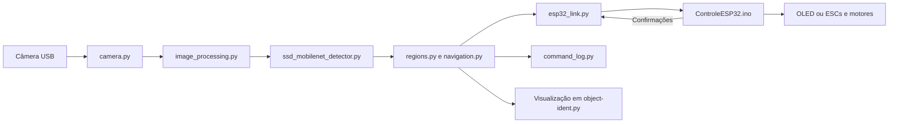
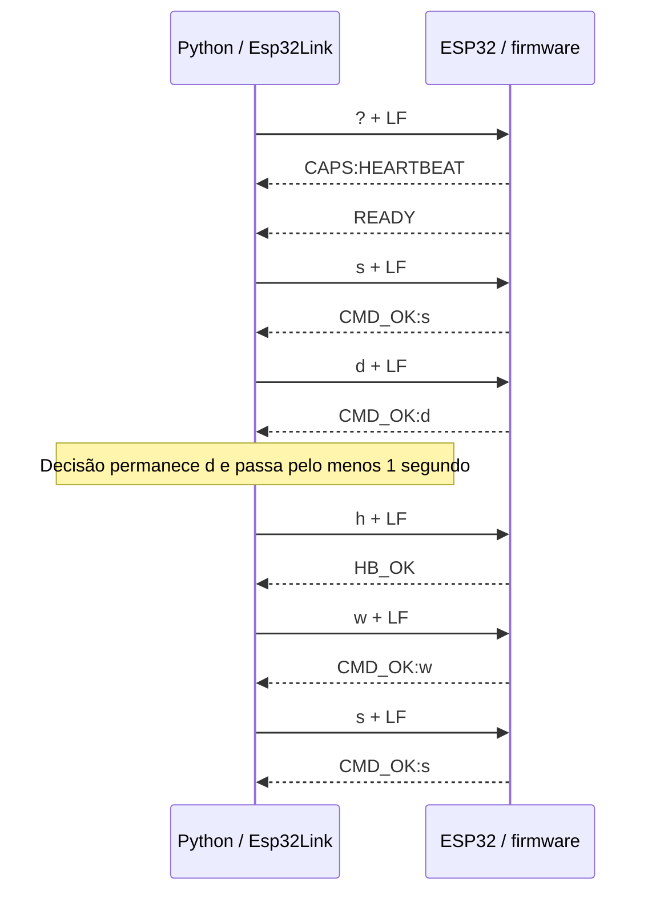

# Estudando o código do EcoFlutuador V4.1

> Atualização de 15/10/2026: a seleção de OLED/motores e ultrassônico passou a
> usar `--output oled|motors` e `--ultrasonic`/`--no-ultrasonic`, com mensagens
> `CONFIG` pela UART. Os trechos abaixo que mostram constantes de modo e o
> protocolo anterior são referências da versão estudada originalmente.
> A parada na faixa inferior também passou a usar o centro da caixa, em vez de `ymax`.
> Veja os comandos e o protocolo atual em [testes.md](testes.md).

Este texto foi escrito para quem está aprendendo programação e quer entender
como os arquivos do projeto trabalham juntos. A leitura acompanha uma imagem
até a decisão de movimento e, depois, segue a mensagem enviada à ESP32.

A implementação principal está na raiz do repositório. Os links abaixo abrem
os arquivos que você pode ler junto com a explicação. As instruções de instalação
e testes estão em [testes.md](testes.md); a apresentação do projeto está no
[README](../README.md).

## Índice

- [1. Uma visão do programa inteiro](#1-uma-visão-do-programa-inteiro)
- [2. config.json: os dados que controlam o comportamento](#2-configjson-os-dados-que-controlam-o-comportamento)
- [3. config.py: ler, preparar e validar a configuração](#3-configpy-ler-preparar-e-validar-a-configuração)
- [4. detection/types.py: representar uma detecção](#4-detectiontypespy-representar-uma-detecção)
- [5. camera.py: abrir a webcam e entregar imagens recentes](#5-camerapy-abrir-a-webcam-e-entregar-imagens-recentes)
- [6. image_processing.py: reduzir e restaurar coordenadas](#6-image_processingpy-reduzir-e-restaurar-coordenadas)
- [7. detection/ssd_mobilenet_detector.py: executar o reconhecimento](#7-detectionssd_mobilenet_detectorpy-executar-o-reconhecimento)
- [8. regions.py: geometria e associação entre detecções](#8-regionspy-geometria-e-associação-entre-detecções)
- [9. navigation.py: decidir e lembrar o que aconteceu](#9-navigationpy-decidir-e-lembrar-o-que-aconteceu)
- [10. object-ident.py: coordenar os componentes](#10-object-identpy-coordenar-os-componentes)
- [11. Antes de ler a serial: canal, bytes e protocolo](#11-antes-de-ler-a-serial-canal-bytes-e-protocolo)
- [12. esp32_link.py: o lado Python da comunicação](#12-esp32_linkpy-o-lado-python-da-comunicação)
- [13. ControleESP32.ino: o lado que recebe e executa](#13-controleesp32ino-o-lado-que-recebe-e-executa)
- [14. platformio.ini: construir o firmware correto](#14-platformioini-construir-o-firmware-correto)
- [15. command_log.py: registrar para entender o programa](#15-command_logpy-registrar-para-entender-o-programa)
- [16. Os arquivos do modelo](#16-os-arquivos-do-modelo)
- [17. Dependências e arquivos de organização](#17-dependências-e-arquivos-de-organização)
- [18. Os testes também ensinam como o código funciona](#18-os-testes-também-ensinam-como-o-código-funciona)
- [19. Um exercício completo sem câmera e sem ESP32](#19-um-exercício-completo-sem-câmera-e-sem-esp32)
- [20. Uma ordem prática para estudar os arquivos](#20-uma-ordem-prática-para-estudar-os-arquivos)

## 1. Uma visão do programa inteiro

O computador, ou a Raspberry Pi, executa Python. Ele recebe imagens, procura
uma garrafa, acompanha sua posição e escolhe uma letra. A ESP32 executa o
firmware C++/Arduino: recebe a letra, interpreta o movimento e atualiza os ESCs
ou a tela OLED.



`object-ident.py` coordena essas etapas. `config.py` lê os parâmetros usados
por elas. A escolha de movimento é uma decisão do programa; a confirmação
serial informa que o firmware aceitou a mensagem. A velocidade e a trajetória
físicas ainda dependem da montagem e da resposta dos motores.

Alguns termos usados ao longo do guia:

| Termo | Significado neste projeto |
|---|---|
| Frame | Uma imagem da câmera em determinado instante |
| Inferência | Executar um modelo treinado sobre uma imagem |
| Bounding box | Retângulo que delimita o objeto detectado |
| Estado | Informação conservada entre uma execução e a seguinte |
| Thread | Uma sequência de execução que pode trabalhar junto ao ciclo principal |
| Protocolo | Regras que os dois programas seguem para trocar mensagens |
| Confirmação ou ACK | Resposta que indica a aceitação de uma mensagem |
| Timeout | Limite de tempo para esperar uma resposta ou atividade |
| Heartbeat | Mensagem curta usada para renovar o prazo de comunicação |

## 2. `config.json`: os dados que controlam o comportamento

Arquivo: [config.json](../config.json).

Esse arquivo contém dados. Ele não executa a câmera nem envia mensagens.
O Python o transforma em um dicionário: uma estrutura de chaves e valores,
acessada com expressões como `config["camera"]["fps"]`.

| Seção | O que configura |
|---|---|
| `camera` | Índice da webcam, largura, altura e FPS solicitado |
| `ssd_mobilenet` | Caminhos do modelo, confiança mínima, entrada da rede e classes permitidas |
| `detection_interval_ms` | Intervalo usado para decidir quando realizar nova inferência |
| `image_processing` | Redução proporcional da imagem antes do detector |
| `display` | Posição da linha horizontal inferior |
| `navigation` | Margem de troca de região e critérios para acompanhar o alvo |

Os valores atuais incluem câmera 640×480, limite de entrega de 30 FPS, entrada
SSD 320×320, confiança mínima 0,45, classe `bottle` e intervalo de inferência
300 ms. São parâmetros distintos: 30 FPS descreve o limite de entrega das
imagens; 300 ms permite aproximadamente 3,3 inferências por segundo quando o
processamento acompanha esse ritmo.

`bottom_zone_ratio=0.8` coloca a linha inferior em 80% da altura. Com altura
480, a linha fica em `480 × 0.8 = 384`.

`target_missing_frames=3` conta atualizações da navegação sem associação válida.
Essas atualizações acontecem nas inferências; o nome do parâmetro não significa
três imagens consecutivas entregues pela câmera.

## 3. `config.py`: ler, preparar e validar a configuração

Arquivo: [config.py](../config.py).

A função principal é `load_config()`. Ela recebe o caminho do JSON e devolve
um dicionário preparado para o restante do programa.

Seu trabalho segue esta ordem:

1. Localizar o JSON e ler seu texto.
2. Converter o texto em dados com `json.loads()`.
3. Resolver os caminhos do modelo em relação à pasta desse JSON.
4. Conferir se os arquivos do modelo existem.
5. Validar os tipos e limites dos parâmetros.
6. Preencher alguns valores opcionais, como os padrões de navegação.

`CONFIG_FILE` usa `__file__`, que identifica o próprio arquivo Python. Assim,
a configuração padrão acompanha a localização do código. Um caminho como
`models/coco.names` é resolvido em relação ao JSON, mesmo que o programa seja
iniciado de outro diretório.

A validação evita situações como FPS zero, dimensões negativas, confiança fora
do intervalo de 0 a 1 e distância de associação inválida. `math.isfinite()`
ajuda a rejeitar valores como infinito e `NaN`, que prejudicariam comparações.

Observe `setdefault()`: ele adiciona um valor somente se a chave ainda não
existe. Por isso, configurações anteriores sem `navigation` recebem os padrões.
Isso altera o dicionário em memória; a função não reescreve o JSON no disco.
Várias outras seções continuam obrigatórias.

## 4. `detection/types.py`: representar uma detecção

Arquivo: [detection/types.py](../detection/types.py).

`Detection` é uma `dataclass`: uma classe criada para reunir dados relacionados.
Ela guarda três informações:

```python
Detection(
    class_name="bottle",
    confidence=0.87,
    bbox=(80, 120, 240, 360),
)
```

`bbox` tem o formato `(x1, y1, x2, y2)`: canto superior esquerdo e canto inferior
direito. Na imagem, `x` cresce para a direita e `y` cresce para baixo.
Essa caixa tem largura `240 - 80 = 160` e altura `360 - 120 = 240`.

A propriedade `centroid` calcula seu centro:

```text
x = (80 + 240) // 2 = 160
y = (120 + 360) // 2 = 240
```

`//` faz divisão inteira. Por ser uma propriedade, o código usa
`detection.centroid`, sem chamar `centroid()`.

`frozen=True` impede a atribuição comum de novos valores aos campos depois da
criação do objeto. Quando as coordenadas precisam ser restauradas, o programa
cria outra `Detection` com a nova caixa.

## 5. `camera.py`: abrir a webcam e entregar imagens recentes

Arquivo: [camera.py](../camera.py).

### `WebcamConfig`

Essa classe reúne os parâmetros da câmera. `open_camera()` cria um
`cv2.VideoCapture`, verifica a abertura e solicita resolução, FPS e buffer
reduzido. A escolha padrão do backend é DirectShow no Windows e V4L2 no Linux.
O backend é a interface usada pelo OpenCV para conversar com o dispositivo.

Solicitar um FPS não garante que a câmera o adote. Por isso, outra classe
limita a entrega de imagens por software. O padrão isolado de `WebcamConfig`
é 15 FPS, mas o `main()` fornece os 30 FPS do JSON atual.

### `LatestFrameCamera`

Essa classe mantém uma thread de captura. O objetivo é obter uma imagem recente
quando a inferência terminar, em vez de consumir uma fila de imagens antigas.

| Atributo | Função |
|---|---|
| `camera` | Objeto OpenCV que lê o dispositivo |
| `frame` | Referência à imagem mais recente |
| `fresh_frame` | Indica que existe uma imagem ainda não entregue |
| `condition` | Coordena o acesso ao frame e a espera do consumidor |
| `stopped` | Evento que solicita o encerramento |
| `error` | Guarda uma falha ocorrida na captura |
| `last_delivery` / `frame_interval` | Controlam o limite de entrega de FPS |

`_capture()` lê continuamente. Ao obter uma imagem, substitui `self.frame`,
marca `fresh_frame=True` e avisa quem está esperando. Se outra imagem chegar
antes da leitura pelo ciclo principal, a referência anterior é substituída.

`read()` espera uma imagem nova ou uma falha. Também respeita o intervalo
`1 / target_fps`: a 30 FPS, ele é aproximadamente 0,033 s. A espera por um frame
novo tem limite de cinco segundos.

O retorno de `read()` é uma referência à imagem, tratada como somente leitura
pelo código consumidor. O NumPy não impede que alguém a altere; é um acordo
entre as partes do programa. `annotate()` faz uma cópia antes de desenhar.

`close()` solicita a parada, espera a thread por um tempo limitado, libera a
câmera e espera novamente. `Event`, `Condition` e `Thread` permitem coordenar
esse trabalho sem acrescentar uma thread separada para a inferência.

## 6. `image_processing.py`: reduzir e restaurar coordenadas

Arquivo: [image_processing.py](../image_processing.py).

`prepare_frame()` reduz uma imagem quando ela ultrapassa os limites configurados.
A escala é calculada por:

```text
min(1, largura_máxima / largura, altura_máxima / altura)
```

O mesmo fator é usado nas duas dimensões, preservando a proporção. O valor 1
impede ampliar uma imagem menor. Se a redução estiver desabilitada ou for
desnecessária, a função devolve a imagem original.

`restore_coordinates()` faz a operação correspondente nas caixas detectadas.
Imagine que um frame 640×480 tenha sido reduzido para 320×240. Uma caixa
`(40, 60, 120, 180)` na imagem reduzida vira `(80, 120, 240, 360)` na original.
As coordenadas `x` e `y` usam as razões de largura e altura, respectivamente.

Esse cuidado permite desenhar a caixa e decidir a região usando a resolução
real da câmera. Com a configuração atual de captura e limites 640×480, essa
primeira redução normalmente não é necessária.

## 7. `detection/ssd_mobilenet_detector.py`: executar o reconhecimento

Arquivo: [detection/ssd_mobilenet_detector.py](../detection/ssd_mobilenet_detector.py).

### Inicialização de `SsdMobileNetDetector`

O construtor carrega a rede com `cv2.dnn.readNetFromTensorflow()`. Também guarda
o limite de confiança, as dimensões da entrada e o conjunto de classes aceitas.

Os nomes das classes são lidos de `coco.names`. O número da linha, começando em
1, é o ID correspondente. No arquivo local, `bottle` está na linha 44.
Reordenar os nomes mudaria essa associação. Linhas vazias e comentários são
ignorados como nomes, mas continuam ocupando suas posições na numeração.

### `detect(frame)`

A função recebe uma imagem e devolve uma lista de objetos `Detection`.
Primeiro, `blobFromImage()` prepara os dados no formato esperado pela rede:

- Entrada com as dimensões configuradas, atualmente 320×320.
- Subtração da média 127,5 e multiplicação por `1 / 127.5`.
- Troca dos canais de cor por `swapRB=True`.
- Redimensionamento com `crop=False`.

Um canal com valor 0 passa a aproximadamente −1; com valor 255, passa a 1.
Essa preparação numérica deve ser compatível com o treinamento do modelo.

A redução de `prepare_frame()` e essa entrada 320×320 são etapas diferentes.
A primeira preserva a proporção. A preparação da rede redimensiona para o
formato solicitado, que pode ter outra proporção.

`setInput()` entrega os dados à rede. `forward()` executa a inferência.
`reshape(-1, 7)` organiza o resultado em linhas de sete valores:

```text
índice da imagem, ID da classe, confiança, xmin, ymin, xmax, ymax
```

O código filtra confiança e classe. Depois converte as coordenadas relativas
em pixels, limita os extremos às dimensões do frame e descarta caixas sem
largura ou altura positiva.

Um exemplo de interpretação da saída é:

```text
Saída SSD: [0, 44, 0.87, 0.125, 0.25, 0.375, 0.75]
Imagem: 640×480
Caixa: (80, 120, 240, 360)
Centro: (160, 240)
```

O centro dessa caixa está no terço esquerdo e seu `ymax=360` ainda está acima
da linha 384.
A navegação pode então decidir `d`. A confiança 0,87 é um score produzido pelo
modelo e atende ao filtro 0,45.

O grafo local já inclui supressão de caixas sobrepostas, chamada NMS. O Python
não aplica uma segunda etapa `NMSBoxes`. O JSON controla o filtro de confiança
do detector Python; ele não configura o NMS interno do grafo.

## 8. `regions.py`: geometria e associação entre detecções

Arquivo: [regions.py](../regions.py).

`Regions` guarda a largura, a posição da linha inferior e as duas divisórias
verticais. `regions_for_frame()` calcula esses valores. Em 640×480:

```text
first_x  = 640 // 3 = 213
second_x = 2 × 213 = 426
line_y   = int(480 × 0.8) = 384
```

As mesmas posições são usadas na decisão e no desenho. A função verifica se a
imagem comporta as regiões e mantém a linha inferior dentro do quadro.

### `valid_targets()`

Filtra os candidatos que podem ser usados para navegação. Cada candidato deve
ser uma `Detection` de `bottle`, ter confiança e coordenadas finitas, confiança
entre 0 e 1, caixa com área positiva e extremos dentro do frame. Esse filtro
protege a decisão contra caixas inválidas.

### `target_order()`

Produz uma chave de ordenação:

```text
(-área, -confiança, x1, y1, x2, y2)
```

Como a seleção usa `min()`, os sinais negativos priorizam a maior área e a maior
confiança. As coordenadas resolvem o desempate. A área da caixa é
`(x2 - x1) × (y2 - y1)`.

### `match_target()`

Procura qual detecção atual corresponde ao alvo anterior. Usa dois critérios:
sobreposição das caixas e distância entre centros.

A sobreposição é medida por IoU, uma razão entre a área da interseção e a área
da união:

```text
IoU = interseção / (área_anterior + área_atual - interseção)
```

Um candidato é elegível quando tem sobreposição positiva suficiente **ou**
está dentro da distância máxima. O código compara distâncias ao quadrado,
evitando calcular a raiz quadrada.

Entre candidatos elegíveis, a prioridade é maior IoU, menor distância e depois
a chave determinística de área, confiança e coordenadas. Uma garrafa maior
em outra região não substitui automaticamente o alvo acompanhado.

Esse acompanhamento é geométrico. Ele conserva uma referência à caixa anterior;
garrafas sobrepostas ou cruzando trajetórias ainda podem tornar a associação
ambígua.

## 9. `navigation.py`: decidir e lembrar o que aconteceu

Arquivo: [navigation.py](../navigation.py).

A decisão precisa conservar informações de uma inferência para a seguinte.
Por isso, `Navigation` é uma classe com estado, enquanto `NavigationResult`
representa o resultado de uma atualização.

### O mapa `COMMANDS`

| Região | Decisão | Acionamento previsto |
|---|---|---|
| `esquerda` | `d` | Motor direito |
| `meio` | `w` | Ambos |
| `direita` | `a` | Motor esquerdo |
| `baixo` | `s` | Parada |

A letra identifica o acionamento no firmware. A região indica onde está o alvo.
Para virar em direção a uma garrafa à esquerda, o projeto aciona o motor direito.

### Estado conservado por `Navigation`

| Atributo | O que lembra |
|---|---|
| `target` | Última detecção associada ao alvo |
| `missing_frames` | Atualizações consecutivas sem associação |
| `horizontal_region` | Região horizontal anterior, usada na histerese |
| `previous_command` | Decisão anterior, para informar se o comando mudou |
| `approach_complete` | Se a aproximação daquele alvo já foi encerrada |

`NavigationResult` guarda região, comando, detecção selecionada, indicação de
mudança, descrição do estado e indicação de aproximação encerrada.

### `update()`

A função calcula as regiões e valida os candidatos. Na seleção inicial, usa
a maior caixa conforme a chave de desempate. Nas atualizações seguintes, tenta
associar uma caixa ao alvo anterior.

Se não encontrar associação, devolve `s` imediatamente. Durante uma perda breve,
a referência anterior continua guardada. Ao atingir o limite de ausências,
limpa o alvo, a histerese e o estado de aproximação encerrada. Um novo alvo pode
ser escolhido na atualização seguinte.

Se houver associação, atualiza o alvo e zera o contador de ausências. Depois
verifica `selected.bbox[3]`, o `ymax`. Se ele alcançou a linha inferior, marca
`approach_complete=True`. Enquanto esse estado permanecer, o resultado continua
sendo `s`, mesmo que a caixa volte para uma região superior.

### `_horizontal()` e a histerese

Uma caixa perto de uma linha pode oscilar alguns pixels a cada inferência.
A histerese usa a região anterior para deslocar os limites da próxima decisão.
A margem padrão é 3% da largura: em 640 pixels, 19,2 pixels.

Por exemplo, partindo da esquerda, o centro deve alcançar aproximadamente
232,2 pixels para entrar no meio. Depois de entrar no meio, ele precisa ficar
abaixo de aproximadamente 193,8 pixels para voltar à esquerda. Isso reduz
alternâncias causadas por pequenas variações. As linhas desenhadas continuam
em 213 e 426; a margem atua na decisão.

### `_result()`, `stop()` e `record_navigation()`

`_result()` monta o resultado e atualiza `previous_command`. `changed=True`
significa que a decisão mudou em relação à anterior. Na primeira atualização,
o comando anterior é `None`, então a primeira decisão também aparece como mudança.

`stop()` cria uma decisão `s` com estado `parado`. A transmissão é feita por
outro componente. Esse método conserva o alvo e `approach_complete`; a liberação
do acompanhamento segue as regras de ausência de alvo em `update()`.

`record_navigation()` transforma o resultado e a lista de detecções em campos
para o log: caixa, centro, confiança, `ymax`, comando e estado. A quantidade
`garrafas_detectadas` é `len(detections)` daquela inferência.

## 10. `object-ident.py`: coordenar os componentes

Arquivo: [object-ident.py](../object-ident.py).

Esse arquivo é o ponto de entrada. Ao final, o trecho
`if __name__ == "__main__":` chama `main()` quando o arquivo é executado como
programa. Se ele for importado, suas funções podem ser usadas sem iniciar a
câmera automaticamente.

### Funções auxiliares

`create_detector()` recebe o dicionário de configuração e cria o detector.
`detect_frame()` conecta preparação da imagem, inferência e restauração das
coordenadas. `annotate()` cria uma cópia do frame e desenha linhas, rótulos,
caixas, centro do alvo e estado da navegação.

O desenho pode ser atualizado em um frame recente enquanto as caixas ainda
correspondem à inferência anterior. Isso permite manter o vídeo entre duas
execuções da rede.

### `main()`

`argparse` transforma os argumentos do terminal em `args`. Por exemplo,
`--serial-port` preenche `args.serial_port`; `--no-display` altera a opção da
janela. O programa também rejeita combinações como imagem estática com serial.

A criação dos componentes usa expressões como:

```python
Navigation(config["display"]["bottom_zone_ratio"], **config["navigation"])
```

O `**` expande um dicionário em argumentos nomeados. Uma chave
`target_max_distance_px` vira o argumento desse nome no construtor.

No modo webcam, o ciclo principal recebe um frame. Quando chega o prazo da
próxima inferência, ou a dimensão da imagem mudou, ele executa:

```python
detections = detect_frame(detector, frame, config)
result = navigation.update(detections, frame.shape[1], frame.shape[0])
if motor_link:
    motor_link.send(result.command)
record_navigation(log, result, detections, mode=mode)
```

`frame.shape` é organizado como altura, largura e canais. Por isso, o código
passa `shape[1]` como largura e `shape[0]` como altura.

A transmissão depende de `motor_link`, criado apenas quando a porta serial é
informada. Em operação normal, o envio/confirmação precede o registro da decisão.
A câmera tem sua thread; a inferência acontece nesse ciclo principal.

### Imagem estática e encerramento

Com `--image` e `--output`, o programa lê uma imagem, detecta, decide, registra
e salva a anotação. Esse caminho não abre webcam, janela nem serial.

O bloco `try` contém a execução; `except` trata interrupções e erros; `finally`
libera os recursos, inclusive quando ocorreu uma falha. O encerramento tenta
confirmar `s`, fecha a serial, registra a decisão de parada, fecha o log, libera
a câmera e destrói a janela criada.

Uma falha ao confirmar a parada é informada. Mesmo um retorno normal do programa
não mede o estado físico dos motores: a confirmação e o watchdog são mecanismos
de software, enquanto o funcionamento real depende da ligação.

## 11. Antes de ler a serial: canal, bytes e protocolo

Há dois canais previstos no firmware. No computador, o cabo USB da placa passa
por um conversor USB–UART e usa `Serial`, a UART0 da ESP32. Na montagem com a
Raspberry, os fios chegam à UART2, representada por `Serial2`, nos GPIOs 16/17,
normalmente marcados RX2/TX2.

O sistema operacional apresenta o canal como uma porta: por exemplo,
`/dev/ttyUSB0` para o conversor USB ou `/dev/ttyAMA0` para a UART da Raspberry.
Informar um nome de porta ao Python não muda qual UART o firmware escuta.
Os dois lados precisam estar ligados ao mesmo canal. A inicialização das UARTs
é descrita na [API do Arduino-ESP32](https://docs.espressif.com/projects/arduino-esp32/en/latest/api/serial.html).

### Texto e bytes

Em Python, `"w"` é uma string. Para transmitir, o programa produz bytes:

```python
message = ("w" + "\n").encode("ascii")
```

O resultado é `b"w\n"`. O prefixo `b` identifica uma sequência de bytes.
Nesse exemplo, os dois valores são:

```text
w   = 0x77
LF  = 0x0A
```

`\n` representa o caractere de nova linha, chamado LF. Ele marca o fim da
mensagem. A UART transporta os bytes em sequência; o firmware precisa reconstruir
onde termina um comando. Enviar `w` sem LF deixa a mensagem incompleta no parser.

A ESP32 responde com texto, como `CMD_OK:w`. `println()` acrescenta a terminação
de linha. No Python, `decode()` transforma os bytes de volta em string e
`strip()` remove a terminação e espaços nas extremidades.

### As mensagens do projeto

| Mensagem | Origem | Significado |
|---|---|---|
| `?` + LF | Python | Consultar o estado; essa consulta também aplica parada |
| `CAPS:HEARTBEAT` | ESP32 | Informar que aceita a mensagem `h` |
| `ARMING` | ESP32 | Período de inicialização ainda em andamento |
| `READY` | ESP32 | Firmware pronto para aceitar movimentos |
| `a`, `w`, `d`, `s` + LF | Python | Solicitar movimento ou parada |
| `CMD_OK:<letra>` | ESP32 | Confirmar a aceitação da letra |
| `h` + LF | Python | Renovar o prazo sem modificar o movimento |
| `HB_OK` | ESP32 | Confirmar a renovação |
| `TIMEOUT:s` | ESP32 | Informar parada por ausência de mensagens recentes |
| `ERROR:<motivo>` | ESP32 | Informar uma falha ou mensagem inválida |

O reconhecimento não transmite a imagem, a caixa ou o nome da garrafa.
Ele transforma esses dados em uma decisão curta. A ESP32 conhece a letra recebida
sem precisar executar o detector de imagens.

## 12. `esp32_link.py`: o lado Python da comunicação

Arquivo: [esp32_link.py](../esp32_link.py).

`Esp32Link` reúne abertura da porta, consulta, envio, espera de confirmação e
encerramento. O ciclo principal chama essa classe; os detalhes da comunicação
ficam concentrados aqui.

### 12.1. Tempos e atributos

| Constante | Valor | Função |
|---|---|---|
| `BAUD` | 115200 | Taxa da comunicação UART, em bits por segundo |
| `READY_TIMEOUT` | 8 s | Janela de espera pela inicialização |
| `ACK_TIMEOUT` | 1 s | Janela de espera pela confirmação de comando ou heartbeat |
| `HEARTBEAT_INTERVAL` | 1 s | Intervalo mínimo para renovar uma decisão repetida |

A abertura é feita com:

```python
serial.Serial(port, self.BAUD, timeout=.1, write_timeout=.5)
```

A biblioteca abre a porta ao criar esse objeto. `timeout=.1` limita as esperas
de leitura; `write_timeout=.5` limita a escrita. Esses parâmetros são separados
dos prazos de oito e um segundo controlados pela classe. O `write()` recebe
bytes e devolve a quantidade escrita. Veja a
[API do pySerial](https://pyserial.readthedocs.io/en/latest/pyserial_api.html).

| Atributo | O que guarda |
|---|---|
| `connection` | Objeto da porta serial |
| `last_command` | Último comando lógico confirmado, como `w` ou `s` |
| `last_sent_at` | Tempo registrado depois da última confirmação bem-sucedida |
| `heartbeat_supported` | Se o firmware anunciou suporte a `h` |
| `failed` | Se uma falha interrompeu a autorização de novos movimentos |

`last_command` continua sendo `w` quando a renovação enviada é `h`.
O estado desejado e a mensagem usada para renovar esse estado são informações
diferentes.

### 12.2. `__init__()`: estabelecer a ligação

`__init__()` é executado quando se cria o objeto:

```python
link = Esp32Link('/dev/ttyAMA0')
```

O construtor importa `serial`, abre a porta e inicia os atributos. Depois:

1. Escreve `b"?\n"` e confere se os dois bytes foram escritos.
2. Chama `_wait_for("READY", 8)`.
3. Ao receber a indicação de prontidão, chama `send("s")`.
4. Aguarda `CMD_OK:s`, confirmando uma parada inicial.

A criação do objeto só termina normalmente depois dessas etapas. Assim, a
mensagem “ESP32 pronta; parada inicial confirmada” só pode ser impressa pelo
código chamador quando o construtor retornou.

Se ocorrer uma falha durante a consulta ou a espera, o construtor tenta enviar
parada, fecha a porta e propaga o erro. O `raise` permite que o programa chamador
trate essa falha.

### 12.3. `_wait_for()`: receber e interpretar as respostas

O método calcula um prazo final usando `time.monotonic()`. Esse relógio é
adequado para medir intervalos porque não acompanha ajustes do calendário do
sistema. Sua unidade é segundo. Veja a
[documentação de time.monotonic](https://docs.python.org/3/library/time.html#time.monotonic).

Enquanto o prazo não termina, a classe executa:

```python
reply = self.connection.readline().decode("ascii", errors="replace").strip()
```

A leitura busca uma linha e está sujeita ao timeout da porta. Uma leitura pode
voltar vazia quando não chegou resposta. O ciclo continua até reconhecer a
mensagem esperada ou atingir seu prazo. A sequência `decode(...).strip()`
permite comparar a resposta com strings como `READY` e `CMD_OK:w`.

As respostas recebem tratamentos diferentes:

- `CAPS:HEARTBEAT` atualiza a capacidade do firmware e a espera continua.
- A resposta esperada encerra a espera com sucesso.
- `ERROR:...` e `TIMEOUT:s` produzem uma exceção.
- `READY` ou `ARMING` inesperados durante a operação sinalizam reinicialização.
- Se a resposta esperada não chegar, o método lança `TimeoutError`.

Na primeira parada, mensagens de prontidão duplicadas ainda são toleradas,
porque `last_command` continua `None`. Depois da primeira confirmação, esse
atributo permite distinguir a partida inicial de uma reinicialização no meio
da operação.

O prefixo `_` identifica um método de uso interno por convenção. Ele não cria
uma barreira de acesso em Python; indica que o restante do programa normalmente
usa `send()` e `close()`.

### 12.4. `send()`: enviar uma decisão sem repetir movimentos à toa

O método recebe uma das letras `a`, `w`, `d` ou `s`. Letras diferentes geram
`ValueError` antes de qualquer envio. Os comandos aceitos são minúsculos.

Se `failed=True`, novos movimentos são bloqueados. A parada continua permitida
para que o encerramento possa tentar enviá-la.

Em seguida, a classe compara o pedido com `last_command`:

| Situação | Ação |
|---|---|
| Comando mudou | Enviar a letra e esperar `CMD_OK:<letra>` |
| Comando igual, menos de 1 s desde a confirmação | Retornar sem transmitir |
| Comando igual, 1 s ou mais, firmware aceita heartbeat | Enviar `h` e esperar `HB_OK` |
| Comando igual, firmware antigo sem heartbeat | Renovar movimento pela própria letra após o intervalo |
| Parada repetida, firmware sem heartbeat | Manter a parada sem reenviar |
| `force=True` | Tratar o pedido como envio forçado, mesmo se for igual |

Quando há envio, `write()` deve informar que escreveu a mensagem completa.
Depois a classe espera a confirmação. Somente após o sucesso atualiza
`last_command` e `last_sent_at`.

O retorno booleano merece atenção: `True` indica comando novo ou forçado
confirmado; `False` indica que a decisão lógica continuou igual. Um retorno
`False` pode acompanhar um heartbeat que foi realmente transmitido.
O ciclo principal não usa esse retorno para decidir o que mostrar no log.

### 12.5. Um heartbeat depende de novas chamadas

O objeto não tem uma thread que envie `h` por conta própria. A renovação
acontece quando o ciclo principal chama `send()` com uma decisão recente e já
se passou o intervalo necessário.

Isso relaciona o movimento ao processamento de imagens: se a captura ou a
inferência travar, deixam de chegar chamadas recentes. A ESP32 então alcança
seu prazo de três segundos e para.

### 12.6. Falhas, `_emergency_stop()` e `close()`

Se o envio ou a confirmação falhar, `send()` marca `failed=True`, tenta a
parada emergencial e repassa a exceção. O tratamento usa `BaseException`, que
também inclui uma interrupção por `Ctrl+C`.

`_emergency_stop()` tenta escrever `b"s\n"` sem esperar confirmação. Se a própria
escrita falhar, esse método não acrescenta outra exceção. A tentativa pode ser
impedida pela perda total da comunicação; por isso o firmware tem seu timeout.

`close()` chama `send("s", force=True)` e fecha a porta dentro de `finally`.
Mesmo se a confirmação da parada falhar, o fechamento da porta é executado.

### 12.7. Exemplo de conversa completa

Este diagrama representa uma consulta respondida quando a ESP32 já está pronta.
Na partida, também pode aparecer `ARMING` antes de `READY`.



`CMD_OK:d` significa que o firmware aceitou `d`. No modo motores, a rampa ainda
pode estar levando o pulso até o alvo. No modo OLED, o comando foi interpretado
para exibição. A confirmação não contém uma medição de rotação do motor.

## 13. `ControleESP32.ino`: o lado que recebe e executa

Arquivo: [ControleESP32.ino](../firmware/ControleESP32/ControleESP32.ino).

Esse programa roda na ESP32. No ambiente Arduino, `setup()` executa uma vez na
partida e `loop()` é chamado repetidamente. As funções auxiliares são chamadas
a partir dessas duas entradas.

### 13.1. Canal de comunicação e seleção de saída

O pré-processador escolhe a UART:

```cpp
#if ECO_SERIAL_USB
 auto& SerialComando = Serial;
#else
 auto& SerialComando = Serial2;
#endif
```

`#if` é avaliado na compilação. `auto&` cria uma referência ao objeto de serial
escolhido. A variável `SerialComando` dá um único nome para o restante do código
usar `begin()`, `read()`, `print()` e `println()`.

Com `ECO_SERIAL_USB=0`, `Serial2` é inicializada a 115200, 8N1, RX=16 e TX=17.
8N1 indica oito bits de dados, sem paridade e um bit de parada. Com
`ECO_SERIAL_USB=1`, os comandos passam por `Serial` e pelo conversor USB da placa.

A seleção da saída usa uma constante C++:

```cpp
constexpr bool OLED_TEST = true;
```

`true` escolhe a tela; `false` escolhe os ESCs. `constexpr` indica um valor
constante conhecido na compilação. Alterar o arquivo exige gerar e gravar outro
firmware. O programa Python continua enviando as mesmas mensagens.

### 13.2. Os atributos que representam o estado da ESP32

| Variável | Significado |
|---|---|
| `comandoAtual` | Última letra de movimento/parada aceita |
| `alvo1`, `alvo2` | Pulsos desejados para os ESCs |
| `atual1`, `atual2` | Pulsos atuais durante a rampa |
| `pwmPronto` | Inicialização da saída concluída; também é usado no modo OLED |
| `armado` | O período de espera inicial terminou |
| `inicio` | Momento da partida |
| `ultimoComando` | Momento da última renovação aceita |
| `ultimaRampa` | Momento do último passo da rampa |

`armado` é uma conclusão baseada no tempo de espera. O firmware não recebe um
sensor do ESC confirmando seu armamento. Da mesma forma, `pwmPronto` informa o
resultado da inicialização, não uma medição do movimento.

### 13.3. `setup()`: preparar a saída e começar parado

`setup()` abre a serial. No modo UART2, também abre `Serial2` com os pinos
configurados e imprime um diagnóstico de canal pela serial USB.

Depois escolhe a saída. No OLED, inicializa `Wire` em SDA=21 e SCL=22 e inicia
a tela de endereço `0x3C`. Se a inicialização retornar falha, informa
`ERROR:OLED`. No modo motores, configura os canais ou pinos LEDC conforme a
versão do core Arduino-ESP32.

Em seguida, aplica `parar()`, guarda o tempo inicial e anuncia `ARMING`.
O período de três segundos também existe no modo OLED. Enquanto a inicialização
da saída não tiver sucesso, o ciclo não aceita movimentos.

### 13.4. `lerComandos()`: reconstruir mensagens recebidas byte a byte

O parser usa duas variáveis `static`: `entrada` e `invalida`. Uma variável local
`static` conserva seu valor entre chamadas da função. Isso permite receber a
letra em uma passagem de `loop()` e a nova linha em outra.

O tratamento segue estas regras:

1. Ler no máximo 64 bytes nessa chamada, enquanto houver dados disponíveis.
2. Ignorar `\r`, que pode aparecer antes de `\n`.
3. Guardar o primeiro caractere da mensagem em `entrada`.
4. Marcar como inválida uma mensagem com outro caractere antes da nova linha.
5. Ao receber `\n`, interpretar a mensagem completa e limpar os dois estados.

Exemplo:

```text
Recebe w: guarda a letra; ainda não executa.
Recebe LF: interpreta w e responde CMD_OK:w.
```

Já `wa` seguido de LF é uma mensagem inválida: provoca parada e erro. Duas
mensagens válidas seriam `w` + LF e depois `a` + LF. Uma linha vazia é ignorada.

A função encaminha os casos especiais:

- `?` aplica parada e responde com capacidades e prontidão.
- `h`, quando armado, atualiza `ultimoComando` e responde `HB_OK`.
- `a/w/d/s` são tratados por `executarComando()`.
- Mensagens malformadas provocam parada e `ERROR:COMANDO_INVALIDO`.

Limitar a leitura por passagem permite voltar às verificações de tempo e da
rampa. O heartbeat não muda o comando nem reinicia motores que já estejam
parados.

### 13.5. `executarComando()`: interpretar a letra e responder

Primeiro, a função valida a letra. Depois rejeita movimentos enquanto o período
de armamento não terminou; `s` continua permitido.

Ao aceitar o comando, atualiza o tempo e `comandoAtual`. Para `s`, chama
`parar()`. Para movimento no modo OLED, chama `mostrarComandoNoOLED()`. Para
movimento no modo motores, define os alvos:

```cpp
alvo1 = (comando == 'a' || comando == 'w') ? potenciaParaPulso(POTENCIA_ESC1) : ESC_MIN_US;
alvo2 = (comando == 'd' || comando == 'w') ? potenciaParaPulso(POTENCIA_ESC2) : ESC_MIN_US;
```

O operador `condição ? valor_se_verdadeiro : valor_se_falso` é uma expressão
condicional. A primeira linha escolhe o pulso do motor esquerdo; a segunda,
o direito. `||` significa “ou”. Assim, `w` satisfaz as duas condições.

A função então imprime `CMD_OK:<letra>`. A atualização dos pulsos de movimento
ocorre progressivamente em `loop()`; a parada aplica o mínimo imediatamente.

### 13.6. Pulsos, potência e rampa

`potenciaParaPulso()` converte a configuração de 0 a 100 para o intervalo de
1000 a 2000 µs. O ajuste 30 produz um alvo de 1300 µs.

Esse ajuste não é uma medição de potência ou velocidade. Em 50 Hz, o período é
20.000 µs, e um pulso de 1300 µs corresponde a aproximadamente 6,5% desse período.
O ESC interpreta a largura do pulso conforme seu funcionamento e calibração.

`pulsoParaDuty()` transforma a largura desejada em um valor para o LEDC de
16 bits. `escreverEscs()` aplica os valores atuais. As APIs dos cores 2.x e 3.x
usam formas diferentes de identificar os canais/pinos; o pré-processador escolhe
o trecho correspondente.

`aproximar()` move o pulso atual em direção ao alvo, no máximo 15 µs por passo.
Por exemplo, a aproximação de 1000 a 1300 passa por 1015, 1030 e assim por diante.
A rampa é atualizada a cada intervalo de pelo menos 20 ms, sem um `delay()`
para cada passo. Dessa forma, o firmware continua lendo a serial.

`parar()` coloca os alvos e os valores atuais em 1000 µs. No modo motores,
escreve o mínimo imediatamente. No OLED, mostra `s`. O comando de parada não
corta a alimentação elétrica dos ESCs.

`mostrarComandoNoOLED()` limpa o buffer da tela, escreve a letra e a interpretação
e chama `display.display()` para enviar o desenho ao dispositivo. O modo OLED
não configura PWM nem executa uma simulação da rampa.

### 13.7. `loop()` e o watchdog de comunicação

O ciclo completa o período inicial, marca `armado=true` e anuncia `READY`.
Depois lê as mensagens, verifica a falta de comunicação e atualiza a rampa
quando o modo motores está selecionado.

A condição de timeout usa:

```cpp
agora - ultimoComando >= SEM_COMANDO_MS
```

Se o comando atual é um movimento e passaram três segundos sem renovação aceita,
o firmware chama `parar()` e informa `TIMEOUT:s`.

`millis()` fornece milissegundos desde a partida da ESP32. O código usa inteiros
sem sinal; a subtração permite trabalhar com a volta do contador ao início,
chamada rollover. Esse relógio é independente do `time.monotonic()` do Python
e do horário de calendário usado pelos logs.

O watchdog descrito aqui é uma verificação dentro de `loop()`. Ele depende de
o firmware continuar executando o ciclo; não é um mecanismo que reinicia o
microcontrolador por hardware.

## 14. `platformio.ini`: construir o firmware correto

Arquivo: [platformio.ini](../firmware/ControleESP32/platformio.ini).

Esse arquivo descreve como o PlatformIO deve compilar o projeto: plataforma,
placa, framework, bibliotecas e arquivos de entrada. `esp32dev` identifica a
placa-alvo escolhida. `lib_deps` informa as bibliotecas Adafruit necessárias.

Há dois perfis:

| Perfil | Configuração |
|---|---|
| `esp32` | UART2, com o padrão `ECO_SERIAL_USB=0` do sketch |
| `esp32-usb` | Herda `esp32` e acrescenta `-DECO_SERIAL_USB=1` |

`extends` reutiliza a configuração do perfil-base. `-D` define uma macro durante
a compilação. O trecho `#ifndef ECO_SERIAL_USB` do sketch só fornece o padrão
zero se a macro ainda não foi definida.

Essa é a explicação para o problema de usar `/dev/ttyAMA0` com o perfil USB:
o Python abre a UART dos GPIOs da Pi, enquanto o firmware recebe por outro canal.
Escolher a porta e escolher o perfil de firmware são etapas distintas.

`OLED_TEST` continua sendo uma seleção de saída no C++. O perfil determina o
canal de comunicação; ambos precisam ser compreendidos ao estudar o programa.

## 15. `command_log.py`: registrar para entender o programa

Arquivo: [command_log.py](../command_log.py).

`CommandLog` recebe o caminho de um arquivo, cria sua pasta quando necessário
e prepara um `RotatingFileHandler`. O log registra a execução para permitir
acompanhar decisões e investigar problemas.

`record(**fields)` aceita campos nomeados. O `**fields` reúne os argumentos
recebidos em um dicionário. A função incrementa a sequência local, acrescenta
um timestamp UTC, transforma os dados em JSON e registra uma linha no arquivo.
JSONL significa que cada linha é um objeto JSON independente.

Quando existem todos os campos `regiao`, `objeto`, `garrafas_detectadas` e
`comando`, a função também imprime o bloco de detecção no terminal. O timestamp
desse bloco usa São Paulo e o formato ano-mês-dia-hora-segundo, **sem minutos**.
O arquivo conserva o timestamp completo em UTC.

Eventos como abertura da câmera e erros não têm todos os campos de uma detecção.
Eles ficam no arquivo sem produzir um bloco vazio de detecção. O programa
principal também imprime suas mensagens de erro no terminal.

A rotação limita cada arquivo a aproximadamente 2.000.000 bytes e conserva
até três anteriores. `close()` fecha o handler. A sequência reinicia a cada
instância de `CommandLog`.

Ao interpretar o log, separe três informações:

- `garrafas_detectadas`: quantidade de detecções na inferência atual.
- `mudou_comando`: comparação entre a decisão atual e a anterior.
- `comando`: estado de movimento decidido, inclusive quando foi mantido.

Esses campos permitem observar a decisão. A confirmação serial é tratada por
`Esp32Link`, e a contagem de coleta física exige outra fonte de informação.

## 16. Os arquivos do modelo

| Arquivo | Função |
|---|---|
| [frozen_inference_graph.pb](../models/frozen_inference_graph.pb) | Modelo TensorFlow congelado em formato binário, com os dados treinados |
| [ssd_mobilenet_v3_large_coco_2020_01_14.pbtxt](../models/ssd_mobilenet_v3_large_coco_2020_01_14.pbtxt) | Descrição textual compatível do grafo usado pelo OpenCV |
| [coco.names](../models/coco.names) | Associação entre IDs e nomes de classes |
| [origem.json](../models/origem.json) | Registro de origem, caminhos e hashes dos arquivos de referência |

Esses arquivos complementam o código Python. Os cálculos treinados de
reconhecimento estão no modelo, enquanto o Python prepara a imagem, executa
a rede e interpreta o resultado.

`origem.json` documenta a procedência do material copiado. Ele não participa do
ciclo de inferência: `load_config()` verifica a existência dos arquivos do
modelo, mas não lê esse registro para comparar hashes em cada execução.

O arquivo [detection/__init__.py](../detection/__init__.py) está vazio e marca
`detection` como um pacote Python convencional. Ele ajuda a organizar os imports;
a implementação do detector está no outro módulo desse pacote.

## 17. Dependências e arquivos de organização

### `requirements.txt` e `requirements-lock.txt`

[requirements.txt](../requirements.txt) lista OpenCV, NumPy e pyserial com
intervalos de versões. O pip usa esse arquivo para instalar as dependências.
Os módulos da biblioteca padrão do Python já acompanham o interpretador.

[requirements-lock.txt](../requirements-lock.txt) registra as versões exatas
do ambiente local. A lista descreve a preparação do ambiente; sua presença não
faz o programa instalar pacotes automaticamente quando você executa Python.

O `.venv/` reúne um interpretador e os pacotes instalados para o projeto. O
PlatformIO tem seu próprio ambiente de ferramentas. O atalho local
`.venv/bin/pio` aponta para o PlatformIO atualizado; ele não muda o protocolo
serial nem o código que roda na ESP32.

### `.gitignore` e `.gitattributes`

[.gitignore](../.gitignore) informa ao Git quais arquivos gerados devem ficar
fora do versionamento, como ambientes, logs e saídas de compilação. Ignorar
um caminho não apaga os arquivos desse caminho.

[.gitattributes](../.gitattributes) define tratamento de texto, fins de linha e
arquivos binários. Isso ajuda a manter o repositório consistente entre sistemas
operacionais. Esses dois arquivos pertencem à organização do projeto e não são
executados para decidir movimentos.

## 18. Os testes também ensinam como o código funciona

Os arquivos em [tests/](../tests/) criam entradas controladas e verificam saídas.
Você pode ler um teste como uma pequena pergunta sobre o comportamento esperado.

| Arquivo | Pergunta que ajuda a responder |
|---|---|
| [test_camera_fps.py](../tests/test_camera_fps.py) | A entrega respeita o FPS e usa uma imagem recente? |
| [test_config_navigation.py](../tests/test_config_navigation.py) | Os padrões e parâmetros inválidos são tratados? |
| [test_navigation.py](../tests/test_navigation.py) | Qual alvo é escolhido e quando a decisão deve mudar ou parar? |
| [test_esp32_link.py](../tests/test_esp32_link.py) | Como consulta, confirmação, heartbeat e falhas afetam os envios? |
| [test_video_display.py](../tests/test_video_display.py) | O ciclo principal integra vídeo, navegação e serial corretamente? |
| [test_firmware.py](../tests/test_firmware.py) | O firmware se comporta corretamente nos modos e APIs previstos? |

Em `test_esp32_link.py`, `FakeSerial` imita uma porta. Ela guarda mensagens
escritas e fornece respostas programadas. O teste pode simular falta de `READY`,
ACK ausente, escrita incompleta ou reinicialização sem ligar uma ESP32.
`patch()` substitui temporariamente a dependência real por esse objeto.

`test_video_display.py` usa substitutos para câmera e funções gráficas. Alguns
casos usam a navegação e a classe serial reais com uma porta simulada, conferindo
a integração entre decisões e mensagens.

`test_firmware.py` compila versões temporárias do sketch com o modo OLED ou
motores selecionado explicitamente. Os programas
[firmware_behavior.cpp](../tests/firmware_behavior.cpp) e
[firmware_oled.cpp](../tests/firmware_oled.cpp) usam os substitutos em
[firmware_stubs/](../tests/firmware_stubs/) para verificar pulsos, parada, rampa,
mensagens e tela. As chamadas de PWM são contadas para conferir que o modo OLED
não as executa.

Essas verificações demonstram o comportamento modelado pelo software. Ensaios
com a placa, os ESCs e a embarcação verificam a resposta física.

## 19. Um exercício completo sem câmera e sem ESP32

Este exemplo usa somente `Detection` e `Navigation`. Execute na raiz do projeto:

```bash
.venv/bin/python - <<'PY'
from detection.types import Detection
from navigation import Navigation

navigation = Navigation()
positions = [(80, 100), (120, 100), (210, 100), (210, 150), (210, 140)]

for x, y in positions:
    detection = Detection('bottle', 0.95, (x - 10, y - 10, x + 10, y + 10))
    result = navigation.update([detection], width=300, height=200)
    print(result.region, result.command, result.approach_complete)
PY
```

A saída esperada é:

```text
esquerda d False
meio w False
direita a False
baixo s True
direita s True
```

A imagem simulada tem divisórias em 100 e 200 e linha inferior em 160. A caixa
é um quadrado de 20 pixels. Na quarta posição, o centro está em `y=150`, mas
`ymax=160`; por isso a aproximação termina. Na quinta, `ymax` recua para 150,
e a região volta a ser direita. O comando continua `s` por causa do estado
`approach_complete`.

A distância entre a segunda e a terceira posição é 90 pixels, ainda dentro
do limite padrão. Assim, o exemplo conserva o mesmo alvo entre as atualizações.
Ele não abre porta serial nem aciona saídas da placa.

Para explorar o código, tente estas alterações no exemplo:

1. Passe uma lista vazia em uma atualização e observe a parada imediata.
2. Passe três listas vazias seguidas e acrescente `print(navigation.target)`
   para observar quando a referência é liberada.
3. Acrescente outra garrafa maior, distante do alvo, e observe o acompanhamento.
4. Mova o centro poucos pixels ao redor de uma divisória e observe a histerese.
5. Leia `test_esp32_link.py` para acompanhar quais bytes seriam escritos quando
   a decisão muda e quando ela permanece igual.

## 20. Uma ordem prática para estudar os arquivos

Comece por `Detection` e pelo exercício anterior: eles mostram os dados e a
decisão sem depender de hardware. Depois leia `config.json`, `regions.py` e
`Navigation.update()` para entender os parâmetros e a memória do alvo.

Em seguida, acompanhe o ciclo de `main()`. Volte às funções de captura,
preparação e detecção quando precisar entender de onde vêm seus dados.
Para a comunicação, siga o caminho abaixo, que representa um comando de movimento
ou parada efetivamente transmitido. Um pedido repetido pode retornar sem
transmissão, e o heartbeat é tratado diretamente por `lerComandos()`, com
resposta `HB_OK`.

```text
main()
  → Navigation.update()
  → Esp32Link.send()
  → SerialComando recebe bytes
  → lerComandos()
  → executarComando()
  → OLED ou alvos dos ESCs
  → resposta CMD_OK
  → Esp32Link._wait_for()
```

Durante a leitura, pergunte em cada função: quais dados entram, o que ela
altera, o que retorna e quem a chama. Também identifique o que é conservado para
a próxima execução. Essa abordagem ajuda a diferenciar dados da imagem,
estado da navegação, estado da comunicação e saída do firmware.

Para conferir a implementação, use os arquivos locais vinculados em cada seção.
As referências gerais estão em [Fontes consultadas](../README.md#fontes-consultadas),
e os procedimentos de bancada estão em [testes.md](testes.md).
