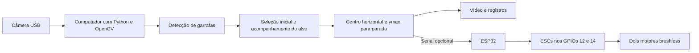

# EcoFlutuador

Este arquivo preserva o README da raiz anterior à promoção do V4.1. Os caminhos
e comandos abaixo registram aquela organização. Para executar o projeto atual,
consulte o [README principal](../../README.md).

O EcoFlutuador é um protótipo de embarcação com visão computacional para orientar
seu deslocamento em direção a garrafas detectadas por uma câmera. O computador
executa o reconhecimento e a decisão de navegação; um ESP32 recebe os comandos e
controla dois motores brushless por meio de ESCs.

A implementação atual desta etapa está em **V4.1**. Ela reúne reconhecimento de
garrafas, visualização das regiões da imagem, registros de operação e comunicação
serial com o firmware. A lógica foi baseada nas versões anteriores do projeto,
com o detector SSD MobileNet V3 proveniente do AquaMonitor.

## Documentação

- [Apresentação completa e guia de execução do V4.1](V4.1/README.md).
- [Relatório das alterações desta sessão](V4.1/docs/RELATORIO_SESSAO_2026-10-12.md).
- [Revisão da aproximação autônoma](V4.1/docs/REVISAO_AUTONOMIA.md).
- [Firmware do ESP32](V4.1/firmware/ControleESP32/ControleESP32.ino).
- [Configuração atual do reconhecimento](V4.1/config.json).

## Funcionamento



O sistema escolhe inicialmente a maior caixa válida de garrafa e acompanha esse
alvo nas inferências seguintes. O centro horizontal determina a direção, com
histerese nas divisórias; `ymax`, a borda inferior da caixa, determina a parada.
A imagem possui três regiões superiores e uma faixa inferior de aproximação.

| Região do alvo | Comando | Saída prevista no firmware |
|---|---|---|
| Esquerda | `d` | Motor direito / ESC 2 ativo; ESC 1 parado |
| Meio | `w` | Ambos ativos |
| Direita | `a` | Motor esquerdo / ESC 1 ativo; ESC 2 parado |
| Baixo ou ausência de alvo | `s` | Ambos parados |

Ao atingir a faixa inferior, a aproximação termina e os motores permanecem
parados enquanto o mesmo alvo continua visível. Isso permite a coleta passiva
pela rede, sem confirmar nem contar objetos coletados. A perda do alvo provoca
parada imediata na próxima inferência; falhas da comunicação solicitam parada e
o watchdog do ESP32 cobre a perda total da ligação.

A associação dos ESCs aos GPIOs preserva `V3/ControleESP32.ino`. A orientação
física da embarcação depende da montagem dos motores e deve ser verificada em
bancada.

## Instalação e demonstração

Os comandos abaixo são executados na raiz do repositório. O V4.1 usa seu próprio
ambiente e seu próprio arquivo de dependências.

```bash
python3 -m venv V4.1/.venv
V4.1/.venv/bin/python -m pip install -r V4.1/requirements.txt
V4.1/.venv/bin/python -m pip check
```

Para demonstrar o reconhecimento com a câmera e as linhas na janela:

```bash
V4.1/.venv/bin/python V4.1/object-ident.py
```

Para executar sem interface gráfica:

```bash
V4.1/.venv/bin/python V4.1/object-ident.py --no-display
```

Depois de gravar o firmware do V4.1 no ESP32, o envio aos motores é ativado
explicitamente pela porta serial:

```bash
V4.1/.venv/bin/python V4.1/object-ident.py --serial-port /dev/ttyUSB0
```

A porta é um exemplo e deve corresponder ao ESP32 conectado. O modo com motores
também aceita `--no-display`. Instalação do firmware, pinagem, protocolo e demais
argumentos estão no [guia do V4.1](V4.1/README.md).

## Tecnologias e ferramentas

| Componente | Uso |
|---|---|
| Python | Captura, coordenação do processamento, decisão e registros |
| OpenCV com GUI | Reconhecimento com `cv2.dnn`, processamento e janela de vídeo |
| NumPy | Representação e manipulação dos frames |
| pyserial | Comunicação USB serial com o ESP32 |
| Arduino-ESP32 e PWM LEDC | Firmware e geração dos sinais dos ESCs |
| Arduino IDE ou PlatformIO | Compilação e gravação do firmware |
| `unittest` e `g++` | Testes Python e simulação da lógica do firmware |

O V4.1 usa `opencv-python`, inclusive para operar sem janela. O arquivo
`requirements.txt` da raiz corresponde ao ambiente geral das versões anteriores;
o ambiente desta versão é definido por `V4.1/requirements.txt`.

## Organização do repositório

| Pasta | Papel |
|---|---|
| `V4.1/` | Implementação atual desta etapa: detector, decisão, registros, serial, firmware e testes |
| `V3/` | Referência histórica de controle manual, reconhecimento automático e acionamento dos motores |
| `V4/` | Implementação anterior com pipeline modular, API, sensores e documentos de auditoria |
| `aquamonitor/` | Projeto de referência do modelo e de componentes de visão computacional |

O V4.1 executa com seus módulos e modelos locais. Seu funcionamento não depende
de iniciar os servidores das outras pastas.

## Validação e estágio do projeto

Foram aprovados **37 testes** do V4.1, incluindo geometria das regiões, escolha
do alvo, limite de FPS, registros, envio serial e lógica de rampa e parada. O
firmware foi compilado para ESP32 Dev Module com PlatformIO. A simulação cobre
os caminhos de API dos cores Arduino-ESP32 2.x e 3.x; a compilação para a placa
foi realizada com o core 2.0.17.

Essa validação confirma a implementação de software. A resposta dos motores,
a calibração dos ESCs e o comportamento da embarcação ainda precisam de
validação física. A precisão de detecção não foi medida com um conjunto de
avaliação. O acompanhamento usa associação geométrica, que pode ser ambígua
quando garrafas se sobrepõem ou cruzam trajetórias.

## Controle de versões

Versione o código, os arquivos de configuração compartilhados, os modelos
necessários, as dependências e a documentação. Ambientes virtuais, logs, caches
e saídas do PlatformIO são gerados localmente e ficam fora do Git.

O `.gitignore` atual contém regras para `V3`, `V4` e `aquamonitor`. Essas regras
não removem do histórico arquivos já acompanhados pelo Git. Os caminhos usam
maiúsculas e minúsculas conforme a árvore do projeto, especialmente `V4.1`.
